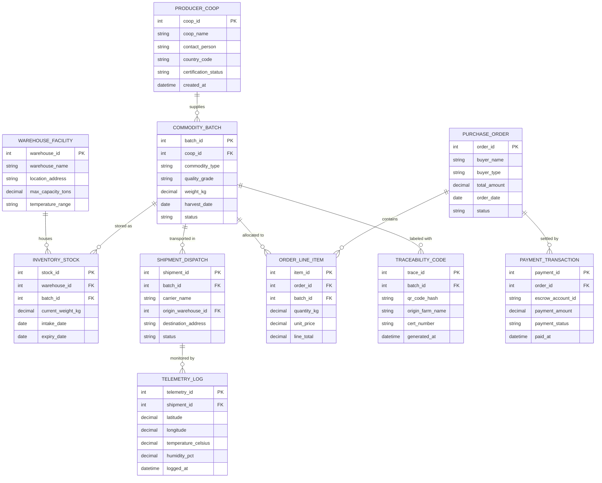

# Conceptual ERD — Agricultural Supply Chain Management System

## Mermaid Code

## Entity Description Table | Bang mo ta Entity

| # | Entity Name | Vietnamese Name | Description | Key Attributes | Main Relationships |
|---|-------------|-----------------|-------------|----------------|-------------------|
| 1 | PRODUCER_COOP | Hợp Tác Xã Sản Xuất | Registered farming cooperative or producer organization supplying agricultural goods | coop_id, coop_name, contact_person, country_code, certification_status | Has many COMMODITY_BATCH |
| 2 | COMMODITY_BATCH | Lô Hàng Nông Sản | Unique batch of harvested agricultural produce registered with specific quality grades | batch_id, coop_id, commodity_type, quality_grade, weight_kg, harvest_date | Belongs to PRODUCER_COOP; has INVENTORY_STOCK, SHIPMENT_DISPATCH, TRACEABILITY_CODE, ORDER_LINE_ITEM |
| 3 | WAREHOUSE_FACILITY | Kho Lạnh Bảo Quản | Refrigerated storage facility managing climate-controlled inventory storage bins | warehouse_id, warehouse_name, location_address, max_capacity_tons, temperature_range | Has many INVENTORY_STOCK |
| 4 | INVENTORY_STOCK | Tồn Kho Lô Hàng | Real-time stock record of commodity pallets stored within warehouse facilities | stock_id, warehouse_id, batch_id, current_weight_kg, expiry_date | Belongs to WAREHOUSE_FACILITY, COMMODITY_BATCH |
| 5 | SHIPMENT_DISPATCH | Vận Chuyển Lô Hàng | Freight dispatch assignment transporting produce from warehouses to buyers | shipment_id, batch_id, carrier_name, origin_warehouse_id, status | Belongs to COMMODITY_BATCH; has many TELEMETRY_LOG |
| 6 | TELEMETRY_LOG | Nhật Ký Cảm Biến Lạnh | Real-time IoT telematics record capturing GPS location, temperature, and humidity during transit | telemetry_id, shipment_id, latitude, longitude, temperature_celsius, logged_at | Belongs to SHIPMENT_DISPATCH |
| 7 | PURCHASE_ORDER | Đơn Đặt Hàng Bán Mua | Commercial contract and wholesale purchase order issued by distributors or retailers | order_id, buyer_name, buyer_type, total_amount, order_date, status | Has many ORDER_LINE_ITEM, PAYMENT_TRANSACTION |
| 8 | ORDER_LINE_ITEM | Chi Tiết Đơn Hàng | Individual line item in a purchase order specifying allocated commodity batch and volume | item_id, order_id, batch_id, quantity_kg, unit_price, line_total | Belongs to PURCHASE_ORDER, COMMODITY_BATCH |
| 9 | TRACEABILITY_CODE | Mã Truy Xuất Nguồn Gốc | GS1 Digital Link QR code record providing public origin and quality verification data | trace_id, batch_id, qr_code_hash, origin_farm_name, cert_number | Belongs to COMMODITY_BATCH |
| 10 | PAYMENT_TRANSACTION | Giao Dịch Thanh Toán Escrow | Financial escrow payment record managing fund holds and releases based on delivery verification | payment_id, order_id, escrow_account_id, payment_amount, payment_status | Belongs to PURCHASE_ORDER |

## Relationship Description | Mo ta Quan he

| # | From Entity | Cardinality | To Entity | Relationship Label | Business Explanation |
|---|-------------|-------------|-----------|-------------------|----------------------|
| 1 | PRODUCER_COOP | one-to-many | COMMODITY_BATCH | supplies | Một hợp tác xạ nông nghiệp cung cấp nhiều lô hàng nông sản thu hoạch. |
| 2 | COMMODITY_BATCH | one-to-many | INVENTORY_STOCK | stored as | Một lô hàng nông sản được lưu kho dưới dạng các bản ghi tồn kho pallet. |
| 3 | COMMODITY_BATCH | one-to-many | SHIPMENT_DISPATCH | transported in | Một lô hàng có thể được vận chuyển qua một hoặc nhiều chuyến xe lạnh. |
| 4 | COMMODITY_BATCH | one-to-many | TRACEABILITY_CODE | labeled with | Một lô hàng nông sản được tạo và dán nhiều nhãn mã QR truy xuất nguồn gốc. |
| 5 | WAREHOUSE_FACILITY | one-to-many | INVENTORY_STOCK | houses | Một kho lạnh chứa và quản lý nhiều lô hàng nông sản tồn kho trong các ô kệ. |
| 6 | SHIPMENT_DISPATCH | one-to-many | TELEMETRY_LOG | monitored by | Một chuyến vận chuyển liên tục phát về nhiều bản ghi cảm biến nhiệt độ và GPS. |
| 7 | PURCHASE_ORDER | one-to-many | ORDER_LINE_ITEM | contains | Một đơn mua hàng bán buôn chứa nhiều dòng chi tiết các mặt hàng nông sản. |
| 8 | PURCHASE_ORDER | one-to-many | PAYMENT_TRANSACTION | settled by | Một đơn hàng được thanh toán và giải ngân qua các giao dịch nạp/rút ký quỹ Escrow. |
| 9 | COMMODITY_BATCH | one-to-many | ORDER_LINE_ITEM | allocated to | Một lô hàng nông sản có thể được phân bổ bán cho nhiều dòng đơn hàng khác nhau. |
