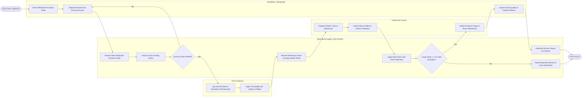

# Swimlane Diagram — Agricultural Supply Chain Management System

## Mermaid Code

## Flow Description | Mo ta luong

| Lane | Actor / Subsystem | Role in Flow |
|------|-------------------|--------------|
| Farm Producer | Supplier | Registers harvested crop batches, generates GS1-compliant barcodes, and affixes QR traceability tags onto produce pallets. |
| Agricultural Supply Chain System | Core Platform | Validates buyer escrow deposits, allocates warehouse stock, optimizes carrier dispatch routes, monitors real-time telemetry, and triggers escrow payment releases upon verified delivery. |
| Cold-Chain Carrier | Logistics Provider | Dispatches refrigerated transport, loads produce pallets, streams live GPS and temperature telemetry data, and completes physical cargo delivery. |
| Distributor / Wholesaler | Buyer | Submits wholesale purchase orders, funds third-party escrow accounts, conducts receiving quality inspections upon arrival, and confirms delivery completion. |
