# Action Tree — Agricultural Supply Chain Management System

## Mermaid Code

```mermaid
graph TD
    Root["Agricultural Supply Chain Management System"]

    Root --> M1["Producer & Harvest Intake Management"]
    Root --> M2["Cold Storage & Warehouse Operations"]
    Root --> M3["Cold-Chain Logistics & Telemetry Tracking"]
    Root --> M4["Commercial Order & Wholesale Fulfillment"]
    Root --> M5["Traceability & Regulatory Compliance"]
    Root --> M6["Supply Chain Financials & Escrow Settlement"]

    M1 --> A11["Register Farming Cooperatives"]
    M1 --> A12["Log Harvest Commodity Batches"]
    M1 --> A13["Generate GS1 GTIN & Lot Barcodes"]

    M2 --> A21["Scan Warehouse Pallet Intake"]
    M2 --> A22["Assign Temperature Storage Bins"]
    M2 --> A23["Track FEFO Inventory Spoilage & Expiry"]
    M2 --> A24["Manage Stock Transfer Between Facilities"]

    M3 --> A31["Optimize Reefer Truck Dispatch Routes"]
    M3 --> A32["Ingest Real-Time GPS & Temperature Stream"]
    M3 --> A33["Trigger Cold-Chain Breach Alerts"]
    M3 --> A34["Log Cargo Transport Claims & Incidents"]

    M4 --> A41["Process Bulk Wholesale Orders"]
    M4 --> A42["Allocate Available Warehouse Stock"]
    M4 --> A43["Fulfill Supermarket Replenishment Orders"]

    M5 --> A51["Generate GS1 Digital Link QR Codes"]
    M5 --> A52["Manage Phytosanitary Test Certificates"]
    M5 --> A53["Export Customs Import Clearances"]

    M6 --> A61["Verify Escrow Account Funding"]
    M6 --> A62["Authorize Producer Payment Release"]
    M6 --> A63["Generate Sales Invoices & Freight Bills"]
    M6 --> A64["Export Supply Chain Profitability Reports"]
```

## Module Description | Mo ta Module

| # | Module | Description | Actions |
|---|--------|-------------|---------|
| 1 | Producer & Harvest Intake Management | Enrolls farming cooperatives, registers newly harvested commodity lots, and generates GS1-compliant barcode tracking labels | Register Farming Cooperatives, Log Harvest Commodity Batches, Generate GS1 GTIN & Lot Barcodes |
| 2 | Cold Storage & Warehouse Operations | Manages pallet intake scanning, core temperature verification, bin allocation, and First-Expired First-Out (FEFO) stock rotations | Scan Warehouse Pallet Intake, Assign Temperature Storage Bins, Track FEFO Inventory Spoilage & Expiry, Manage Stock Transfer Between Facilities |
| 3 | Cold-Chain Logistics & Telemetry Tracking | Handles route optimization for reefer transport, continuous IoT telematics ingestion, thermal breach alerting, and transport claims | Optimize Reefer Truck Dispatch Routes, Ingest Real-Time GPS & Temperature Stream, Trigger Cold-Chain Breach Alerts, Log Cargo Transport Claims & Incidents |
| 4 | Commercial Order & Wholesale Fulfillment | Processes bulk wholesale purchase orders, allocates unreserved produce stock, and coordinates retailer replenishment dispatches | Process Bulk Wholesale Orders, Allocate Available Warehouse Stock, Fulfill Supermarket Replenishment Orders |
| 5 | Traceability & Regulatory Compliance | Creates public QR code traceability links, archives pesticide/chemical residue testing logs, and exports phytosanitary customs files | Generate GS1 Digital Link QR Codes, Manage Phytosanitary Test Certificates, Export Customs Import Clearances |
| 6 | Supply Chain Financials & Escrow Settlement | Oversees third-party escrow deposits, releases milestone payments to producers, generates shipping invoices, and analyzes profitability | Verify Escrow Account Funding, Authorize Producer Payment Release, Generate Sales Invoices & Freight Bills, Export Supply Chain Profitability Reports |
