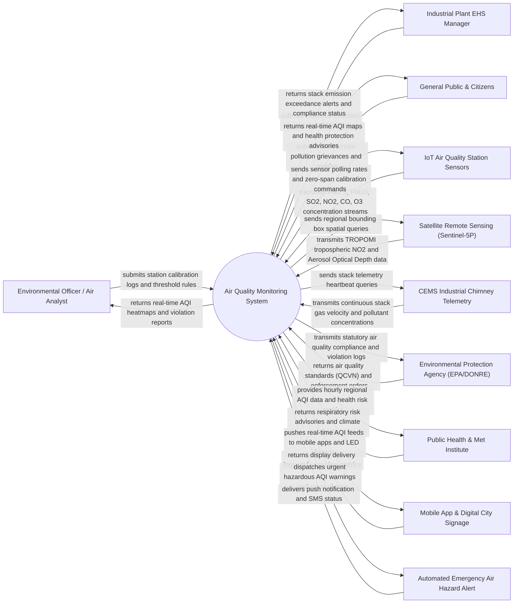

# Context Diagram — Air Quality Monitoring System

## Mermaid Code

## Actor & Interaction Table | Bang Actor & Tuong tac

| # | Actor | Actor Type | Data Sent TO System | Data Received FROM System | Notes |
|---|-------|------------|---------------------|---------------------------|-------|
| 1 | Environmental Officer / Air Analyst | Primary | Station calibration profiles, zero-span adjustments, alert threshold configurations, audit notes | Real-time regional AQI heatmaps, sensor drift warnings, industrial violation reports, historical trends | Primary technical user monitoring regional air quality, auditing stations, and managing pollution data |
| 2 | Industrial Plant EHS Manager | Primary | Industrial facility profile, chimney CEMS specifications, emission permits, corrective action plans | Real-time CEMS stack exceedance alerts, hourly emission summaries, legal compliance reports | Environmental Health & Safety manager responsible for factory chimney compliance |
| 3 | General Public & Citizens | Primary / Public | Local air pollution grievances, burning complaints, citizen location queries | Real-time AQI ratings, dominant pollutant breakdown, health recommendations, activity advice | Citizens checking air quality to plan outdoor exercise, school activities, or wear protective masks |
| 4 | IoT Air Quality Station Sensors | Supporting System | Real-time $PM_{2.5}, PM_{10}, SO_2, NO_2, CO, O_3$ concentration readings, ambient temp, humidity, pressure | Polling frequency commands, sensor gain adjustments, zero-span calibration signals | Reference-grade (FRM/FEM) and low-cost IoT sensor stations deployed across urban and rural zones |
| 5 | Satellite Remote Sensing (Sentinel-5P) | Supporting System | Sentinel-5P TROPOMI tropospheric $NO_2, SO_2$, formaldehyde columns, Aerosol Optical Depth (AOD) | Spatial bounding box query parameters, orbital pass timestamp requests | European Space Agency (ESA) satellite feed providing macro-level regional atmospheric pollution grids |
| 6 | CEMS Industrial Chimney Telemetry | Supporting System | Continuous Emission Monitoring System (CEMS) stack gas flow rate, temperature, $SO_2, NO_x, Dust/Opacities$ | Telemetry status queries, connection heartbeat signals | Automated sensors installed inside industrial factory smokestacks transmitting 5-minute average data |
| 7 | Environmental Protection Agency (EPA/DONRE) | Regulatory System | Statutory air quality standards (QCVN 05:2023/BTNMT), industrial emission quota rules | Legal violation notices, regional AQI compliance statistics, annual air quality status reports | Government regulatory body enforcing environmental laws, issuing fines, and setting air standards |
| 8 | Public Health & Met Institute | Supporting System | Respiratory disease vulnerability thresholds, weather forecasts, wind rose vectors | Hourly AQI feeds, heavy PM2.5 episode logs, regional pollution transport metrics | Research and health institutes analyzing air pollution impacts on public health and hospital admissions |
| 9 | Mobile App & Digital City Signage | Supporting System | User location requests, LED signage status, display view logs | Real-time AQI numeric index, color-coded health badges, dominant pollutant alerts | Public facing digital displays, smart city LED boards, and mobile apps (e.g., AirVisual, VN-AQI) |
| 10 | Automated Emergency Air Hazard Alert | Supporting System | SMS delivery receipts, broadcast dispatch logs | Emergency severe smog alerts (AQI > 300 / Hazardous), vulnerable group warnings | Multi-channel alert gateway dispatching high-priority push notifications during severe air pollution spikes |

## System Boundary Description | Mo ta Pham vi He thong

The **Air Quality Monitoring System** is an enterprise environmental monitoring platform designed to ingest high-frequency IoT sensor telemetry, industrial CEMS stack emissions, and satellite atmospheric data, compute Air Quality Index (AQI) ratings, model pollution dispersion heatmaps, and issue automated health alerts.

The **system boundary** encompasses IoT sensor telemetry ingestion, AQI calculation engines (US EPA & VN-AQI standards), industrial CEMS compliance auditing, satellite AOD data fusion, spatial interpolation heatmapping (Kriging/IDW), sensor calibration tracking, public API distribution, and emergency alert broadcasting.

**External to the system boundary** are physical optical laser particle counters inside sensor hardware, physical chemical gas reactions in the atmosphere, factory chimney scrubbing machinery, civil legal court fine enforcement, and public display LED hardware manufacturing. Interfaces connect via MQTT IoT protocols, Modbus RTU/TCP CEMS feeds, RESTful web APIs, and OGC geospatial raster standards.
