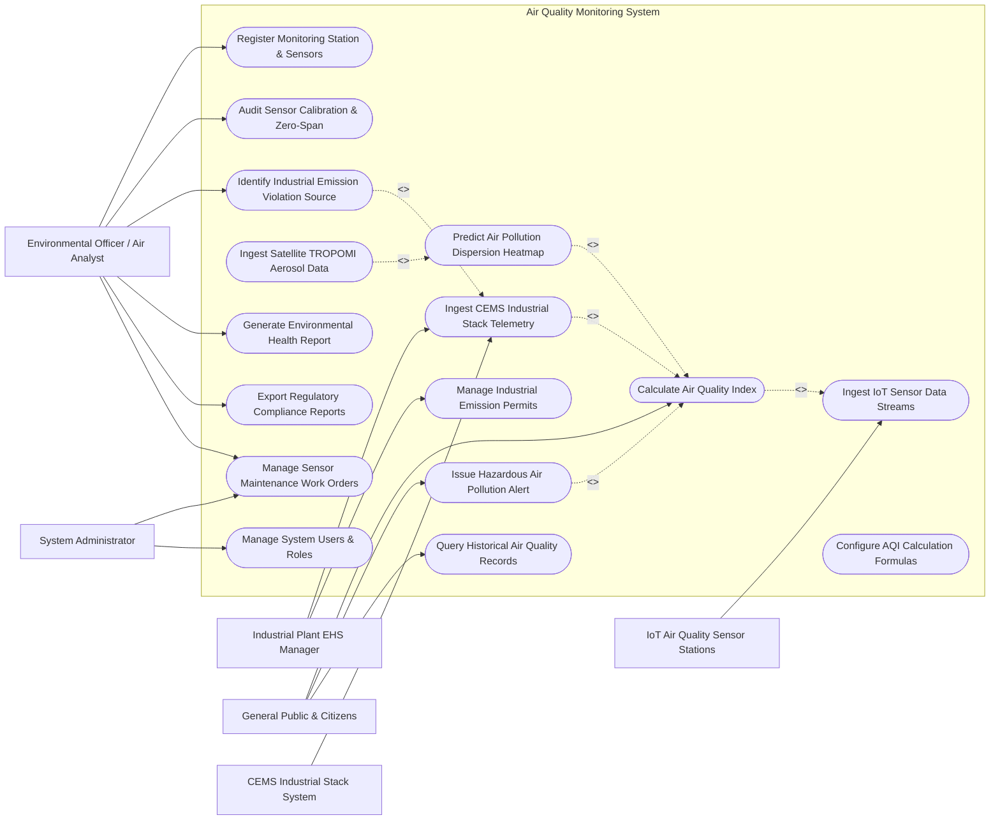

# Use Case Diagram — Air Quality Monitoring System

## Mermaid Code

## Actor Table | Bang Actor

| # | Actor | Actor Type | Role Description | Related Use Cases |
|---|-------|------------|------------------|-------------------|
| 1 | Environmental Officer / Air Analyst | Primary | Domain specialist monitoring regional air quality, auditing sensors, and identifying pollution sources | UC01, UC07, UC08, UC10, UC13, UC15 |
| 2 | Industrial Plant EHS Manager | Primary | Plant manager responsible for continuous smokestack emissions compliance and permit tracking | UC04, UC11 |
| 3 | General Public & Citizens | Primary / Public | End users monitoring local AQI ratings, receiving emergency smog alerts, and viewing historical trends | UC03, UC06, UC12 |
| 4 | System Administrator | Primary | Technical admin managing system rulesets, AQI standard formulas, user access, and sensor maintenance | UC15, UC16 |
| 5 | IoT Air Quality Sensor Stations | Secondary / System | Physical station hardware streaming $PM_{2.5}, SO_2, NO_2, CO, O_3$ concentration readings | UC02 |
| 6 | CEMS Industrial Stack System | Secondary / System | Automated stack sensors streaming continuous industrial gas flow, dust opacity, and chemical concentration | UC04 |

## Use Case Table | Bang Use Case

| # | UC ID | Use Case Name | Primary Actor | Secondary Actor | Description | Priority |
|---|-------|---------------|---------------|-----------------|-------------|----------|
| 1 | UC01 | Register Monitoring Station & Sensors | Air Analyst | None | Configures new monitoring station GIS coordinates, sensor models, and sampling parameters | High |
| 2 | UC02 | Ingest IoT Sensor Data Streams | System | IoT Stations | Ingests real-time pollutant concentration data streams via MQTT/HTTP protocols | High |
| 3 | UC03 | Calculate Air Quality Index | Citizens | System | Computes sub-AQI and overall AQI ratings using US EPA and VN-AQI calculation formulas | High |
| 4 | UC04 | Ingest CEMS Industrial Stack Telemetry | Industrial Plant EHS | CEMS Stack | Collects 5-minute continuous industrial chimney gas flow, dust opacity, and pollutant metrics | High |
| 5 | UC05 | Predict Air Pollution Dispersion Heatmap | System | Satellite Feed | Uses spatial interpolation (Kriging/IDW) and wind vectors to generate real-time AQI heatmaps | High |
| 6 | UC06 | Issue Hazardous Air Pollution Alert | Citizens | Notification Gateway | Dispatches emergency push notifications when AQI exceeds hazardous health thresholds (>300) | High |
| 7 | UC07 | Audit Sensor Calibration & Zero-Span | Air Analyst | IoT Stations | Tracks zero-gas and span-gas calibration logs to detect sensor drift and accuracy loss | Medium |
| 8 | UC08 | Identify Industrial Emission Violation Source | Air Analyst | CEMS Stack | Pinpoints industrial facilities exceeding legal emission limits using stack telemetry and wind direction | High |
| 9 | UC09 | Ingest Satellite TROPOMI Aerosol Data | System | Satellite Feed | Ingests Sentinel-5P TROPOMI satellite rasters to monitor regional tropospheric $NO_2$ and AOD | Medium |
| 10 | UC10 | Generate Environmental Health Report | Air Analyst | Health Institute | Analyzes long-term exposure to $PM_{2.5}$ and correlates pollution spikes with health vulnerability | Medium |
| 11 | UC11 | Manage Industrial Emission Permits | Industrial Plant EHS | Regulatory EPA | Tracks annual legal stack emission quotas, permitted concentration limits, and renewal dates | High |
| 12 | UC12 | Query Historical Air Quality Records | Citizens | None | Provides searchable historical database of daily/monthly AQI trends and pollutant averages | Low |
| 13 | UC13 | Export Regulatory Compliance Reports | Air Analyst | Regulatory EPA | Exports legal compliance reports, monthly exceedance logs, and station uptime metrics | High |
| 14 | UC14 | Configure AQI Calculation Formulas | System Admin | Regulatory EPA | Updates sub-AQI breakpoint tables for $PM_{2.5}, PM_{10}, SO_2, NO_2, CO, O_3$ per QCVN standards | Medium |
| 15 | UC15 | Manage Sensor Maintenance Work Orders | System Admin | Air Analyst | Dispatches maintenance work orders for sensor replacement, filter cleaning, and hardware repairs | Medium |
| 16 | UC16 | Manage System Users & Roles | System Admin | None | Manages user accounts, roles (Analyst, Plant EHS, Citizen, Admin), and API token access | Low |

## Use Case Specification | Dac ta Use Case

---

### UC02 — Ingest IoT Sensor Data Streams

| Field | Detail |
|-------|--------|
| **UC ID** | UC02 |
| **Use Case Name** | Ingest IoT Sensor Data Streams |
| **Actor(s)** | Primary: System   Secondary: IoT Air Quality Sensor Stations |
| **Description** | Ingests continuous, high-frequency pollutant concentration data streams ($PM_{2.5}, PM_{10}, SO_2, NO_2, CO, O_3$) and meteorological metrics from ground monitoring stations via secure MQTT/HTTP protocols. |
| **Precondition** | 1. Monitoring station is registered in system with valid station ID and API access key (UC01).   2. Station IoT gateway network connection is active. |
| **Main Flow** | 1. Station IoT gateway packages sensor readings into JSON payload containing: Station ID, Timestamp, $PM_{2.5} (\mu g/m^3)$, $PM_{10} (\mu g/m^3)$, $SO_2 (ppm)$, $NO_2 (ppm)$, $CO (ppm)$, $O_3 (ppm)$, Temperature ($^\circ C$), Relative Humidity ($\%$), and Barometric Pressure ($hPa$).   2. Gateway transmits payload to System MQTT broker over TLS-encrypted connection.   3. System ingests packet, parses sensor fields, and validates data payload integrity.   4. System executes Outlier Detection Rules (e.g., checks if $PM_{2.5} > 1000 \mu g/m^3$ or negative concentration values).   5. System applies sensor calibration slope/offset adjustment factors based on active calibration log (UC07).   6. System normalizes gas concentrations from $ppm$ to $\mu g/m^3$ at standard temperature ($25^\circ C$) and pressure ($1\text{ atm}$).   7. System writes validated 1-minute telemetry record to time-series database.   8. System triggers 1-hour and 24-hour moving average calculations for AQI computation (UC03). |
| **Alternative Flow** | **AF1** — Batch Telemetry Recovery: If station was temporarily offline, station gateway uploads buffered historical 1-minute data files upon network re-establishment. |
| **Exception Flow** | **EX1** — Malfunctioning Sensor Signal: Sensor outputs flatline constant value ($0.00$) for $>60$ consecutive minutes; System flags sensor status as `SENSOR_FAULT` and triggers maintenance alert (UC15).   **EX2** — Unauthorized Station Key: Ingestion request fails API key authentication, system rejects payload and logs security attempt. |
| **Postcondition** | Normalized, validated 1-minute air quality telemetry stored in time-series database and available for AQI calculation. |
| **Business Rule** | **BR1**: Raw sensor data must be preserved in immutable log storage alongside calibrated values for audit integrity. |

---

### UC03 — Calculate Air Quality Index (AQI)

| Field | Detail |
|-------|--------|
| **UC ID** | UC03 |
| **Use Case Name** | Calculate Air Quality Index (AQI) |
| **Actor(s)** | Primary: General Public & Citizens   Secondary: System |
| **Description** | Computes individual sub-AQI values for each pollutant ($PM_{2.5}, PM_{10}, SO_2, NO_2, CO, O_3$) using 1-hour/24-hour moving averages against legal breakpoint tables, determines the overall AQI rating, dominant pollutant, and color-coded health risk category. |
| **Precondition** | 1. Validated telemetry data (UC02) is recorded for target monitoring station.   2. Standard AQI breakpoint tables (US EPA / VN-AQI QCVN) are active in system configuration (UC14). |
| **Main Flow** | 1. System fetches 24-hour moving average for $PM_{2.5}$ and $PM_{10}$, 1-hour moving average for $SO_2, NO_2, CO$, and 8-hour moving average for $O_3$.   2. System calculates sub-AQI ($I_p$) for each pollutant using the linear interpolation formula:   &nbsp;&nbsp;&nbsp;&nbsp;$$I_p = \frac{I_{Hi} - I_{Lo}}{BP_{Hi} - BP_{Lo}} (C_p - BP_{Lo}) + I_{Lo}$$   &nbsp;&nbsp;&nbsp;&nbsp;where $C_p$ is truncated pollutant concentration, $BP_{Hi}/BP_{Lo}$ are breakpoint concentrations, and $I_{Hi}/I_{Lo}$ are corresponding AQI index limits.   3. System identifies the maximum sub-AQI score among all pollutants as the **Overall AQI** value.   4. System identifies the pollutant yielding the highest sub-AQI score as the **Dominant Pollutant**.   5. System maps Overall AQI score to standardized color-coded health categories:   &nbsp;&nbsp;&nbsp;&nbsp;a. **0 - 50** (Green): `Good`   &nbsp;&nbsp;&nbsp;&nbsp;b. **51 - 100** (Yellow): `Moderate`   &nbsp;&nbsp;&nbsp;&nbsp;c. **101 - 150** (Orange): `Unhealthy for Sensitive Groups`   &nbsp;&nbsp;&nbsp;&nbsp;d. **151 - 200** (Red): `Unhealthy`   &nbsp;&nbsp;&nbsp;&nbsp;e. **201 - 300** (Purple): `Very Unhealthy`   &nbsp;&nbsp;&nbsp;&nbsp;f. **> 300** (Maroon): `Hazardous`   6. System attaches health protection advice tailored to the AQI category (e.g., "Wear N95 mask outdoors, close windows").   7. System updates public API, mobile app feeds, and triggers alert evaluation if AQI $> 150$ or $> 300$ (UC06). |
| **Alternative Flow** | **AF1** — InstantCast AQI Calculation: System computes rapid 1-hour "InstantCast" AQI for fast-changing wildfire or dust storm events to provide real-time public warnings. |
| **Exception Flow** | **EX1** — Missing Data Threshold: If fewer than 18 hourly readings exist in a 24-hour window ($<75\%$ data completeness), system flags daily AQI calculation as `INCOMPLETE_DATA` and displays 1-hour sub-AQI instead. |
| **Postcondition** | Calculated sub-AQI, overall AQI score, dominant pollutant, and health category saved in database and displayed on public dashboards. |
| **Business Rule** | **BR1**: Overall AQI must strictly equal the maximum calculated sub-AQI value across all monitored parameters. |

---

### UC05 — Predict Air Pollution Dispersion Heatmap

| Field | Detail |
|-------|--------|
| **UC ID** | UC05 |
| **Use Case Name** | Predict Air Pollution Dispersion Heatmap |
| **Actor(s)** | Primary: System   Secondary: Satellite Remote Sensing Feed |
| **Description** | Fuses ground-station AQI readings, industrial CEMS stack emissions, 3D wind vectors, and satellite Aerosol Optical Depth (AOD) rasters using spatial kriging interpolation to generate real-time 1km-grid regional air pollution heatmaps. |
| **Precondition** | 1. Real-time AQI scores (UC03) are computed across ground monitoring station network.   2. Meteorological wind speed, wind direction, and mixing height vectors are available. |
| **Main Flow** | 1. System retrieves latest ground monitoring station coordinates and real-time $PM_{2.5}$ / AQI values.   2. System fetches industrial CEMS stack emission flow rates and active chimney positions (UC04).   3. System ingests satellite TROPOMI aerosol optical depth (AOD) raster grid (UC09) for spatial gap filling.   4. System executes Spatial Kriging / Inverse Distance Weighting (IDW) interpolation algorithm considering terrain DEM elevation and wind vector direction.   5. System generates a continuous $1\text{ km} \times 1\text{ km}$ spatial grid layer of predicted $PM_{2.5}$ concentrations and AQI values across the region.   6. System renders colorized raster heatmap overlay (Green-to-Maroon gradient).   7. System publishes updated spatial heatmap layer to GIS web portal and public mobile app. |
| **Alternative Flow** | **AF1** — 24-Hour Forward Forecast Heatmap: System integrates numerical weather prediction (NWP) wind forecasts to project pollution dispersion movement 24 hours into the future. |
| **Exception Flow** | **EX1** — Sparse Station Density Warning: In rural areas with low station density ($>50\text{ km}$ gap), system flags heatmap interpolation uncertainty as `HIGH_VARIANCE` and overlays satellite AOD data to compensate. |
| **Postcondition** | Georeferenced spatial AQI raster heatmap generated, updated hourly, and rendered on public/regulatory GIS dashboards. |
| **Business Rule** | **BR1**: Spatial interpolation must account for barrier topography (mountains) to prevent unrealistic pollution bleed across mountain ranges. |

---

### UC06 — Issue Hazardous Air Pollution Alert

| Field | Detail |
|-------|--------|
| **UC ID** | UC06 |
| **Use Case Name** | Issue Hazardous Air Pollution Alert |
| **Actor(s)** | Primary: General Public & Citizens   Secondary: Automated Emergency Air Hazard Alert Gateway |
| **Description** | Evaluates real-time AQI trends and dispatches high-priority push notifications, SMS alerts, and public digital signage warnings when air pollution reaches `Unhealthy` (AQI $>150$) or `Hazardous` (AQI $>300$) levels. |
| **Precondition** | 1. Station or regional AQI calculation (UC03) exceeds warning threshold.   2. Automated Alert Gateway connection is active. |
| **Main Flow** | 1. System detects station or regional AQI score crossing an alert threshold (e.g., AQI $> 200$ `Very Unhealthy` or AQI $> 300$ `Hazardous`).   2. System determines affected geographic zones (districts/wards within 10 km radius of high-AQI stations).   3. System retrieves health advisory payload tailored to the alert tier (e.g., "AQI 320 Hazardous: Children, elderly, and individuals with respiratory conditions must remain indoors. All outdoor activity prohibited.").   4. System formats emergency broadcast messages for:   &nbsp;&nbsp;&nbsp;&nbsp;a. Mobile App Push Notifications.   &nbsp;&nbsp;&nbsp;&nbsp;b. High-priority SMS to subscribed citizens in affected postal codes.   &nbsp;&nbsp;&nbsp;&nbsp;c. Smart City Outdoor LED Signage displays.   5. System dispatches alert payload to Automated Emergency Alert Gateway.   6. Gateway broadcasts messages and returns delivery receipt logs.   7. System logs alert event in database and updates emergency status dashboard. |
| **Alternative Flow** | **AF1** — Agricultural Straw Burning Alert: System detects localized $PM_{2.5}$ spike (>500 $\mu g/m^3$) during harvest season, issuing localized illegal open-burning warning to district agricultural officers. |
| **Exception Flow** | **EX1** — False Spike Verification: If AQI jumps from 30 to 400 in 1 minute at a single sensor, system triggers 5-minute verification delay to check neighboring sensors before broadcasting public alarm to prevent panic. |
| **Postcondition** | Emergency air quality alert record created, timestamped, and dispatched to public mobile devices and city signage. |
| **Business Rule** | **BR1**: Alerts for AQI $> 300$ must be dispatched within 3 minutes of data confirmation. |

---

### UC08 — Identify Industrial Emission Violation Source

| Field | Detail |
|-------|--------|
| **UC ID** | UC08 |
| **Use Case Name** | Identify Industrial Emission Violation Source |
| **Actor(s)** | Primary: Environmental Officer / Air Analyst   Secondary: CEMS Industrial Stack System |
| **Description** | Cross-references continuous industrial chimney (CEMS) telemetry, illegal emission limit breaches, and wind trajectory models (back-trajectory analysis) to pinpoint specific factories violating legal pollution limits. |
| **Precondition** | 1. Continuous CEMS stack telemetry (UC04) is ingested into system.   2. Legal facility emission permit limits (UC11) are registered. |
| **Main Flow** | 1. System continuously monitors incoming CEMS stack emissions against legal permit limits (e.g., $SO_2 > 500\text{ mg/Nm}^3$, Dust Opacity $> 20\%$).   2. System detects a stack exceedance event (e.g., Factory #F-102 Chimney #2 $SO_2$ concentration reaches $850\text{ mg/Nm}^3$ for $>15$ consecutive minutes).   3. System correlates stack exceedance timestamp with ambient ground station $SO_2$ spikes downwind.   4. System executes HYSPLIT / Wind Rose back-trajectory calculation to confirm pollution plume origin.   5. System compiles Violation Evidence Dossier: Facility Name, Tax Code, Stack ID, Measured Concentration, Legal Limit, Duration of Violation, and Wind Vector Map.   6. System updates facility compliance status to `VIOLATION_DETECTED` and generates legal Violation Notice (UC13).   7. System dispatches automated exceedance warning notification to Plant EHS Manager and Air Analyst. |
| **Alternative Flow** | **AF1** — Nighttime Illegal Bypass Detection: System detects sudden $NO_x$ surge between 01:00 AM and 04:00 AM combined with CEMS telemetry disconnection, flagging suspected illegal scrubber bypass for emergency inspection. |
| **Exception Flow** | **EX1** — Permitted Maintenance Exemption: Facility EHS Manager submits pre-approved "Maintenance Exemption Ticket" prior to stack shutdown; system logs event as `EXEMPT_MAINTENANCE` instead of illegal violation. |
| **Postcondition** | Violation record logged, evidence dossier compiled, and formal violation notice generated for enforcement action. |
| **Business Rule** | **BR1**: Stack concentration exceeding legal limits for $>15$ continuous minutes constitutes a legal emission violation under national environmental law. |
