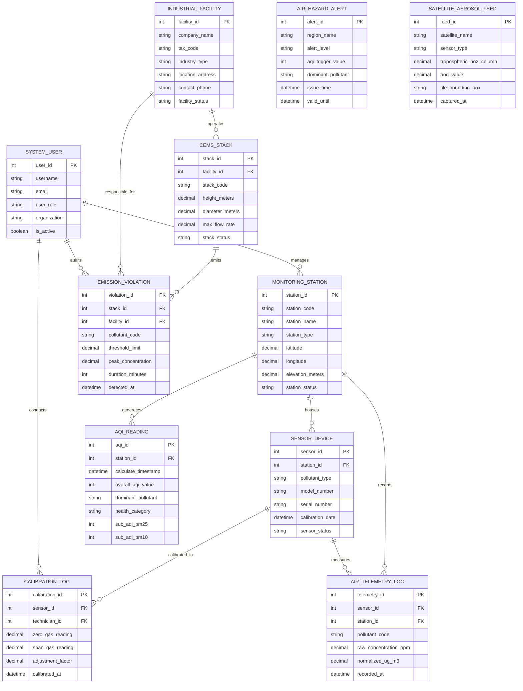

# Conceptual ERD — Air Quality Monitoring System

## Mermaid Code

## Entity Description Table | Bang mo ta Entity

| # | Entity Name | Vietnamese Name | Description | Key Attributes | Main Relationships |
|---|-------------|-----------------|-------------|----------------|-------------------|
| 1 | MONITORING_STATION | Trạm Quan Trắc Không Khí | Stores physical monitoring station details, GIS coordinates, station type (Urban, Industrial, Rural), and status | station_id, station_code, station_name, station_type, latitude, longitude, station_status | Houses SENSOR_DEVICE, records TELEMETRY_LOG, generates AQI_READING |
| 2 | SENSOR_DEVICE | Thiết Bị Cảm Biến Ô Nhiễm | Stores individual gas/particulate sensor hardware specs, target pollutant ($PM_{2.5}, SO_2$), serials, and calibration dates | sensor_id, station_id, pollutant_type, model_number, serial_number, sensor_status | Housed in MONITORING_STATION, measures TELEMETRY_LOG, calibrated in CALIBRATION_LOG |
| 3 | AIR_TELEMETRY_LOG | Nhật Ký Dữ Liệu Quan Trắc | High-frequency telemetry storing raw ($ppm$) and normalized ($\mu g/m^3$) pollutant concentration measurements | telemetry_id, sensor_id, station_id, pollutant_code, raw_concentration_ppm, recorded_at | Measured by SENSOR_DEVICE, recorded at MONITORING_STATION |
| 4 | AQI_READING | Kết Quả Chỉ Số AQI | Captures computed hourly/daily Air Quality Index (AQI) values, dominant pollutants, sub-AQIs, and health categories | aqi_id, station_id, calculate_timestamp, overall_aqi_value, dominant_pollutant, health_category | Generated by MONITORING_STATION |
| 5 | INDUSTRIAL_FACILITY | Cơ Sở Sản Xuất Công Nghiệp | Stores industrial plant master profile, corporate tax code, industry category (steel, cement, power), and location | facility_id, company_name, tax_code, industry_type, location_address, facility_status | Operates CEMS_STACK, responsible for EMISSION_VIOLATION |
| 6 | CEMS_STACK | Ống Khói Khí Thải Công Nghiệp | Represents physical factory chimneys fitted with CEMS stack sensors, height, diameter, and max flow rate | stack_id, facility_id, stack_code, height_meters, max_flow_rate, stack_status | Operated by INDUSTRIAL_FACILITY, emits EMISSION_VIOLATION |
| 7 | EMISSION_VIOLATION | Vi Phạm Phát Thải Khí Thải | Tracks legal emission threshold exceedance events detected from industrial smokestacks, peak concentrations, and durations | violation_id, stack_id, facility_id, pollutant_code, threshold_limit, peak_concentration, detected_at | Emitted by CEMS_STACK, responsible by INDUSTRIAL_FACILITY, audited by USER |
| 8 | AIR_HAZARD_ALERT | Cảnh Báo Ô Nhiễm Nguy Hiểm | Captures automated emergency public alerts dispatched when regional AQI scores reach hazardous health levels | alert_id, region_name, alert_level, aqi_trigger_value, dominant_pollutant, issue_time | Dispatched for regional zones |
| 9 | CALIBRATION_LOG | Nhật Ký Hiệu Chuẩn Cảm Biến | Records zero-gas and span-gas calibration test results, adjustment factors, and technician IDs | calibration_id, sensor_id, technician_id, zero_gas_reading, span_gas_reading, calibrated_at | Calibrates SENSOR_DEVICE, conducted by SYSTEM_USER |
| 10 | SATELLITE_AEROSOL_FEED | Dữ Liệu Vệ Tinh Khí Quyển | Ingests tropospheric $NO_2$ column and Aerosol Optical Depth (AOD) raster data from Sentinel-5P TROPOMI satellite | feed_id, satellite_name, sensor_type, tropospheric_no2_column, aod_value, captured_at | Ingested into system |
| 11 | SYSTEM_USER | Người Dùng Hệ Thống | Stores user credentials, roles (Air Analyst, Plant EHS Manager, Admin), organizations, and permissions | user_id, username, user_role, organization, is_active | Conducts CALIBRATION_LOG, manages MONITORING_STATION, audits VIOLATION |

## Relationship Description | Mo ta Quan he

| # | From Entity | Cardinality | To Entity | Relationship Label | Business Explanation |
|---|-------------|-------------|-----------|-------------------|----------------------|
| 1 | MONITORING_STATION | one-to-many | SENSOR_DEVICE | houses | A monitoring station houses multiple individual gas and particulate matter sensor devices |
| 2 | MONITORING_STATION | one-to-many | AIR_TELEMETRY_LOG | records | A monitoring station records continuous time-series air quality telemetry log entries |
| 3 | SENSOR_DEVICE | one-to-many | AIR_TELEMETRY_LOG | measures | A sensor device measures high-frequency pollutant concentration data entries over time |
| 4 | MONITORING_STATION | one-to-many | AQI_READING | generates | A monitoring station generates hourly and daily Air Quality Index (AQI) rating records |
| 5 | SENSOR_DEVICE | one-to-many | CALIBRATION_LOG | calibrated_in | A sensor device undergoes periodic zero-span gas calibration tests recorded in logs |
| 6 | INDUSTRIAL_FACILITY | one-to-many | CEMS_STACK | operates | An industrial facility operates one or more continuous emission monitoring smokestacks |
| 7 | CEMS_STACK | one-to-many | EMISSION_VIOLATION | emits | A CEMS smokestack can emit illegal gas or dust concentration exceedances recorded as violations |
| 8 | INDUSTRIAL_FACILITY | one-to-many | EMISSION_VIOLATION | responsible_for | An industrial facility is legally responsible for emission violations occurring at its chimneys |
| 9 | SYSTEM_USER | one-to-many | CALIBRATION_LOG | conducts | A technician system user conducts zero-span calibration tests on sensor devices |
| 10 | SYSTEM_USER | one-to-many | MONITORING_STATION | manages | Environmental analyst users manage physical monitoring station metadata and hardware health |
| 11 | SYSTEM_USER | one-to-many | EMISSION_VIOLATION | audits | Environmental enforcement officer users audit and process industrial emission violations |
