# Swimlane Diagram — Air Quality Monitoring System

## Mermaid Code

```mermaid
flowchart LR
    Start(["Start Monitoring Cycle"])

    subgraph SensorLane["IoT Station & CEMS Stack Sensors"]
        S1["Measure Pollutant Concentrations"]
        S2["Stream 1-Min Data via MQTT"]
    end

    subgraph SystemLane["Air Quality Monitoring System"]
        M1["Ingest & Validate Telemetry Data"]
        M2["Compute Sub-AQI & Overall AQI Score"]
        M3{"AQI > 150 or Stack Violation?"}
        M4["Generate 1km Spatial AQI Heatmap"]
        M5["Log Stack Exceedance Evidence"]
    end

    subgraph AnalystLane["Environmental Officer / Air Analyst"]
        A1["Monitor Regional AQI Heatmap"]
        A2["Audit Industrial Violation Source"]
        A3["Issue Legal Enforcement Notice"]
    end

    subgraph EHSManagerLane["Industrial Plant EHS Manager"]
        E1["Receive Stack Exceedance Alarm"]
        E2["Adjust Flue Gas Scrubber Operations"]
    end

    subgraph PublicLane["General Public & Health Advisory"]
        P1["Receive Mobile AQI Notification"]
        P2["View Health Protection Advice"]
    end

    Finish(["End Cycle"])

    Start --> S1 --> S2 --> M1 --> M2 --> M3
    M3 -->|"Normal AQI <= 150"| M4 --> A1 --> P1 --> P2 --> Finish
    M3 -->|"AQI > 150 / Exceedance"| M5 --> E1 --> E2 --> A2 --> A3 --> Finish
    M3 -->|"AQI > 300 Hazardous"| P1
```

## Flow Description | Mo ta luong

| Lane | Actor | Role in Flow |
|------|-------|-------------|
| 1 | IoT Station & CEMS Stack Sensors | Measures physical particulate matter ($PM_{2.5}, PM_{10}$) and toxic gas concentrations ($SO_2, NO_2, CO$), packaging readings into telemetry packets and streaming 1-minute data via TLS MQTT |
| 2 | Air Quality Monitoring System | Ingests and validates sensor streams, calculates sub-AQI and overall AQI ratings, checks against emergency warning thresholds ($AQI > 150$ or stack exceedances), renders spatial dispersion heatmaps, and logs violation evidence |
| 3 | Environmental Officer / Air Analyst | Monitors real-time regional AQI heatmaps, audits industrial stack exceedance evidence dossiers, conducts wind trajectory analyses, and issues legal violation notices to offending factories |
| 4 | Industrial Plant EHS Manager | Receives automated smokestack exceedance alarms, inspects factory chimney CEMS telemetry, adjusts flue gas scrubber or electrostatic precipitator operations, and logs corrective actions |
| 5 | General Public & Health Advisory | Receives real-time push notifications on mobile devices, checks local AQI ratings, views dominant pollutant breakdowns, and follows recommended health protection advice |
