# Action Tree — Air Quality Monitoring System

## Mermaid Code

```mermaid
graph TD
    Root["Air Quality Monitoring System"]

    Root --> M1["Monitoring Station & Sensor Management"]
    Root --> M2["IoT & CEMS Telemetry Data Ingestion"]
    Root --> M3["AQI Computation & Dispersion Heatmapping"]
    Root --> M4["Industrial Stack Violation & Compliance"]
    Root --> M5["Hazardous Air Alert & Health Advisory"]
    Root --> M6["Satellite Aerosol Data & Trend Analytics"]
    Root --> M7["Calibration Maintenance & System Admin"]

    M1 --> A11["Register Air Quality Station GIS Location"]
    M1 --> A12["Configure Gas & Particulate Sensor Devices"]
    M1 --> A13["Set Station Sampling Rates & Protocols"]
    M1 --> A14["Track Station Hardware Power & Battery Health"]

    M2 --> A21["Ingest 1-Minute IoT Sensor Data Streams"]
    M2 --> A22["Collect Continuous CEMS Stack Emission Telemetry"]
    M2 --> A23["Execute Outlier & Sensor Drift Filtering"]
    M2 --> A24["Normalize Concentration Values to Standard Units"]

    M3 --> A31["Calculate Sub-AQI Scores per Pollutant"]
    M3 --> A32["Determine Overall AQI & Dominant Pollutant"]
    M3 --> A33["Execute Spatial Kriging Dispersion Heatmap"]
    M3 --> A34["Project 24-Hour Forward AQI Dispersion Trend"]

    M4 --> A41["Monitor Stack Emissions vs Legal QCVN Limits"]
    M4 --> A42["Execute Wind Trajectory Violation Source Tracking"]
    M4 --> A43["Compile Stack Exceedance Evidence Dossier"]
    M4 --> A44["Track Facility Emission Permits & Annual Quotas"]

    M5 --> A51["Detect Hazardous AQI Threshold Exceedances"]
    M5 --> A52["Formulate Tailored Health Protection Advice"]
    M5 --> A53["Dispatch Emergency Push & SMS Warnings"]
    M5 --> A54["Push AQI Data to Smart City LED Displays"]

    M6 --> A61["Ingest Sentinel-5P TROPOMI Satellite NO2 Feeds"]
    M6 --> A62["Correlate Satellite AOD with Ground Station PM2.5"]
    M6 --> A63["Analyze Multi-Year Air Pollution Seasonal Trends"]
    M6 --> A64["Generate Public Health Vulnerability Reports"]

    M7 --> A71["Record Sensor Zero-Span Calibration Logs"]
    M7 --> A72["Update QCVN AQI Breakpoint Formula Tables"]
    M7 --> A73["Dispatch Sensor Repair Maintenance Work Orders"]
    M7 --> A74["Manage User System Access Roles & API Keys"]
```

## Module Description | Mo ta Module

| # | Module | Description | Actions |
|---|--------|-------------|---------|
| 1 | Monitoring Station & Sensor Management | Manages physical monitoring station registrations, GIS coordinates, gas/particulate sensor device profiles, sampling rates, and power health | Register Air Quality Station GIS Location, Configure Gas & Particulate Sensor Devices, Set Station Sampling Rates & Protocols, Track Station Hardware Power & Battery Health |
| 2 | IoT & CEMS Telemetry Data Ingestion | Ingests high-frequency IoT sensor telemetry and industrial CEMS smokestack data streams, filters outliers, and normalizes concentrations ($\mu g/m^3$) | Ingest 1-Minute IoT Sensor Data Streams, Collect Continuous CEMS Stack Emission Telemetry, Execute Outlier & Sensor Drift Filtering, Normalize Concentration Values to Standard Units |
| 3 | AQI Computation & Dispersion Heatmapping | Computes sub-AQI scores, determines overall AQI ratings and dominant pollutants, and generates spatial Kriging dispersion heatmaps | Calculate Sub-AQI Scores per Pollutant, Determine Overall AQI & Dominant Pollutant, Execute Spatial Kriging Dispersion Heatmap, Project 24-Hour Forward AQI Dispersion Trend |
| 4 | Industrial Stack Violation & Compliance | Monitors CEMS stack emissions against legal QCVN limits, pinpoints violating factories using wind trajectory analysis, and tracks emission permits | Monitor Stack Emissions vs Legal QCVN Limits, Execute Wind Trajectory Violation Source Tracking, Compile Stack Exceedance Evidence Dossier, Track Facility Emission Permits & Annual Quotas |
| 5 | Hazardous Air Alert & Health Advisory | Detects severe AQI pollution spikes, formulates tailored health protection advice, and broadcasts emergency alerts via SMS, push, and city LED signages | Detect Hazardous AQI Threshold Exceedances, Formulate Tailored Health Protection Advice, Dispatch Emergency Push & SMS Warnings, Push AQI Data to Smart City LED Displays |
| 6 | Satellite Aerosol Data & Trend Analytics | Ingests Sentinel-5P TROPOMI satellite rasters, correlates AOD data with ground sensors, analyzes multi-year pollution trends, and exports health reports | Ingest Sentinel-5P TROPOMI Satellite NO2 Feeds, Correlate Satellite AOD with Ground Station PM2.5, Analyze Multi-Year Air Pollution Seasonal Trends, Generate Public Health Vulnerability Reports |
| 7 | Calibration Maintenance & System Admin | Tracks zero-span sensor calibration test logs, updates national AQI formula tables, dispatches hardware maintenance work orders, and manages user access | Record Sensor Zero-Span Calibration Logs, Update QCVN AQI Breakpoint Formula Tables, Dispatch Sensor Repair Maintenance Work Orders, Manage User System Access Roles & API Keys |
