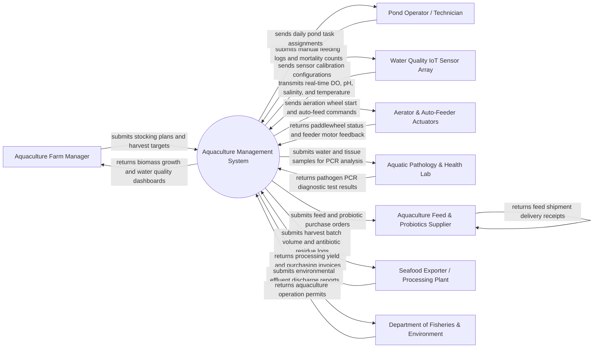

# Context Diagram — Aquaculture Management System

## Mermaid Code

## Actor & Interaction Table | Bang Actor & Tuong tac

| # | Actor | Actor Type | Data Sent TO System | Data Received FROM System | Notes |
|---|-------|------------|---------------------|---------------------------|-------|
| 1 | Aquaculture Farm Manager | Primary | Pond stocking density plans, harvest schedule targets, crop budget allocations | Biomass growth charts, Feed Conversion Ratio (FCR), profit margins | Primary operational supervisor overseeing pond production and business sales |
| 2 | Pond Operator / Technician | Primary | Daily manual feeding logs, visual water clarity measurements, mortality counts | Daily task checklists, low DO alarm notifications, feed ration tables | Field operator executing pond maintenance, feeding, and water sampling |
| 3 | Water Quality IoT Sensor Array | Supporting System | Dissolved oxygen (DO in mg/L), pH, salinity (ppt), water temp (°C), ammonia (NH3) | Sensor zero-point calibration commands, sampling frequency profiles | Submerged sensor probes deployed in fish/shrimp grow-out ponds |
| 4 | Aerator & Auto-Feeder Actuators | Supporting System | Paddlewheel motor status, blower RPM, automatic feeder dispensing motor feedback | Relay start/stop signals for paddlewheel aerators, acoustic feed pulses | Electrical equipment supplying dissolved oxygen and automated feed delivery |
| 5 | Aquatic Pathology & Health Lab | Supporting | Water bacterial plate counts (Vibrio), PCR virus test results (WSSV, EHP, AHPND) | Sample identification barcodes, diagnostic testing requests | Diagnostic laboratory verifying shrimp/fish disease pathogens |
| 6 | Aquaculture Feed & Probiotics Supplier | Supporting | Aquafeed protein grades, pellet size availability, probiotic batch numbers | Feed purchase orders, probiotic replenishment requests | Vendor supplying formulated fish/shrimp feeds and water treatment chemicals |
| 7 | Seafood Exporter / Processing Plant | Supporting | Carcass/head-on weight yields, size count grading (e.g., 30 count/kg), payment receipts | Harvest batch origin files, antibiotic residue lab clearances, traceability tags | Commercial processing facility buying harvested shrimp/fish for export |
| 8 | Department of Fisheries & Environment | Regulatory System | National water discharge regulations, banned chemical lists, environmental standards | Wastewater effluent quality reports, farm location registrations, permits | Government regulatory body monitoring environmental compliance and food safety |

## System Boundary Description | Mo ta Pham vi He thong

The **Aquaculture Management System** is an end-to-end digital platform engineered for monitoring water quality, optimizing feeding logistics, controlling aeration equipment, and managing harvest yields in commercial fish and shrimp aquaculture farms. The system boundary encompasses real-time submerged sensor telemetry ingestion, automated paddlewheel aerator control interlocks, Feed Conversion Ratio (FCR) calculation, disease PCR lab integration, biomass estimation models, and seafood export traceability. Excluded from the system boundary are physical motor fabrication, raw chemical manufacturing, physical pond excavation plumbing, and live seafood cargo flight logistics. The platform communicates via Modbus RS485 and LoRaWAN wireless protocols with pond hardware while exchanging XML/JSON compliance payloads with external export authorities.
