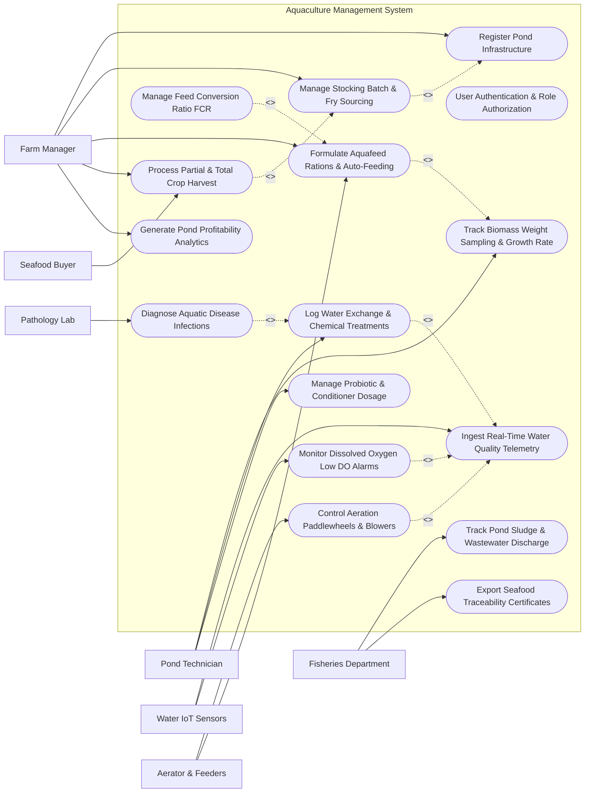

# Use Case Diagram — Aquaculture Management System

## Mermaid Code

## Actor Table | Bang Actor

| # | Actor | Actor Type | Role Description | Related Use Cases |
|---|-------|------------|------------------|-------------------|
| 1 | Farm Manager | Primary | Manages pond setup, stocking batches, feeding formulas, harvest sales, and financial performance analytics | UC01, UC02, UC03, UC06, UC11, UC15 |
| 2 | Pond Technician | Primary | Performs weekly biomass sampling, applies lime/probiotics, logs manual feeds, and monitors pond water clarity | UC02, UC08, UC09, UC10 |
| 3 | Water IoT Sensors | Secondary | Transmits continuous submerged sensor readings for Dissolved Oxygen, pH, salinity, temperature, and ammonia | UC04, UC12 |
| 4 | Aerator & Feeders | Secondary | Receives electrical relay triggers to operate paddlewheel aerators, root blowers, and automatic feed dispensers | UC05, UC06 |
| 5 | Pathology Lab | Secondary | Uploads Polymerase Chain Reaction (PCR) test results and histology diagnostic reports for aquatic pathogens | UC07 |
| 6 | Seafood Buyer | Secondary | Purchases harvested fish/shrimp batches and verifies antibiotic residue test clearances | UC11 |
| 7 | Fisheries Department | System | Receives environmental wastewater discharge metrics and issues official seafood export traceability certificates | UC14, UC16 |

## Use Case Table | Bang Use Case

| # | UC ID | Use Case Name | Primary Actor | Secondary Actor | Description | Priority |
|---|-------|---------------|---------------|-----------------|-------------|----------|
| 1 | UC01 | Register Pond Infrastructure | Farm Manager | None | Configures earthen ponds, HDPE lined ponds, or net cages with volume, depth, and aeration capacity | High |
| 2 | UC02 | User Authentication & Role Authorization | Farm Manager | Pond Technician | Secures portal access and restricts module permissions based on user roles | High |
| 3 | UC03 | Manage Stocking Batch & Fry Sourcing | Farm Manager | None | Registers new crop stocking batches, post-larvae (PL) count, hatchery origin, and initial stocking density | High |
| 4 | UC04 | Ingest Real-Time Water Quality Telemetry | Water IoT Sensors | Pond Technician | Collects continuous readings for Dissolved Oxygen (DO), pH, salinity, water temperature, and toxic NH3/NO2 | High |
| 5 | UC05 | Control Aeration Paddlewheels & Blowers | Aerator & Feeders | Water IoT Sensors | Automatically switches paddlewheel aerators and air blowers on/off based on real-time DO levels | High |
| 6 | UC06 | Formulate Aquafeed Rations & Auto-Feeding | Farm Manager | Aerator & Feeders | Calculates daily feed tables (Dry Matter, Crude Protein %) and dispatches acoustic auto-feeder timer pulses | High |
| 7 | UC07 | Diagnose Aquatic Disease Infections | Pathology Lab | Farm Manager | Processes PCR lab results to identify shrimp/fish pathogens (WSSV, EHP, AHPND, Streptococcus) and prescribe remedies | High |
| 8 | UC08 | Track Biomass Weight Sampling & Growth Rate | Pond Technician | Farm Manager | Logs weekly cast-net sampling weights (Mean Body Weight - MBW) to calculate Average Daily Growth (ADG) | High |
| 9 | UC09 | Log Water Exchange & Chemical Treatments | Pond Technician | Water IoT Sensors | Documents water exchange volumes, lime (CaCO3) applications, and chlorine disinfection cycles | High |
| 10 | UC10 | Manage Probiotic & Conditioner Dosage | Pond Technician | None | Schedules application of Bacillus probiotic bacteria and molasses to balance C:N ratio and suppress Vibrio | Medium |
| 11 | UC11 | Process Partial & Total Crop Harvest | Farm Manager | Seafood Buyer | Logs partial culling or final pond harvest weight, size count grading (pieces/kg), and sales revenue | High |
| 12 | UC12 | Monitor Dissolved Oxygen Low DO Alarms | Water IoT Sensors | Pond Technician | Triggers high-priority SMS alerts when Dissolved Oxygen drops below dangerous thresholds (<3.5 mg/L) | High |
| 13 | UC13 | Manage Feed Conversion Ratio FCR | Farm Manager | None | Calculates cumulative Feed Conversion Ratio (FCR = Total Feed Input / Total Biomass Gain) per pond | High |
| 14 | UC14 | Track Pond Sludge & Wastewater Discharge | Fisheries Department | Farm Manager | Monitors sedimentation basin sludge removal and tests effluent water before environmental discharge | Medium |
| 15 | UC15 | Generate Pond Profitability Analytics | Farm Manager | None | Compiles operational cost breakdowns (feed, power, chemicals) against harvest revenue per pond | High |
| 16 | UC16 | Export Seafood Traceability Certificates | Farm Manager | Fisheries Department | Generates official GS1-compliant seafood origin certificates with antibiotic residue clearance attachments | High |

## Use Case Specification | Dac ta Use Case

---

### UC04 — Ingest Real-Time Water Quality Telemetry

| Field | Detail |
|-------|--------|
| **UC ID** | UC04 |
| **Use Case Name** | Ingest Real-Time Water Quality Telemetry |
| **Actor(s)** | Primary: Water IoT Sensors / Secondary: Pond Technician |
| **Description** | Continuously receives submerged IoT sensor data streams, processing Dissolved Oxygen (DO mg/L), pH, salinity (ppt), water temperature (°C), and un-ionized ammonia (NH3 mg/L) for active aquaculture ponds. |
| **Precondition** | 1. Submerged sensor probes are calibrated and submerged in target ponds.   2. LoRaWAN or Modbus RS485 telemetry gateway is online. |
| **Main Flow** | 1. Sensor probe node wakes up on a 5-minute sampling interval.   2. Optical DO sensor measures dissolved oxygen concentration (e.g., 5.2 mg/L).   3. Glass electrode pH probe measures pH (7.8), and conductivity sensor measures salinity (15 ppt).   4. Sensor node transmits encrypted wireless data packet to farm gateway.   5. System receives packet, applies temperature-compensation algorithms, and calculates un-ionized ammonia (NH3) from total ammonia nitrogen (TAN).   6. System updates live pond water quality dashboard, renders multi-parameter trend graphs, and checks safety thresholds. |
| **Alternative Flow** | **AF1** — Manual Water Testing Entry: Pond Technician uses handheld optical meter or chemical titration kit to measure alkalinity and nitrite (NO2), manually entering readings into the mobile app.   **AF2** — High-Frequency Night Polling: During critical night hours (00:00 - 06:00), System commands sensors to double polling frequency from 5 minutes to 2 minutes for rapid hypoxia detection. |
| **Exception Flow** | **EX1** — Probe Bio-Fouling Drift Warning: Optical DO probe readings drift >1.5 mg/L compared to secondary reference sensor (indicates bio-fouling algae buildup). System flags "Probe Cleaning Required".   **EX2** — Sensor Packet Timeout: If no telemetry is received from Pond 4 for 15 minutes, System flags "Telemetry Offline" and alerts technician to inspect power supply. |
| **Postcondition** | Water quality parameters are saved in time-series database, live heatmaps are updated, and automated aeration controls (UC05) are triggered if required. |
| **Business Rule** | **BR1**: Dissolved Oxygen levels below 4.0 mg/L for shrimp or 3.0 mg/L for tilapia must trigger immediate automated aeration interlocks.   **BR2**: Un-ionized ammonia (NH3) concentrations exceeding 0.05 mg/L must trigger high-toxicity water exchange alerts. |

---

### UC05 — Control Aeration Paddlewheels & Blowers

| Field | Detail |
|-------|--------|
| **UC ID** | UC05 |
| **Use Case Name** | Control Aeration Paddlewheels & Blowers |
| **Actor(s)** | Primary: Aerator & Feeders / Secondary: Water IoT Sensors |
| **Description** | Automatically switches electrical paddlewheel aerators, long-arm aerators, and root blowers on/off based on real-time Dissolved Oxygen (DO) levels to maintain optimal oxygenation while optimizing power consumption. |
| **Precondition** | 1. Aerator motors are wired to smart electrical relay control panels.   2. DO sensor telemetry is actively streaming (UC04). |
| **Main Flow** | 1. System detects Dissolved Oxygen in Pond 2 dropping below target setpoint (DO < 4.5 mg/L).   2. System determines required additional oxygenation capacity (2 paddlewheels needed).   3. System checks electrical power supply voltage to ensure grid stability.   4. System sends "Relay CLOSE" command to activate Paddlewheel Motor #1 and Motor #2 in Pond 2.   5. Aerator control panel closes relays, starts motors, and returns digital status confirmation "Paddlewheels 1 & 2 RUNNING".   6. System continuously monitors DO recovery. Once DO reaches safe recovery limit (DO > 6.0 mg/L for 20 mins), System sends "Relay OPEN" signal to shut down non-essential aerators, saving electricity. |
| **Alternative Flow** | **AF1** — Scheduled Night Aeration: System automatically turns on 100% of available paddlewheel aerators at 22:00 every night to counter microalgae nocturnal respiration DO crashes, regardless of current daytime DO.   **AF2** — Variable Speed Drive (VSD) Modulation: For blowers equipped with VSDs, System modulates motor frequency (30Hz to 50Hz) proportionally to DO deficit. |
| **Exception Flow** | **EX1** — Motor Over-Current Trip: Aerator Motor #1 draws excessive current (indicating entangled net or mechanical jam). Thermal relay trips, and System sends urgent "Aerator Motor Overload Trip" alert while starting backup Motor #3.   **EX2** — Power Outage Emergency Generator Interlock: Main grid power fails. System instantly sheds non-essential farm loads, starts diesel backup generator, and prioritizes powering 1 primary aerator per active pond. |
| **Postcondition** | Aeration motors operate safely to restore DO levels, power consumption is logged, and motor runtime hours are updated. |
| **Business Rule** | **BR1**: Aeration capacity must guarantee a minimum DO safety buffer of 4.0 mg/L under maximum biomass loading.   **BR2**: In the event of grid power loss, backup generators must restore primary aeration within 120 seconds to prevent mass mortality. |

---

### UC06 — Formulate Aquafeed Rations & Auto-Feeding

| Field | Detail |
|-------|--------|
| **UC ID** | UC06 |
| **Use Case Name** | Formulate Aquafeed Rations & Auto-Feeding |
| **Actor(s)** | Primary: Farm Manager / Secondary: Aerator & Feeders |
| **Description** | Calculates daily feed biomass percentages based on current estimated stock weight, water temperature, and DO levels, broadcasting timed feed pulses to automated acoustic/solar feed dispensers. |
| **Precondition** | 1. Estimated pond biomass and Mean Body Weight (MBW) are updated (UC08).   2. Automated feed dispensers are filled with formulated pellet feed. |
| **Main Flow** | 1. System calculates current estimated pond biomass (e.g., Pond 1: 5,000 kg shrimp biomass).   2. System checks feed table matrix for current MBW (15g shrimp = 2.8% body weight daily feed rate = 140 kg feed/day).   3. System adjusts feed ration based on water temperature (e.g., reduce feed by 20% if water temp <24°C) and DO levels.   4. System divides daily ration into 6 automated feeding cycles (e.g., 23.3 kg per feeding session).   5. System sends timer pulse parameters to automatic solar feed dispensers in Pond 1.   6. Feed dispensers broadcast pellets over designated feeding zone radius and return feed consumption confirmation payload. |
| **Alternative Flow** | **AF1** — Passive Acoustic Feed Control: Feeder is integrated with hydrophone underwater microphones. System analyzes shrimp feeding click sounds (mastication clicks), automatically dispensing feed only when active feeding sounds are detected.   **AF2** — Feed Tray Manual Inspection: Technician inspects underwater feed trays after 1 hour. If 10% feed remains on tray, technician logs "Overfeeding", and System automatically reduces next feed cycle by 15%. |
| **Exception Flow** | **EX1** — Low DO Feed Suspension: DO drops below 3.5 mg/L. Feeding during low DO causes severe metabolic stress and waste. System automatically halts auto-feeders until DO recovers above 4.5 mg/L.   **EX2** — Feeder Hopper Empty: Feeder sensor detects zero feed in hopper. System logs "Feed Hopper Empty" alert and sends SMS to technician for refilling. |
| **Postcondition** | Precise feed portions are dispensed, feed consumption is logged, and cumulative FCR calculations (UC13) are updated. |
| **Business Rule** | **BR1**: Automated feeders must be automatically disabled whenever Dissolved Oxygen drops below 3.5 mg/L or water temperature exceeds 33°C.   **BR2**: Daily feeding calculations must not exceed maximum safe nitrogen loading capacity of the pond ecosystem. |

---

### UC07 — Diagnose Aquatic Disease Infections

| Field | Detail |
|-------|--------|
| **UC ID** | UC07 |
| **Use Case Name** | Diagnose Aquatic Disease Infections |
| **Actor(s)** | Primary: Pathology Lab / Secondary: Farm Manager |
| **Description** | Records clinical disease symptoms, processes laboratory Polymerase Chain Reaction (PCR) test results for viral/bacterial pathogens, and generates biosecurity containment and treatment protocols. |
| **Precondition** | 1. Water or animal tissue samples have been collected and sent to pathology lab.   2. Pathology Lab user is authenticated in the system. |
| **Main Flow** | 1. Pond Technician reports visual symptoms in Pond 3 (e.g., lethargy, white spots, empty stomach).   2. Technician submits tissue samples to Aquatic Pathology Lab with system sample barcode.   3. Pathology Lab performs Real-Time PCR testing for major aquaculture pathogens (WSSV, EHP, AHPND/EMS, DIV1).   4. Pathology Lab uploads test report: "White Spot Syndrome Virus (WSSV) — POSITIVE (High Viral Load)".   5. System flags Pond 3 status as "CRITICAL DISEASE OUTBREAK — WSSV POSITIVE".   6. System triggers immediate biosecurity quarantine protocol: halts water exchange, locks harvest dispatch, and notifies Farm Manager and nearby ponds. |
| **Alternative Flow** | **AF1** — Bacterial Vibrio Plate Count Diagnosis: Lab performs TCBS agar plating for Vibrio parahaemolyticus. System logs green/yellow colony forming units (CFU/mL) and recommends specific probiotic dosage (UC10).   **AF2** — Parasitic Wet Mount Diagnosis: Technician performs gill microscopic examination, identifies Trichodina parasites, and System recommends approved formalin/copper sulfate treatment (UC09). |
| **Exception Flow** | **EX1** — Unclassified Pathogen Outbreak: PCR tests return negative for known viruses but mortality exceeds 5%/day. System flags "Unclassified Disease Anomaly" and alerts government fisheries authority for isolation.   **EX2** — Sample Cross-Contamination Warning: Lab detects control sample anomaly. System invalidates test batch and requests fresh tissue sampling. |
| **Postcondition** | Disease diagnosis is committed to pond record, biosecurity containment locks are engaged, and treatment/culling workflows are initiated. |
| **Business Rule** | **BR1**: Positive PCR diagnoses for OIE-listed viral pathogens (WSSV, TSV, IHHNV) must automatically lock pond water discharge gates.   **BR2**: All antibiotic treatments must strictly comply with national veterinary drug registration and mandatory withdrawal periods. |

---

### UC11 — Process Partial & Total Crop Harvest

| Field | Detail |
|-------|--------|
| **UC ID** | UC11 |
| **Use Case Name** | Process Partial & Total Crop Harvest |
| **Actor(s)** | Primary: Farm Manager / Secondary: Seafood Buyer |
| **Description** | Manages partial thinning or final drain-down harvest operations, recording harvested biomass weight, size count classifications (pieces/kg), quality grading, and generating buyer sales invoices. |
| **Precondition** | 1. Stocking batch is active and has reached marketable size.   2. Pre-harvest antibiotic residue testing has passed with 100% negative clearance. |
| **Main Flow** | 1. Farm Manager schedules "Total Drain-Down Harvest" for Pond 1.   2. System verifies pre-harvest chemical withdrawal logs (UC09) and confirms zero active drug restrictions.   3. Harvest crew completes netting operations, weighing iced harvest crates on calibrated digital scales.   4. Manager inputs total gross harvest weight (e.g., 8,500 kg) and average size count (e.g., 40 pieces/kg).   5. System calculates final survival rate (e.g., 78%), total biomass yield per hectare, and final Feed Conversion Ratio (FCR = 1.35).   6. System generates a formal Harvest Sales Invoice and assigns a unique Seafood Traceability Batch Code linked to Seafood Buyer's purchase order. |
| **Alternative Flow** | **AF1** — Partial Thinning Harvest: Manager harvests 30% of pond biomass (2,000 kg large size) to reduce stocking density. System deducts harvested weight and count from active batch, updating remaining pond biomass estimate.   **AF2** — Emergency Harvest Due to Disease: Following a disease alert (UC07), Manager executes emergency early harvest. System flags batch as "Emergency Harvest" and routes to local processing plant under restricted grading. |
| **Exception Flow** | **EX1** — Active Antibiotic Residue Violation: System detects an active drug withdrawal period (UC09) expiring in 48 hours. System blocks harvest confirmation with warning "Antibiotic Residue Risk — Harvest Blocked".   **EX2** — Weight Scale Discrepancy: Buyer scale weight differs by >3% from farm net scale weight. System flags "Harvest Weight Variance Discrepancy" for manager review. |
| **Postcondition** | Stocking batch status is updated to "Harvested/Closed", pond inventory is cleared, final FCR/profitability analytics are compiled, and traceability tags are issued. |
| **Business Rule** | **BR1**: Harvest operations are strictly prohibited if active chemical or antibiotic withdrawal periods have not fully elapsed.   **BR2**: Every harvested batch must be assigned a unique GS1 Digital Link QR traceability payload prior to leaving farm premises. |
