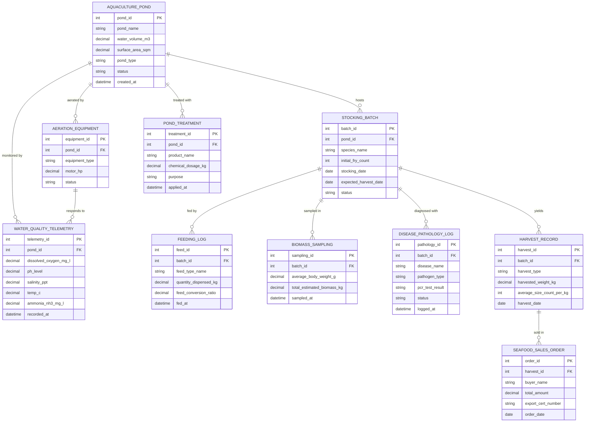

# Conceptual ERD — Aquaculture Management System

## Mermaid Code

## Entity Description Table | Bang mo ta Entity

| # | Entity Name | Vietnamese Name | Description | Key Attributes | Main Relationships |
|---|-------------|-----------------|-------------|----------------|-------------------|
| 1 | AQUACULTURE_POND | Ao/Bè Nuôi Thủy Sản | Physical earthen pond, HDPE-lined pond, or floating net cage asset managing water volume and depth | pond_id, pond_name, water_volume_m3, surface_area_sqm, pond_type, status | Has many STOCKING_BATCH, WATER_QUALITY_TELEMETRY, AERATION_EQUIPMENT, POND_TREATMENT |
| 2 | STOCKING_BATCH | Lô Con Giống Nuôi | Active crop batch of fish or shrimp post-larvae (PL) stocked into a specific pond asset | batch_id, pond_id, species_name, initial_fry_count, stocking_date, status | Belongs to AQUACULTURE_POND; has FEEDING_LOG, BIOMASS_SAMPLING, DISEASE_PATHOLOGY_LOG, HARVEST_RECORD |
| 3 | WATER_QUALITY_TELEMETRY | Dữ Liệu Chất Lượng Nước | Time-series submerged IoT sensor telemetry tracking Dissolved Oxygen, pH, salinity, temperature, and NH3 | telemetry_id, pond_id, dissolved_oxygen_mg_l, ph_level, salinity_ppt, recorded_at | Belongs to AQUACULTURE_POND; linked to AERATION_EQUIPMENT |
| 4 | AERATION_EQUIPMENT | Thiết Bị Sục Khí Aerator | Mechanical paddlewheel aerator, long-arm wheel, or root air blower supplying oxygen to pond water | equipment_id, pond_id, equipment_type, motor_hp, status | Belongs to AQUACULTURE_POND; responds to WATER_QUALITY_TELEMETRY |
| 5 | FEEDING_LOG | Nhật Ký Cho Ăn | Log of daily formulated aquafeed pellets or probiotic mixes dispensed to a stocking batch | feed_id, batch_id, feed_type_name, quantity_dispensed_kg, feed_conversion_ratio | Belongs to STOCKING_BATCH |
| 6 | BIOMASS_SAMPLING | Nhật Ký Mẫu Sinh Khối | Sampling record capturing cast-net Mean Body Weight (MBW in grams) and calculated total biomass (kg) | sampling_id, batch_id, average_body_weight_g, total_estimated_biomass_kg, sampled_at | Belongs to STOCKING_BATCH |
| 7 | DISEASE_PATHOLOGY_LOG | Nhật Ký Bệnh Thủy Sản | Pathological record logging clinical disease symptoms, PCR virus test results, and biosecurity flags | pathology_id, batch_id, disease_name, pathogen_type, pcr_test_result, status | Belongs to STOCKING_BATCH |
| 8 | POND_TREATMENT | Nhật Ký Xử Lý Môi Trường | Application log of water conditioners, agricultural lime (CaCO3), chlorine disinfectants, and bio-probiotics | treatment_id, pond_id, product_name, chemical_dosage_kg, purpose, applied_at | Belongs to AQUACULTURE_POND |
| 9 | HARVEST_RECORD | Nhật Ký Thu Hoạch | Log of partial culling or final drain-down harvest detailing total weight (kg), size count, and survival rate | harvest_id, batch_id, harvest_type, harvested_weight_kg, average_size_count_per_kg | Belongs to STOCKING_BATCH; generates SEAFOOD_SALES_ORDER |
| 10 | SEAFOOD_SALES_ORDER | Đơn Bán Hải Sản | Commercial sales contract and export traceability manifest generated for seafood buyers | order_id, harvest_id, buyer_name, total_amount, export_cert_number, order_date | Belongs to HARVEST_RECORD |

## Relationship Description | Mo ta Quan he

| # | From Entity | Cardinality | To Entity | Relationship Label | Business Explanation |
|---|-------------|-------------|-----------|-------------------|----------------------|
| 1 | AQUACULTURE_POND | one-to-many | STOCKING_BATCH | hosts | Một ao nuôi thủy sản có thể trải qua nhiều lứa/lô thả con giống theo thời gian. |
| 2 | AQUACULTURE_POND | one-to-many | WATER_QUALITY_TELEMETRY | monitored by | Một ao nuôi liên tục truyền về nhiều bản ghi cảm biến đo oxy hòa tan, pH, độ mặn. |
| 3 | AQUACULTURE_POND | one-to-many | AERATION_EQUIPMENT | aerated by | Một ao nuôi được lắp đặt và sục khí bởi nhiều máy guồng nước/bơm quạt. |
| 4 | AQUACULTURE_POND | one-to-many | POND_TREATMENT | treated with | Một ao nuôi được xử lý môi trường bằng nhiều đợt đánh vôi, diệt khuẩn, đánh vi sinh. |
| 5 | STOCKING_BATCH | one-to-many | FEEDING_LOG | fed by | Một lô con giống nuôi nhận được nhiều lượt cho ăn thức ăn viên hàng ngày. |
| 6 | STOCKING_BATCH | one-to-many | BIOMASS_SAMPLING | sampled in | Một lô con giống được chài mẫu định kỳ để đo trọng lượng bình quân (MBW) và tốc độ tăng trưởng. |
| 7 | STOCKING_BATCH | one-to-many | DISEASE_PATHOLOGY_LOG | diagnosed with | Một lô nuôi có thể có các bản ghi chẩn đoán xét nghiệm PCR sâu bệnh hại. |
| 8 | STOCKING_BATCH | one-to-many | HARVEST_RECORD | yields | Một lô nuôi cho ra một hoặc nhiều đợt thu hoạch tỉa hoặc thu hoạch toàn bộ ao. |
| 9 | HARVEST_RECORD | one-to-many | SEAFOOD_SALES_ORDER | sold in | Một đợt thu hoạch được xuất bán và gắn với các đơn hàng, chứng nhận xuất khẩu. |
| 10 | AERATION_EQUIPMENT | one-to-many | WATER_QUALITY_TELEMETRY | responds to | Thiết bị sục khí phản ứng bật/tắt theo ngưỡng nồng độ oxy hòa tan đo được. |
