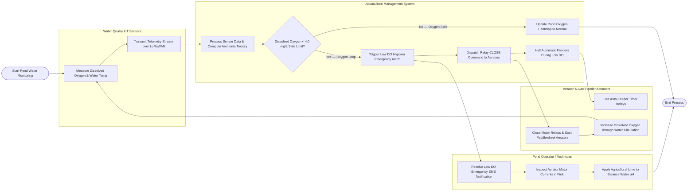

# Swimlane Diagram — Aquaculture Management System

## Mermaid Code

## Flow Description | Mo ta luong

| Lane | Actor / Subsystem | Role in Flow |
|------|-------------------|--------------|
| Water Quality IoT Sensors | Submerged Sensor Array | Continuously measures Dissolved Oxygen (DO mg/L), water temperature, pH, and transmits wireless telemetry streams over LoRaWAN. |
| Aquaculture Management System | Central Core Platform | Evaluates oxygen drop thresholds, triggers emergency SMS alarms, sends automated relay signals to activate paddlewheels, halts feeders during hypoxia, and maintains live pond heatmaps. |
| Aerator & Auto-Feeder Actuators | Field Electrical Relays | Receives start signals to energize paddlewheel aerator motors, halts feed dispensers during low DO conditions, and circulates pond water to restore oxygenation. |
| Pond Operator / Technician | Field Technician | Receives emergency SMS notifications, performs physical inspections of aerator motor currents, and applies agricultural lime to stabilize pH and water quality. |
