# Action Tree — Aquaculture Management System

## Mermaid Code

```mermaid
graph TD
    Root["Aquaculture Management System"]

    Root --> M1["Pond Infrastructure & Water Asset Management"]
    Root --> M2["Fry Stocking & Biomass Growth Tracking"]
    Root --> M3["IoT Water Quality Telemetry & Climate Control"]
    Root --> M4["Aquafeed Nutrition & FCR Optimization"]
    Root --> M5["Aquatic Health & Disease Biosecurity"]
    Root --> M6["Harvest Processing & Export Traceability"]

    M1 --> A11["Register Earthen & HDPE Lined Ponds"]
    M1 --> A12["Configure Aeration Paddlewheel Capacity"]
    M1 --> A13["Manage Sedimentation Basin & Sludge Discharge"]

    M2 --> A21["Register Post-Larvae Fry Stocking Batches"]
    M2 --> A22["Log Weekly Cast-Net Biomass Weight Sampling"]
    M2 --> A23["Calculate Average Daily Growth ADG"]

    M3 --> A31["Ingest Real-Time DO, pH & Salinity Sensor Data"]
    M3 --> A32["Trigger Automated Paddlewheel Relay Signals"]
    M3 --> A33["Calculate Un-Ionized Ammonia NH3 Toxicity"]
    M3 --> A34["Send Low DO Hypoxia Emergency SMS Alerts"]

    M4 --> A41["Calculate Daily Feed Biomass Percentages"]
    M4 --> A42["Dispatch Timed Auto-Feeder Dispensing Pulses"]
    M4 --> A43["Track Cumulative Feed Conversion Ratio FCR"]

    M5 --> A51["Log PCR Pathogen Lab Test Results"]
    M5 --> A52["Apply Probiotics & Carbon-Nitrogen C:N Ratio"]
    M5 --> A53["Enforce Antibiotic Residue Withdrawal Locks"]
    M5 --> A54["Execute Pond Quarantine Biosecurity Isolation"]

    M6 --> A61["Process Partial Thinning & Total Harvest Yields"]
    M6 --> A62["Grade Seafood Size Counts & Carcass Weight"]
    M6 --> A63["Generate Harvest Invoices & Buyer Contracts"]
    M6 --> A64["Export GS1 Digital Link Seafood Traceability"]
```

## Module Description | Mo ta Module

| # | Module | Description | Actions |
|---|--------|-------------|---------|
| 1 | Pond Infrastructure & Water Asset Management | Registers earthen ponds, HDPE-lined ponds, and net cages, managing aeration capacity and sludge sedimentation basins | Register Earthen & HDPE Lined Ponds, Configure Aeration Paddlewheel Capacity, Manage Sedimentation Basin & Sludge Discharge |
| 2 | Fry Stocking & Biomass Growth Tracking | Logs post-larvae (PL) stocking batches, performs weekly cast-net sampling (MBW), and calculates Average Daily Growth (ADG) | Register Post-Larvae Fry Stocking Batches, Log Weekly Cast-Net Biomass Weight Sampling, Calculate Average Daily Growth ADG |
| 3 | IoT Water Quality Telemetry & Climate Control | Collects continuous submerged sensor data (DO, pH, salinity, NH3), triggers paddlewheel relays, and sends low DO hypoxia alerts | Ingest Real-Time DO pH & Salinity Sensor Data, Trigger Automated Paddlewheel Relay Signals, Calculate Un-Ionized Ammonia NH3 Toxicity, Send Low DO Hypoxia Emergency SMS Alerts |
| 4 | Aquafeed Nutrition & FCR Optimization | Formulates daily feed tables based on body weight percentages, controls acoustic auto-feeders, and optimizes Feed Conversion Ratio (FCR) | Calculate Daily Feed Biomass Percentages, Dispatch Timed Auto-Feeder Dispensing Pulses, Track Cumulative Feed Conversion Ratio FCR |
| 5 | Aquatic Health & Disease Biosecurity | Processes PCR pathogen lab reports (WSSV, EHP, AHPND), applies C:N ratio probiotics, and locks harvests during antibiotic withdrawal periods | Log PCR Pathogen Lab Test Results, Apply Probiotics & Carbon-Nitrogen C:N Ratio, Enforce Antibiotic Residue Withdrawal Locks, Execute Pond Quarantine Biosecurity Isolation |
| 6 | Harvest Processing & Export Traceability | Manages partial and total harvests, grades size counts (pieces/kg), generates buyer sales invoices, and exports GS1 QR traceability certificates | Process Partial Thinning & Total Harvest Yields, Grade Seafood Size Counts & Carcass Weight, Generate Harvest Invoices & Buyer Contracts, Export GS1 Digital Link Seafood Traceability |
