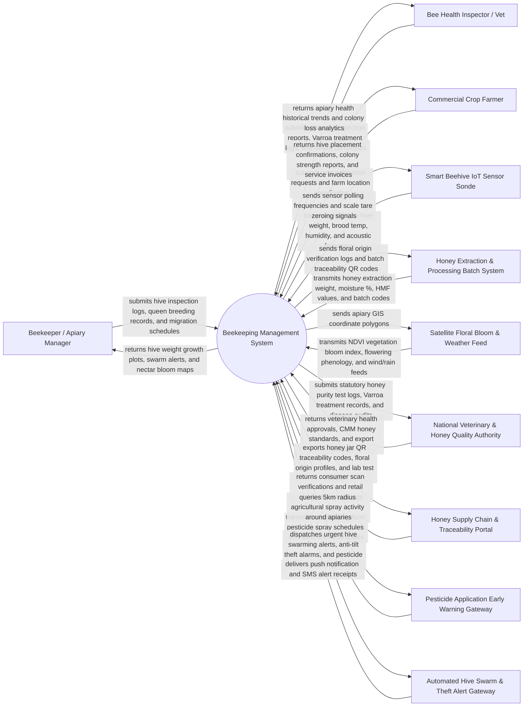

# Context Diagram — Beekeeping Management System

## Mermaid Code

## Actor & Interaction Table | Bang Actor & Tuong tac

| # | Actor | Actor Type | Data Sent TO System | Data Received FROM System | Notes |
|---|-------|------------|---------------------|---------------------------|-------|
| 1 | Beekeeper / Apiary Manager | Primary | Apiary site registrations, hive box inventories, queen bee pedigrees, inspection notes, honey yields | Real-time hive weight plots, acoustic swarm warnings, nectar bloom maps, migration routes | Commercial or migratory beekeeper managing apiaries and honey production |
| 2 | Bee Health Inspector / Vet | Primary | Varroa mite counts, European/American Foulbrood diagnoses, treatment logs, health certifications | Regional colony collapse statistics, apiary disease heatmaps, treatment compliance logs | Specialized apiculture veterinarian inspecting hive biosecurity and colony health |
| 3 | Commercial Crop Farmer (Pollination Client) | Primary | Crop pollination service requests (almonds, apples, berries, canola), farm GPS boundaries | Hive placement schedules, colony strength certifications (frames of bees), service invoices | Commercial fruit/nut grower hiring beehive colonies for crop pollination services |
| 4 | Smart Beehive IoT Sensor Sonde | Supporting System | Real-time hive weight ($kg$), brood chamber temperature ($^\circ C$), humidity ($\%$), acoustic frequency ($Hz$) | Scale tare commands, temperature sensor calibration offsets, battery polling rates | Weatherproof IoT scale and acoustic/thermal sonde installed under and inside hive boxes |
| 5 | Honey Extraction & Processing Batch System | Supporting System | Honey extraction volume ($kg$), moisture content ($\%$), HMF ($mg/kg$), pollen analysis, batch IDs | Floral origin verification logs, honey batch barcodes, export traceability QR codes | Honey processing facility extracting, filtering, testing, and bottling honey batches |
| 6 | Satellite Floral Bloom & Weather Forecast Feed | Supporting System | Satellite NDVI floral bloom index, flowering phenology, ambient temperature, wind speed, rainfall | Apiary GPS location coordinates, forage radius polygons ($3-5\text{ km}$) | Remote sensing satellite and meteorological feeds mapping nectar flow availability |
| 7 | National Veterinary & Honey Quality Authority | Regulatory System | Statutory honey purity standards, maximum residue limits (MRLs), quarantine mandates | Annual national colony statistics, disease outbreak reports, honey export certificates | Government veterinary and food safety authority enforcing apiculture standards |
| 8 | Honey Supply Chain & Traceability Portal | Supporting System | Retail QR code scan requests, consumer authenticity verification queries | Georeferenced honey origin maps, beekeeper profiles, laboratory purity test certificates | Consumer and retail traceability portal providing transparency from hive to table |
| 9 | Pesticide Application Early Warning Gateway | Supporting System | Neighboring farm pesticide spraying notices, chemical active ingredients (Neonicotinoids, Pyrethroids) | Apiary location buffer queries ($5\text{ km}$ radius around spraying zones) | Agricultural extension database broadcasting farm chemical spray warnings to beekeepers |
| 10 | Automated Hive Swarm & Theft Alert Gateway | Supporting System | SMS delivery receipts, alert dispatch status logs | High-priority acoustic swarming alerts, hive anti-tilt theft alarms, sudden weight loss warnings | Emergency notification gateway dispatching urgent alerts to beekeepers when hives are disturbed |

## System Boundary Description | Mo ta Pham vi He thong

The **Beekeeping Management System** is a specialized precision apiculture software platform designed to manage apiary sites, monitor beehive health via IoT scales and acoustic AI sensors, track queen bee breeding genetics, coordinate seasonal transhumance migration, manage commercial crop pollination contracts, log honey extraction batches, and issue pesticide early warnings.

The **system boundary** encompasses apiary location GIS mapping, IoT telemetry processing (weight, temperature, acoustic buzz spectrum), AI acoustic swarming classification ($400 - 500\text{ Hz}$ frequency shift), Varroa mite disease tracking, pollination service contracting, honey batch traceability (moisture %, HMF, pollen profile), and neighbor pesticide alert broadcasting.

**External to the system boundary** are physical bee flight aerodynamics, physical flower nectar secretion biochemistry, physical honey extraction centrifuge mechanics, legal theft prosecution of stolen hives, and satellite orbital operations. System interfaces operate via secure HTTPS REST APIs, MQTT IoT telematics feeds, OGC spatial GIS protocols, and Bluetooth Low Energy (BLE) field scanner links.
