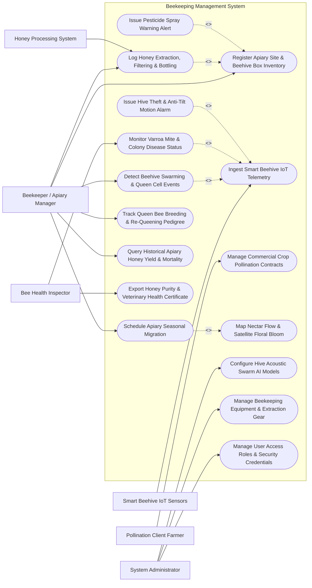

# Use Case Diagram — Beekeeping Management System

## Mermaid Code

## Actor Table | Bang Actor

| # | Actor | Actor Type | Role Description | Related Use Cases |
|---|-------|------------|------------------|-------------------|
| 1 | Beekeeper / Apiary Manager | Primary | Commercial beekeeper managing hive boxes, inspecting colonies, tracking queen bees, and harvesting honey | UC01, UC03, UC05, UC07, UC11, UC12 |
| 2 | Bee Health Inspector | Primary | Apiculture veterinarian inspecting colonies for Varroa mites, Foulbrood disease, and issuing health certificates | UC04, UC13 |
| 3 | Pollination Client Farmer | Primary | Commercial fruit/nut grower contracting beehive placement for crop pollination services | UC06 |
| 4 | System Administrator | Primary | Technical admin managing acoustic AI classification models, equipment inventories, and user roles | UC14, UC15, UC16 |
| 5 | Smart Beehive IoT Sensors | Secondary / System | Weatherproof scale and acoustic/thermal sondes streaming real-time hive weight, temp, and buzz spectrum | UC02 |
| 6 | Honey Processing System | Secondary / System | Processing plant system logging honey extraction volumes, moisture %, HMF values, and batch barcodes | UC07 |

## Use Case Table | Bang Use Case

| # | UC ID | Use Case Name | Primary Actor | Secondary Actor | Description | Priority |
|---|-------|---------------|---------------|-----------------|-------------|----------|
| 1 | UC01 | Register Apiary Site & Beehive Box Inventory | Beekeeper | None | Configures apiary location GIS coordinates, floral forage types, hive box counts, and frame inventories | High |
| 2 | UC02 | Ingest Smart Beehive IoT Telemetry | System | Smart Hive Sensors | Ingests real-time hive scale weight ($kg$), brood temperature ($^\circ C$), humidity ($\%$), and acoustic spectrum ($Hz$) | High |
| 3 | UC03 | Detect Beehive Swarming & Queen Cell Events | Beekeeper | System | Detects impending swarm events via acoustic frequency shift ($250\rightarrow 450\text{ Hz}$) and sudden weight drop | High |
| 4 | UC04 | Monitor Varroa Mite & Colony Disease Status | Bee Vet | System | Logs Varroa mite infestation rates per 100 bees, Nosema spore counts, Foulbrood signs, and treatments | High |
| 5 | UC05 | Schedule Apiary Seasonal Migration | Beekeeper | System | Plans transhumance truck routes to move hives between seasonal nectar flows (Acacia, Coffee, Wildflower) | High |
| 6 | UC06 | Manage Commercial Crop Pollination Contracts | Pollination Client | Beekeeper | Manages hive renting contracts for crop pollination (almond, apple, berry), frame strength, and fees | High |
| 7 | UC07 | Log Honey Extraction, Filtering & Bottling | Beekeeper | Honey Processing | Logs honey harvest volume ($kg$), moisture content ($\%$), Hydroxymethylfurfural (HMF), and batch QR codes | High |
| 8 | UC08 | Map Nectar Flow & Satellite Floral Bloom | Beekeeper | System | Overlays satellite NDVI floral bloom heatmaps to identify rich nectar forage zones within $5\text{ km}$ radius | High |
| 9 | UC09 | Issue Pesticide Spray Warning Alert | System | Notification Gateway | Dispatches emergency alerts to beekeepers when neighboring farms schedule toxic pesticide spraying | High |
| 10 | UC10 | Issue Hive Theft & Anti-Tilt Motion Alarm | System | Notification Gateway | Triggers immediate SMS/push alarms when hive scale detects sudden unauthorized movement or tipping | High |
| 11 | UC11 | Track Queen Bee Breeding & Re-Queening Pedigree | Beekeeper | None | Manages queen bee genetic lineage, birth year color marking, laying pattern ratings, and re-queening dates | Medium |
| 12 | UC12 | Query Historical Apiary Honey Yield & Mortality | Beekeeper | None | Provides searchable historical reports on honey yield per hive ($kg$), winter mortality rate, and feeding costs | Low |
| 13 | UC13 | Export Honey Purity & Veterinary Health Certificate | Bee Vet | Regulatory Authority | Exports lab test reports (CMM standards, antibiotic residue checks) and veterinary health transit passes | High |
| 14 | UC14 | Configure Hive Acoustic Swarm AI Models | System Admin | System | Retrains FFT acoustic audio classification neural networks for detecting swarm piping sound signatures | Medium |
| 15 | UC15 | Manage Beekeeping Equipment & Extraction Gear | System Admin | Beekeeper | Tracks hive supers, smokers, protective suits, uncapping knives, honey extractors, and refractometers | Low |
| 16 | UC16 | Manage User Access Roles & Security Credentials | System Admin | None | Configures user accounts, apiculture roles (Beekeeper, Vet, Client, Admin), and security permissions | Low |

## Use Case Specification | Dac ta Use Case

---

### UC02 — Ingest Smart Beehive IoT Telemetry

| Field | Detail |
|-------|--------|
| **UC ID** | UC02 |
| **Use Case Name** | Ingest Smart Beehive IoT Telemetry |
| **Actor(s)** | Primary: System   Secondary: Smart Beehive IoT Sensors |
| **Description** | Ingests real-time, high-frequency sensor telemetry from smart hive scales and brood chamber sondes, recording total hive weight ($kg$), brood temperature ($^\circ C$), internal humidity ($\%$), and acoustic buzz frequency spectrum ($Hz$). |
| **Precondition** | 1. Smart hive scale and internal sonde are installed and registered in system (UC01).   2. Hive IoT gateway cellular/LoRaWAN connection is active. |
| **Main Flow** | 1. Smart hive sensor sonde takes readings every 15 minutes.   2. Sensor packages telemetry payload: Apiary Site ID, Hive Code, Sensor Serial Number, Timestamp, Total Weight ($kg$), Brood Temperature ($^\circ C$), Internal Relative Humidity ($\%$), Peak Acoustic Buzz Frequency ($Hz$), and Battery Voltage ($V$).   3. Sensor transmits payload to System gateway via LoRaWAN / Cellular MQTT over TLS.   4. System ingests packet, parses sensor fields, and validates payload integrity.   5. System checks **Brood Chamber Temperature Stability**:   &nbsp;&nbsp;&nbsp;&nbsp;a. **Optimal Brood Temp**: $34.5^\circ C - 35.5^\circ C$ (indicates active queen laying and healthy brood thermoregulation).   &nbsp;&nbsp;&nbsp;&nbsp;b. **Low Brood Temp ($<32.0^\circ C$)**: Indicates queenlessness or severe adult bee population loss.   6. System calculates 24-hour **Hive Net Weight Delta ($\Delta W = W_{today} - W_{yesterday}$)**:   &nbsp;&nbsp;&nbsp;&nbsp;a. Positive $\Delta W$ ($+1.5\text{ kg/day}$): Active nectar flow underway.   &nbsp;&nbsp;&nbsp;&nbsp;b. Negative $\Delta W$ ($-0.2\text{ kg/day}$): Nectar dearth; colony consuming honey stores.   7. System stores validated 15-minute telemetry record in time-series database.   8. System updates apiary dashboard and triggers swarm or theft detection algorithms (UC03, UC10). |
| **Alternative Flow** | **AF1** — Nighttime Foraging Bee Census: System calculates net daily foraging bee return rate by comparing hive weight at 02:00 AM vs 12:00 PM. |
| **Exception Flow** | **EX1** — Sudden Mass Weight Loss Alarm: Hive scale detects sudden drop of $>4.0\text{ kg}$ within 10 minutes; system flags `POSSIBLE_SWARM_OR_THEFT` and dispatches immediate notification (UC10). |
| **Postcondition** | Hive weight, brood temp, humidity, and acoustic frequency metrics saved in database and mapped on beekeeper dashboard. |
| **Business Rule** | **BR1**: Brood chamber temperature sensors must be positioned between the 4th and 5th central frames where the queen bee maintains the brood nest. |

---

### UC03 — Detect Beehive Swarming & Queen Cell Events

| Field | Detail |
|-------|--------|
| **UC ID** | UC03 |
| **Use Case Name** | Detect Beehive Swarming & Queen Cell Events |
| **Actor(s)** | Primary: Beekeeper / Apiary Manager   Secondary: System |
| **Description** | Analyzes fast-fourier transform (FFT) acoustic frequency shifts and hive weight patterns to predict impending colony swarming 24-48 hours before the prime swarm leaves the hive, allowing the beekeeper to perform hive splitting. |
| **Precondition** | 1. Ingested smart hive acoustic and weight telemetry (UC02) is active.   2. Acoustic Fast Fourier Transform (FFT) swarm detection AI model is trained (UC14). |
| **Main Flow** | 1. System retrieves continuous 15-minute acoustic audio frequency data ($Hz$) and hive weight ($kg$) for target hive.   2. System passes acoustic audio spectrum to FFT Frequency Analysis Engine.   3. Engine checks for characteristic **Pre-Swarm Acoustic Signatures**:   &nbsp;&nbsp;&nbsp;&nbsp;a. **Normal Foraging Buzz**: Frequency peaks around $200 - 250\text{ Hz}$.   &nbsp;&nbsp;&nbsp;&nbsp;b. **Pre-Swarm Acoustic Shift**: Acoustic frequency increases to a sustained $400 - 500\text{ Hz}$ "warble" tone (caused by worker bees gorging on honey and increased wing vibration).   &nbsp;&nbsp;&nbsp;&nbsp;c. **Queen "Piping" Tone**: High-pitched acoustic spike at $600 - 1000\text{ Hz}$ (virgin queens piping in cells).   4. System checks for secondary physical indicator: Brood chamber temperature spike to $>36.5^\circ C$ followed by a sudden $1.5-3.0\text{ kg}$ weight loss (half the colony exiting with old queen).   5. If acoustic shift to $450\text{ Hz}$ is sustained for $>3$ hours, System sets hive status to `SWARMING_IMMINENT_ALERT`.   6. System dispatches urgent push/SMS alert to Beekeeper: "Swarm Warning: Hive H-104 exhibiting pre-swarm acoustic signatures. Recommended Action: Perform artificial split or swarm control inspection within 24 hours."   7. Beekeeper receives alert, inspects hive, locates queen cells, and performs artificial hive split. |
| **Alternative Flow** | **AF1** — Queen Cell Visual Inspection Override: Beekeeper manually logs presence of capped swarm cells during physical inspection, overriding automated acoustic score. |
| **Exception Flow** | **EX1** — False Acoustic Spike (Lawnmower Noise): External machinery creates temporary 450 Hz noise spike; system verifies hive weight remains constant and filters false alarm. |
| **Postcondition** | Pre-swarm state detected, swarm warning alert dispatched to beekeeper, and colony split action recommended. |
| **Business Rule** | **BR1**: Swarm detection algorithms must combine both acoustic frequency shift ($>400\text{ Hz}$) AND brood temperature trends to achieve $>90\%$ prediction accuracy. |

---

### UC05 — Schedule Apiary Seasonal Migration

| Field | Detail |
|-------|--------|
| **UC ID** | UC05 |
| **Use Case Name** | Schedule Apiary Seasonal Migration |
| **Actor(s)** | Primary: Beekeeper / Apiary Manager   Secondary: System |
| **Description** | Plans and coordinates transhumance migratory movements of beehive colonies between seasonal nectar flow regions (e.g., Coffee blossom in highlands to Acacia forest in spring), optimizing truck routes and transport timing. |
| **Precondition** | 1. Apiary sites and hive inventories are registered (UC01).   2. Satellite floral bloom heatmaps (UC08) indicate incoming nectar flow in destination region. |
| **Main Flow** | 1. Beekeeper opens "Apiary Transhumance & Migration Planner".   2. System presents satellite NDVI floral bloom forecast map highlighting peak flowering regions (e.g., Acacia bloom starting in 10 days in North District).   3. Beekeeper selects source apiary site (e.g., Site A - 100 hives) and destination apiary site (Site B - Acacia Forest).   4. System calculates optimal truck transport route, avoiding heavy traffic highways and high-temperature day travel.   5. System specifies **Migration Protocol Requirements**:   &nbsp;&nbsp;&nbsp;&nbsp;a. **Night Loading Schedule**: Strap and close hive entrance screens after sunset (20:00 PM) when all foraging bees have returned.   &nbsp;&nbsp;&nbsp;&nbsp;b. **Ventilation Netting**: Mandate mesh netting over truck bed to prevent overheating during transport.   &nbsp;&nbsp;&nbsp;&nbsp;c. **Arrival Placement**: Unstrap and open entrance screens before sunrise (05:00 AM) at destination.   6. Beekeeper inputs flatbed truck capacity (e.g., 80 hives per truck) and assigns migration date.   7. System generates Migration Transport Dossier including destination GPS coordinates, land lease permit verification, and veterinary transit pass (UC13).   8. Beekeeper executes night migration; upon arrival, updates hive locations to new destination site. |
| **Alternative Flow** | **AF1** — Emergency Heat Wave Rerouting: If temperature forecast during night transport exceeds $28^\circ C$, system alerts beekeeper to spray hives with water mist during transit stops to prevent comb meltdown. |
| **Exception Flow** | **EX1** — Destination Site Overcrowding Hazard: Proposed destination site already has $>300$ hives registered within 3 km forage radius; system warns of severe nectar competition and suggests secondary site. |
| **Postcondition** | Apiary migration trip scheduled, transport route generated, transit passes attached, and hive location records updated. |
| **Business Rule** | **BR1**: Beehive transport must occur exclusively between dusk and dawn when all worker bees are inside the hive. |

---

### UC06 — Manage Commercial Crop Pollination Contracts

| Field | Detail |
|-------|--------|
| **UC ID** | UC06 |
| **Use Case Name** | Manage Commercial Crop Pollination Contracts |
| **Actor(s)** | Primary: Commercial Crop Farmer (Pollination Client)   Secondary: Beekeeper / Apiary Manager |
| **Description** | Manages commercial contracts between crop growers and beekeepers for paid pollination services (almonds, apples, berries, melons), verifying colony strength (frames of bees) and tracking hive placement schedules. |
| **Precondition** | 1. Commercial farmer requires insect pollination for crop bloom period.   2. Beekeeper has available strong hives for renting. |
| **Main Flow** | 1. Pollination Client (Farmer) opens "Pollination Service Portal" and submits request: Crop Type (e.g., Commercial Almond Orchard), Required Hives Count (e.g., 200 hives), Orchard GPS Boundary, Placement Date, and Removal Date.   2. System matches request with qualified Beekeepers operating in the target region.   3. Beekeeper reviews request, verifies hive availability, and accepts contract offer.   4. System compiles **Pollination Service Contract**:   &nbsp;&nbsp;&nbsp;&nbsp;a. **Colony Strength Standard**: Minimum 8 frames covered with active bees per hive box.   &nbsp;&nbsp;&nbsp;&nbsp;b. **Rental Fee**: $50\text{ USD}$ per hive for 21-day bloom period ($10,000\text{ USD}$ total).   &nbsp;&nbsp;&nbsp;&nbsp;c. **Pesticide Clause**: Farmer agrees to refrain from spraying toxic Class-I pesticides during hive placement.   5. Both Farmer and Beekeeper sign digital contract.   6. On placement date, Beekeeper delivers 200 hives to designated orchard placement drop-points.   7. Bee Health Inspector or Farmer conducts random 10% colony strength audit, confirming $\ge 8$ frames of bees.   8. At end of bloom period, Beekeeper retrieves hives; System issues electronic invoice and processes payment settlement. |
| **Alternative Flow** | **AF1** — Bonus Yield Sharing Contract: Contract includes performance clause paying beekeeper a $10\%$ bonus fee if crop fruit set percentage exceeds baseline targets. |
| **Exception Flow** | **EX1** — Sub-Standard Colony Strength Audit: Audit reveals 30% of delivered hives have $<4$ frames of bees; system adjusts rental invoice downward proportionally based on contract penalty terms. |
| **Postcondition** | Pollination contract executed, hives placed in orchard, colony strength audited, and payment settled. |
| **Business Rule** | **BR1**: Commercial pollination contract hives must meet minimum statutory colony strength standards (minimum 6-8 frames of bees per hive). |

---

### UC07 — Log Honey Extraction, Filtering & Batch Bottling

| Field | Detail |
|-------|--------|
| **UC ID** | UC07 |
| **Use Case Name** | Log Honey Extraction, Filtering & Batch Bottling |
| **Actor(s)** | Primary: Beekeeper / Apiary Manager   Secondary: Honey Processing System |
| **Description** | Logs honey supers harvested from apiaries, records processing metrics during centrifugal extraction and cold filtering (moisture content %, HMF values, color grade), and generates QR code traceability barcodes for honey jars. |
| **Precondition** | 1. Capped honey supers are harvested from apiary hives and delivered to extraction plant.   2. Digital optical refractometer and honey testing equipment are connected. |
| **Main Flow** | 1. Beekeeper opens "Honey Harvest & Extraction Logging" module.   2. Beekeeper inputs harvest details: Harvest Date, Source Apiary Site ID, Dominant Floral Variety (e.g., Longan Blossom Honey), and Number of Honey Supers.   3. Uncapping machine removes wax caps; honey frames pass into centrifugal extractor.   4. System ingests raw extracted honey batch weight ($kg$) from scale.   5. Beekeeper measures honey sample using digital refractometer and inputs **Moisture Content Percentage ($\%$)**:   &nbsp;&nbsp;&nbsp;&nbsp;a. **Optimal Moisture**: $<18.5\%$ (safe from fermentation).   &nbsp;&nbsp;&nbsp;&nbsp;b. **High Moisture ($>20.0\%$)**: Unripe honey; system mandates dehumidification drying before bottling.   6. Laboratory tests sample for **Hydroxymethylfurfural (HMF)** value ($mg/kg$) and Diastase activity to verify honey has not been overheated.   7. System verifies quality parameters match Codex Alimentarius / CMM standards ($\text{HMF} < 40\text{ mg/kg}$).   8. System generates unique **Honey Batch Code** (e.g., `BATCH-2026-LONGAN-08`) and exports printable QR code traceability labels for honey jars.   9. Consumer scanning jar QR code views interactive story map: Apiary GPS location, harvest date, floral source, beekeeper profile, and lab purity certificate. |
| **Alternative Flow** | **AF1** — Comb Honey Production Logging: For raw comb honey sections, system logs individual comb section weights and packaging without centrifugal extraction. |
| **Exception Flow** | **EX1** — Antibiotic Residue Contamination: Lab test detects trace Chloramphenicol antibiotic residue; system flags batch as `CONTAMINATED_REJECTED`, blocks barcode printing, and alerts veterinary authority. |
| **Postcondition** | Honey extraction batch logged, moisture and HMF parameters recorded, and QR traceability barcodes generated for retail jars. |
| **Business Rule** | **BR1**: Honey with moisture content exceeding $20.0\%$ must not be bottled for commercial sale without mechanical dehumidification to prevent fermentation. |
