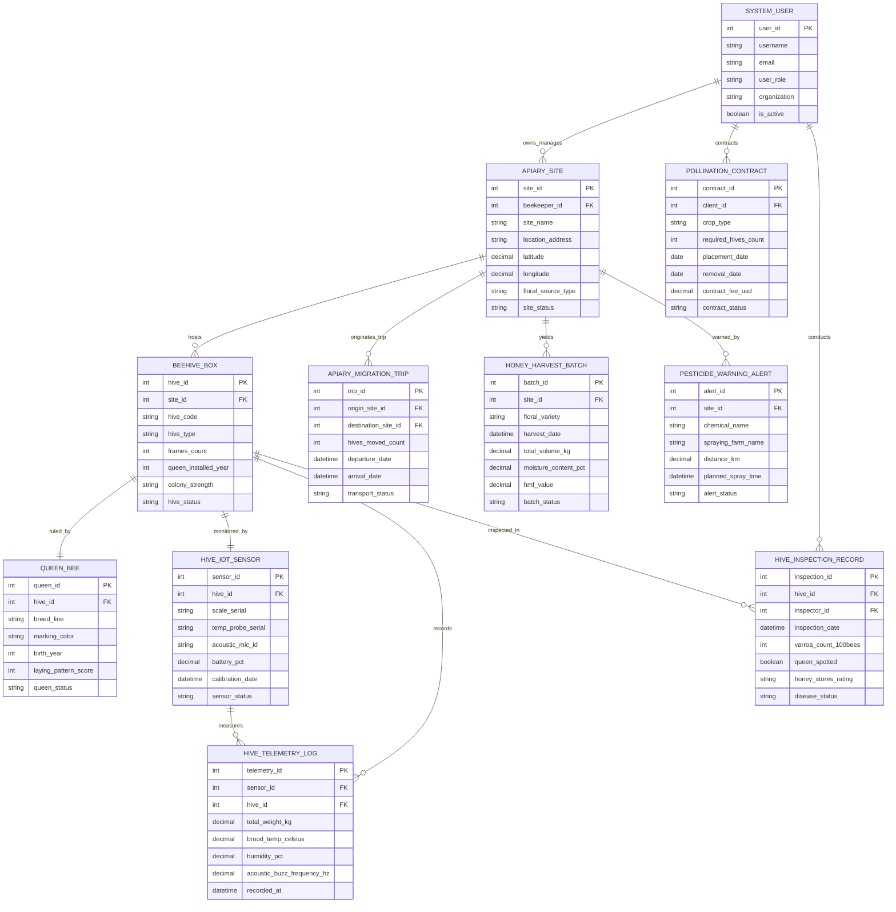

# Conceptual ERD — Beekeeping Management System

## Mermaid Code

## Entity Description Table | Bang Mo Ta Entity

| # | Entity Name | Vietnamese Name | Description | Key Attributes | Main Relationships |
|---|-------------|-----------------|-------------|----------------|-------------------|
| 1 | APIARY_SITE | Trạm Nuôi Ong Master | Stores apiary location GIS coordinates, address, floral forage type (Acacia, Coffee, Wildflower), capacity, and status | site_id, beekeeper_id, site_name, location_address, latitude, longitude, floral_source_type, site_status | Hosts BEEHIVE_BOX, originates MIGRATION, yields HONEY_HARVEST |
| 2 | BEEHIVE_BOX | Thùng Ong Nuôi | Represents individual hive boxes, frame capacity, hive type (Langstroth, Top-Bar), colony strength rating, and status | hive_id, site_id, hive_code, hive_type, frames_count, queen_installed_year, colony_strength, hive_status | Belongs to APIARY_SITE, ruled by QUEEN_BEE, monitored by HIVE_IOT_SENSOR |
| 3 | QUEEN_BEE | Ong Chúa | Tracks individual queen bee genetic line, birth year color marking (International Color Code), laying pattern score, and status | queen_id, hive_id, breed_line, marking_color, birth_year, laying_pattern_score, queen_status | Rules BEEHIVE_BOX |
| 4 | HIVE_IOT_SENSOR | Thước Đo Cảm Biến IoT | Stores IoT smart hive scale serial numbers, brood temperature probes, acoustic microphones, battery level, and calibration dates | sensor_id, hive_id, scale_serial, temp_probe_serial, acoustic_mic_id, battery_pct, sensor_status | Monitors BEEHIVE_BOX, measures HIVE_TELEMETRY_LOG |
| 5 | HIVE_TELEMETRY_LOG | Nhật Ký Dữ Liệu Cảm Biến | High-frequency telemetry storing total hive weight ($kg$), brood temp ($^\circ C$), humidity ($\%$), and acoustic buzz frequency ($Hz$) | telemetry_id, sensor_id, hive_id, total_weight_kg, brood_temp_celsius, humidity_pct, recorded_at | Measured by HIVE_IOT_SENSOR, recorded for BEEHIVE_BOX |
| 6 | HIVE_INSPECTION_RECORD | Nhật Ký Kiểm Tra Thùng Ong | Records physical hive inspections: Varroa mite count per 100 bees, queen spotting status, honey stores rating, and diseases | inspection_id, hive_id, inspector_id, inspection_date, varroa_count_100bees, queen_spotted, disease_status | Inspected for BEEHIVE_BOX, conducted by SYSTEM_USER |
| 7 | POLLINATION_CONTRACT | Hợp Đồng Dịch Vụ Thụ Phấn | Manages commercial crop pollination contracts with farmers, crop type, required hives count, rental fees ($USD$), and status | contract_id, client_id, crop_type, required_hives_count, placement_date, contract_fee_usd, contract_status | Contracted by SYSTEM_USER |
| 8 | APIARY_MIGRATION_TRIP | Chuyến Di Đàn Ong | Tracks transhumance migratory movements between apiary sites, hives count moved, departure/arrival dates, and status | trip_id, origin_site_id, destination_site_id, hives_moved_count, departure_date, arrival_date, transport_status | Originated from APIARY_SITE |
| 9 | HONEY_HARVEST_BATCH | Lô Mật Ong Thu Hoạch | Stores honey harvest batch details, floral variety, total weight ($kg$), moisture content ($\%$), HMF value, and batch QR codes | batch_id, site_id, floral_variety, harvest_date, total_volume_kg, moisture_content_pct, hmf_value | Yielded from APIARY_SITE |
| 10 | PESTICIDE_WARNING_ALERT | Cảnh Báo Phun Thuốc Trừ Sâu | Logs neighboring farm pesticide spraying notices, active chemical ingredients, distance ($km$), and alert notification status | alert_id, site_id, chemical_name, spraying_farm_name, distance_km, planned_spray_time, alert_status | Warns APIARY_SITE |
| 11 | SYSTEM_USER | Người Dùng Hệ Thống | Stores user accounts, roles (Beekeeper, Vet, Pollination Client, Admin), organizations, and security access permissions | user_id, username, email, user_role, organization, is_active | Owns APIARY_SITE, contracts POLLINATION, conducts INSPECTION |

## Relationship Description | Mo ta Quan he

| # | From Entity | Cardinality | To Entity | Relationship Label | Business Explanation |
|---|-------------|-------------|-----------|-------------------|----------------------|
| 1 | APIARY_SITE | one-to-many | BEEHIVE_BOX | hosts | An apiary site hosts multiple individual beehive boxes (e.g., 20 to 100 hives per site) |
| 2 | BEEHIVE_BOX | one-to-one | QUEEN_BEE | ruled_by | A healthy beehive box is ruled by exactly one primary laying queen bee |
| 3 | BEEHIVE_BOX | one-to-one | HIVE_IOT_SENSOR | monitored_by | A beehive box can be monitored by one active IoT scale and thermal/acoustic sensor sonde |
| 4 | HIVE_IOT_SENSOR | one-to-many | HIVE_TELEMETRY_LOG | measures | A hive IoT sensor measures continuous time-series weight, temperature, humidity, and acoustic logs |
| 5 | BEEHIVE_BOX | one-to-many | HIVE_TELEMETRY_LOG | records | A beehive box records aggregate telemetry log entries over time |
| 6 | BEEHIVE_BOX | one-to-many | HIVE_INSPECTION_RECORD | inspected_in | A beehive box undergoes periodic physical health and Varroa mite inspections |
| 7 | APIARY_SITE | one-to-many | APIARY_MIGRATION_TRIP | originates_trip | An apiary site originates migratory transhumance trips moving hives to new forage locations |
| 8 | APIARY_SITE | one-to-many | HONEY_HARVEST_BATCH | yields | An apiary site yields harvested honey extraction batches during peak nectar flows |
| 9 | APIARY_SITE | one-to-many | PESTICIDE_WARNING_ALERT | warned_by | An apiary site receives pesticide spraying early warning alerts from nearby agricultural farms |
| 10 | SYSTEM_USER | one-to-many | APIARY_SITE | owns_manages | A beekeeper system user owns and manages multiple apiary sites |
| 11 | SYSTEM_USER | one-to-many | POLLINATION_CONTRACT | contracts | A commercial farmer system user contracts pollination services with beekeepers |
| 12 | SYSTEM_USER | one-to-many | HIVE_INSPECTION_RECORD | conducts | A bee health inspector system user conducts veterinary inspections on beehives |
