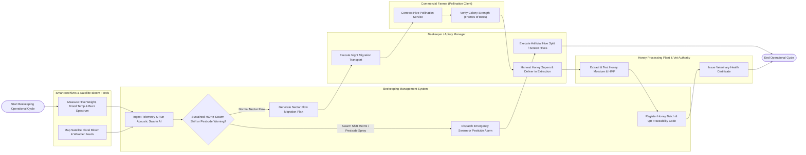

# Swimlane Diagram — Beekeeping Management System

## Mermaid Code

## Flow Description | Mo ta luong

| Lane | Actor | Role in Flow |
|------|-------|-------------|
| 1 | Smart Beehives & Satellite Bloom Feeds | Smart hive scale sondes measure total hive weight, brood temperature ($35^\circ C$), and acoustic buzz spectrum ($Hz$), while satellite remote sensing maps NDVI floral bloom availability |
| 2 | Beekeeping Management System | Ingests telemetry, executes FFT acoustic swarm detection AI models, evaluates pesticide spray buffer alerts, generates transhumance migration plans, and registers honey QR traceability barcodes |
| 3 | Beekeeper / Apiary Manager | Receives emergency pre-swarm acoustic alerts, performs artificial hive splits, executes night migratory hive transport to peak nectar flows, and harvests honey supers |
| 4 | Commercial Farmer (Pollination Client) | Contracts commercial beehive pollination services for crop bloom periods, verifies colony strength ($\ge 8$ frames of bees), and coordinates spray-free windows |
| 5 | Honey Processing Plant & Vet Authority | Extracts honey, tests moisture content ($<18.5\%$) and HMF levels ($<40\text{ mg/kg}$), verifies laboratory purity, and issues veterinary health certificates |
