# Action Tree — Beekeeping Management System

## Mermaid Code

```mermaid
graph TD
    Root["Beekeeping Management System"]

    Root --> M1["Apiary Site & Beehive Inventory Management"]
    Root --> M2["Smart Hive IoT Telemetry & Swarm Acoustic AI"]
    Root --> M3["Bee Colony Health, Varroa & Re-Queening"]
    Root --> M4["Nectar Bloom Mapping & Transhumance Migration"]
    Root --> M5["Commercial Pollination & Crop Service"]
    Root --> M6["Honey Harvesting, Extraction & Traceability"]
    Root --> M7["Pesticide Early Warning & System Admin"]

    M1 --> A11["Register Apiary Site GIS Location Polygons"]
    M1 --> A12["Define Beehive Box & Frame Inventory Types"]
    M1 --> A13["Track Hive Box Assignments & Capacity"]
    M1 --> A14["Map Apiary Forage Radius & Water Sources"]

    M2 --> A21["Ingest 15-Minute Hive Weight & Brood Temp Streams"]
    M2 --> A22["Execute FFT Acoustic Swarm Frequency AI Models"]
    M2 --> A23["Detect Imminent Pre-Swarm Acoustic Shifts"]
    M2 --> A24["Trigger Hive Theft & Anti-Tilt Motion Alarms"]

    M3 --> A31["Record Varroa Mite Counts per 100 Bees"]
    M3 --> A32["Log Foulbrood & Nosema Veterinary Treatments"]
    M3 --> A33["Track Queen Bee Pedigree & Laying Ratings"]
    M3 --> A34["Schedule Queen Marking & Artificial Splitting"]

    M4 --> A41["Ingest Satellite NDVI Floral Bloom Heatmaps"]
    M4 --> A42["Identify Peak Nectar Flow Forage Regions"]
    M4 --> A43["Plan Night Migratory Transport Routes"]
    M4 --> A44["Manage Transhumance Land Lease Agreements"]

    M5 --> A51["Manage Orchard Pollination Service Contracts"]
    M5 --> A52["Audit Hive Colony Strength Frames of Bees"]
    M5 --> A53["Schedule Hive Placement & Removal Dates"]
    M5 --> A54["Generate Pollination Invoices & Service Fees"]

    M6 --> A61["Log Honey Super Harvest Volumes & Varieties"]
    M6 --> A62["Measure Honey Moisture Content & HMF Values"]
    M6 --> A63["Verify Codex Alimentarius Honey Purity Limits"]
    M6 --> A64["Generate Consumer Traceability QR Code Barcodes"]

    M7 --> A71["Broadcast Neighboring Farm Pesticide Spray Warnings"]
    M7 --> A72["Retrain Hive Acoustic Swarm Classification Models"]
    M7 --> A73["Export Veterinary Health & Transit Certificates"]
    M7 --> A74["Manage User Access Roles & Security Credentials"]
```

## Module Description | Mo ta Module

| # | Module | Description | Actions |
|---|--------|-------------|---------|
| 1 | Apiary Site & Beehive Inventory Management | Manages apiary site GIS coordinates, floral forage types, hive box configurations, frame counts, and water source proximity | Register Apiary Site GIS Location Polygons, Define Beehive Box & Frame Inventory Types, Track Hive Box Assignments & Capacity, Map Apiary Forage Radius & Water Sources |
| 2 | Smart Hive IoT Telemetry & Swarm Acoustic AI | Ingests 15-minute telemetry (weight, brood temp, acoustic frequency), runs FFT swarm detection AI, and detects hive theft anti-tilt motion | Ingest 15-Minute Hive Weight & Brood Temp Streams, Execute FFT Acoustic Swarm Frequency AI Models, Detect Imminent Pre-Swarm Acoustic Shifts, Trigger Hive Theft & Anti-Tilt Motion Alarms |
| 3 | Bee Colony Health, Varroa & Re-Queening | Logs Varroa mite infestation counts, Foulbrood disease treatments, queen bee genetic lineages, laying scores, and artificial hive splits | Record Varroa Mite Counts per 100 Bees, Log Foulbrood & Nosema Veterinary Treatments, Track Queen Bee Pedigree & Laying Ratings, Schedule Queen Marking & Artificial Splitting |
| 4 | Nectar Bloom Mapping & Transhumance Migration | Overlays satellite NDVI floral bloom heatmaps, identifies nectar flow regions, plans night transhumance transport routes, and leases land | Ingest Satellite NDVI Floral Bloom Heatmaps, Identify Peak Nectar Flow Forage Regions, Plan Night Migratory Transport Routes, Manage Transhumance Land Lease Agreements |
| 5 | Commercial Pollination & Crop Service | Manages orchard crop pollination contracts (almonds, apples, berries), audits colony strength ($\ge 8$ frames), and schedules placement/removal | Manage Orchard Pollination Service Contracts, Audit Hive Colony Strength Frames of Bees, Schedule Hive Placement & Removal Dates, Generate Pollination Invoices & Service Fees |
| 6 | Honey Harvesting, Extraction & Traceability | Logs harvested honey volumes, measures moisture $\%$, tests HMF levels, verifies purity against CMM standards, and generates QR barcodes | Log Honey Super Harvest Volumes & Varieties, Measure Honey Moisture Content & HMF Values, Verify Codex Alimentarius Honey Purity Limits, Generate Consumer Traceability QR Code Barcodes |
| 7 | Pesticide Early Warning & System Admin | Broadcasts neighbor farm pesticide spray warnings, retrains acoustic swarm AI models, exports veterinary health certificates, and manages security roles | Broadcast Neighboring Farm Pesticide Spray Warnings, Retrain Hive Acoustic Swarm Classification Models, Export Veterinary Health & Transit Certificates, Manage User Access Roles & Security Credentials |
