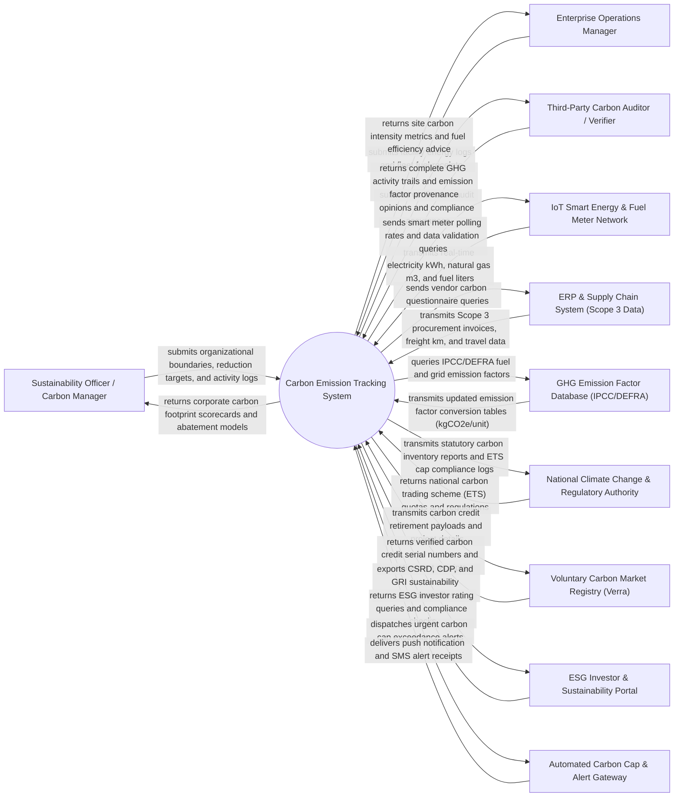

# Context Diagram — Carbon Emission Tracking System

## Mermaid Code

## Actor & Interaction Table | Bang Actor & Tuong tac

| # | Actor | Actor Type | Data Sent TO System | Data Received FROM System | Notes |
|---|-------|------------|---------------------|---------------------------|-------|
| 1 | Sustainability Officer / Carbon Manager | Primary | Corporate organizational boundaries, Science Based Targets (SBTi), activity data logs | Total corporate carbon footprint ($tCO_2e$), Scope 1/2/3 breakdown, Marginal Abatement Cost (MAC) curves | Primary internal user responsible for corporate decarbonization strategy and GHG accounting |
| 2 | Enterprise Operations Manager | Primary | Facility operational fuel receipts, utility bills, fleet mileage, machinery hours | Facility carbon intensity ($tCO_2e/\text{unit produced}$), energy efficiency recommendations | Site manager tracking operational emissions across manufacturing plants and logistics fleets |
| 3 | Third-Party Carbon Auditor / Verifier | Primary | Formal ISO 14064 verification opinions, audit finding notes, assurance statements | Immutable GHG activity trails, raw data evidence files, emission factor calculation provenance | Independent certified auditor validating corporate carbon inventories for regulatory compliance |
| 4 | IoT Smart Energy & Fuel Meter Network | Supporting System | Real-time smart electricity meter readings ($kWh$), natural gas meters ($m^3$), diesel fuel dispenser logs | Meter polling frequency parameters, data packet heartbeat queries, zero-calibration offsets | Automated physical IoT meters tracking direct fuel and electricity consumption across facilities |
| 5 | ERP & Supply Chain System (Scope 3 Data) | Supporting System | Purchased goods invoices, freight transportation ($ton\cdot km$), business travel itineraries, waste volumes | Supplier carbon questionnaires, Scope 3 vendor allocation factors, product carbon footprints | Corporate ERP system (e.g., SAP, Oracle) supplying upstream and downstream value chain activity data |
| 6 | GHG Emission Factor Database (IPCC/DEFRA) | Supporting System | Conversion factors ($kgCO_2e/\text{unit}$), GWP values ($CO_2, CH_4, N_2O$), regional grid emission factors | Fuel code queries, country grid intensity requests, factor version lookup payloads | Recognized international databases (IPCC 6th Assessment, UK DEFRA, US EPA eGRID, IEA) |
| 7 | National Climate Change & Regulatory Authority | Regulatory System | Statutory carbon reporting mandates, Emissions Trading Scheme (ETS) cap allocations | Annual national GHG inventory submissions, ETS compliance logs, carbon tax returns | Government authority regulating corporate carbon emissions and enforcing climate disclosure laws |
| 8 | Voluntary Carbon Market Registry (Verra) | Supporting System | Carbon credit issuance data, project methodologies (VCS, Gold Standard) | Credit retirement requests, serial number verification payloads, project credit transfers | International registry tracking verified carbon offset credits purchased for carbon neutrality claims |
| 9 | ESG Investor & Sustainability Portal | Supporting System | Sustainability disclosure frameworks (CSRD, CDP, GRI, TCFD, ISSB) | Standardized ESG carbon disclosure exports, carbon risk ratings, climate transition plans | Institutional investor platforms and reporting frameworks consuming verified carbon metrics |
| 10 | Automated Carbon Cap & Alert Gateway | Supporting System | SMS delivery receipts, alert dispatch status logs | High-priority carbon cap breach alerts, sudden fuel leak warnings, target deviation warnings | Notification gateway dispatching urgent alerts to management when emissions exceed monthly carbon budgets |

## System Boundary Description | Mo ta Pham vi He thong

The **Carbon Emission Tracking System** is an enterprise Greenhouse Gas (GHG) accounting and sustainability management platform designed to automate the collection, calculation, audit verification, and disclosure of corporate carbon footprints across Scope 1 (Direct), Scope 2 (Indirect Energy), and Scope 3 (Value Chain) emissions.

The **system boundary** encompasses organizational boundary definition (operational control vs financial control), automated activity data ingestion, GHG Protocol calculation engines, emission factor database management, Science Based Target (SBTi) progress tracking, marginal abatement cost (MAC) modeling, carbon credit offset retirement, and automated ESG reporting (CDP, CSRD, GRI).

**External to the system boundary** are physical atmospheric greenhouse gas mole fraction dynamics, physical combustion of fossil fuels in engines, physical electricity generation in power plants, legal court prosecution of fraud, and physical tree growth in forest offset projects. Interfaces operate via secure HTTPS REST APIs, MQTT IoT telematics feeds, and standardized XML/JSON reporting data formats.
