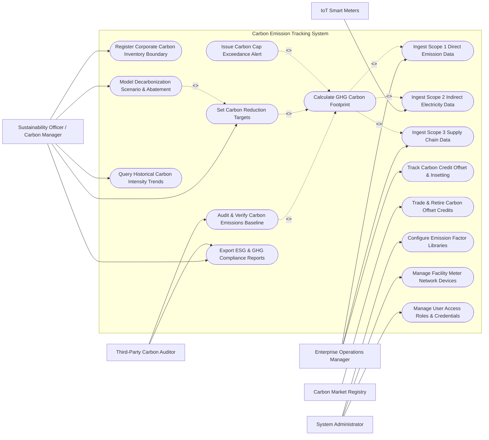

# Use Case Diagram — Carbon Emission Tracking System

## Mermaid Code

## Actor Table | Bang Actor

| # | Actor | Actor Type | Role Description | Related Use Cases |
|---|-------|------------|------------------|-------------------|
| 1 | Sustainability Officer / Carbon Manager | Primary | Corporate executive establishing GHG inventory boundaries, setting SBTi reduction targets, and managing carbon disclosure | UC01, UC07, UC09, UC12, UC13 |
| 2 | Enterprise Operations Manager | Primary | Facility manager providing operational activity data (Scope 1/2/3), fuel receipts, and tracking offset projects | UC02, UC04, UC08 |
| 3 | Third-Party Carbon Auditor | Primary | Certified ISO 14064 auditor inspecting corporate carbon inventory trails and issuing formal verification assurance | UC06, UC13 |
| 4 | System Administrator | Primary | Technical admin configuring emission factor libraries (IPCC/DEFRA), smart meter networks, and security roles | UC14, UC15, UC16 |
| 5 | IoT Smart Meters | Secondary / System | Automated smart meters streaming real-time electricity ($kWh$), natural gas ($m^3$), and fuel consumption | UC03 |
| 6 | Carbon Market Registry | Secondary / System | External carbon credit registry (Verra / Gold Standard) verifying and retiring carbon offset certificates | UC11 |

## Use Case Table | Bang Use Case

| # | UC ID | Use Case Name | Primary Actor | Secondary Actor | Description | Priority |
|---|-------|---------------|---------------|-----------------|-------------|----------|
| 1 | UC01 | Register Corporate Carbon Inventory Boundary | Carbon Manager | None | Defines corporate organizational boundaries (operational vs financial control), facilities, and consolidation approach | High |
| 2 | UC02 | Ingest Scope 1 Direct Emission Data | Operations Manager | System | Ingests stationary combustion, mobile fleet fuel receipts, and fugitive refrigerant leakage data | High |
| 3 | UC03 | Ingest Scope 2 Indirect Electricity Data | Operations Manager | IoT Meters | Ingests purchased electricity ($kWh$), steam, heating, and cooling utility billing and smart meter feeds | High |
| 4 | UC04 | Ingest Scope 3 Supply Chain Data | Operations Manager | ERP System | Collects value chain activity data: purchased goods, freight transportation ($t\cdot km$), waste, business travel | High |
| 5 | UC05 | Calculate GHG Carbon Footprint | Carbon Manager | System | Computes $CO_2, CH_4, N_2O$ emissions in metric tons of $CO_2$ equivalent ($tCO_2e$) using global warming potentials | High |
| 6 | UC06 | Audit & Verify Carbon Emissions Baseline | Carbon Auditor | System | Inspects raw activity evidence, audit trails, and emission factor provenance to issue ISO 14064 verification | High |
| 7 | UC07 | Set Carbon Reduction Targets | Carbon Manager | System | Configures near-term and long-term Science Based Targets (SBTi) for $1.5^\circ C$ decarbonization pathways | High |
| 8 | UC08 | Track Carbon Credit Offset & Insetting | Operations Manager | Carbon Registry | Logs internal carbon insetting initiatives (solar panels, reforestation) and purchased offset credit volumes | Medium |
| 9 | UC09 | Model Decarbonization Scenario & Abatement | Carbon Manager | System | Generates Marginal Abatement Cost (MAC) curves to evaluate ROI ($USD/tCO_2e$) of energy efficiency projects | High |
| 10 | UC10 | Issue Carbon Cap Exceedance Alert | System | Notification Gateway | Dispatches emergency alerts when monthly facility emissions breach assigned corporate carbon budget caps | High |
| 11 | UC11 | Trade & Retire Carbon Offset Credits | Carbon Manager | Carbon Registry | Executes electronic carbon credit retirement on Verra/Gold Standard registries for net-zero claims | Medium |
| 12 | UC12 | Query Historical Carbon Intensity Trends | Carbon Manager | None | Provides searchable historical database of carbon intensity metrics ($tCO_2e/\text{revenue}$ or $tCO_2e/\text{unit product}$) | Low |
| 13 | UC13 | Export ESG & GHG Compliance Reports | Carbon Manager | Carbon Auditor | Exports standardized ESG disclosure packages: CDP questionnaire, CSRD, GRI 305, TCFD, and GHG Protocol reports | High |
| 14 | UC14 | Configure Emission Factor Libraries | System Administrator | System | Manages versioned IPCC, DEFRA, US EPA eGRID, and country-specific grid emission factor conversion tables | High |
| 15 | UC15 | Manage Facility Meter Network Devices | System Administrator | IoT Meters | Monitors smart meter gateway health, polling rates, data validation rules, and sensor communication status | Medium |
| 16 | UC16 | Manage User Access Roles & Credentials | System Administrator | None | Configures user accounts, corporate roles (Manager, Operations, Auditor, Admin), and security API keys | Low |

## Use Case Specification | Dac ta Use Case

---

### UC01 — Register Corporate Carbon Inventory Boundary

| Field | Detail |
|-------|--------|
| **UC ID** | UC01 |
| **Use Case Name** | Register Corporate Carbon Inventory Boundary |
| **Actor(s)** | Primary: Sustainability Officer / Carbon Manager   Secondary: None |
| **Description** | Establishes corporate organizational and operational boundaries for Greenhouse Gas (GHG) accounting, selecting consolidation approach (Operational Control, Financial Control, or Equity Share) and mapping facilities and subsidiaries. |
| **Precondition** | 1. Carbon Manager is authenticated with corporate governance privileges.   2. Corporate organizational chart, facility list, and ownership percentages are available. |
| **Main Flow** | 1. Carbon Manager opens "Organizational Boundary Configuration" in the portal.   2. Manager selects global reporting period (e.g., Fiscal Year 2026).   3. Manager selects GHG Protocol consolidation approach:   &nbsp;&nbsp;&nbsp;&nbsp;a. **Operational Control**: $100\%$ emissions included for facilities over which entity has operational authority.   &nbsp;&nbsp;&nbsp;&nbsp;b. **Financial Control**: $100\%$ emissions included for facilities where entity holds financial control.   &nbsp;&nbsp;&nbsp;&nbsp;c. **Equity Share**: Emissions accounted according to percentage equity ownership.   4. Manager registers legal corporate subsidiaries, joint ventures, and operating divisions.   5. Manager adds physical facility sites (manufacturing plants, warehouses, office buildings, retail outlets) attaching geographic coordinates and square footage.   6. Manager defines included GHG emission scopes (Scope 1, Scope 2, Scope 3 categories 1-15).   7. System validates boundary completeness against ISO 14064-1 structural criteria.   8. System saves corporate inventory boundary profile and sets status to `BOUNDARY_ACTIVE`. |
| **Alternative Flow** | **AF1** — Multi-National Jurisdiction Setup: Manager configures region-specific boundary rules (e.g., EU ETS boundary vs US EPA GHGRP boundary) for global multi-national corporations. |
| **Exception Flow** | **EX1** — Unallocated Facility Conflict: System detects a facility owned by a subsidiary with $0\%$ assigned consolidation rule, blocking boundary lock until equity rule is specified. |
| **Postcondition** | Corporate organizational boundary defined, saved in database, and established as baseline for all Scope 1, 2, and 3 calculations. |
| **Business Rule** | **BR1**: Consolidation approach must remain consistent across reporting years unless formal structural recalculation occurs. |

---

### UC03 — Ingest Scope 2 Indirect Electricity Data

| Field | Detail |
|-------|--------|
| **UC ID** | UC03 |
| **Use Case Name** | Ingest Scope 2 Indirect Electricity Data |
| **Actor(s)** | Primary: Enterprise Operations Manager   Secondary: IoT Smart Meters |
| **Description** | Collects purchased electricity ($kWh$), steam, heating, and cooling consumption data from utility billing invoices and automated smart meter feeds, enabling dual-reporting under Location-Based and Market-Based methods. |
| **Precondition** | 1. Facility sites are registered within the corporate inventory boundary (UC01).   2. Smart utility meter API connections or utility invoice upload functions are enabled. |
| **Main Flow** | 1. Operations Manager or automated smart meter system initiates Scope 2 data entry for a target facility.   2. System ingests electricity consumption activity data via:   &nbsp;&nbsp;&nbsp;&nbsp;a. **Automated IoT Smart Meter Feed**: Streams hourly/daily $kWh$ consumption logs.   &nbsp;&nbsp;&nbsp;&nbsp;b. **Utility Invoice Data Capture**: Parses monthly utility bills ($kWh$, billing period, utility provider name).   3. System checks for contractual Renewable Energy Certificates (RECs), Power Purchase Agreements (PPAs), or Green Tariff certificates attached to the facility.   4. System validates consumption data against historical facility baselines to detect anomalous data spikes.   5. System attaches relevant grid emission factors:   &nbsp;&nbsp;&nbsp;&nbsp;a. **Location-Based**: Regional grid average emission factor (e.g., eGRID / IEA $kgCO_2e/kWh$).   &nbsp;&nbsp;&nbsp;&nbsp;b. **Market-Based**: Supplier-specific factor or REC zero-emission credit ($0.0\text{ kgCO}_2\text{e/kWh}$).   6. System stores validated electricity consumption activity record in time-series database.   7. System updates Scope 2 emission counters for the target facility and corporate dashboard. |
| **Alternative Flow** | **AF1** — Purchased Steam & District Heating: Manager enters purchased steam volume ($GJ$ or $MMBtu$) and boiler efficiency metrics for industrial heating. |
| **Exception Flow** | **EX1** — Unmatched Utility Provider Grid Factor: System cannot match utility provider to known grid factor; system prompts admin to assign country default grid factor (UC14). |
| **Postcondition** | Scope 2 electricity activity data recorded, validated, and prepared for dual-method GHG footprint calculation. |
| **Business Rule** | **BR1**: Scope 2 reporting must strictly mandate dual-reporting (both Location-Based and Market-Based totals) per GHG Protocol Scope 2 Guidance. |

---

### UC05 — Calculate GHG Carbon Footprint (CO2e)

| Field | Detail |
|-------|--------|
| **UC ID** | UC05 |
| **Use Case Name** | Calculate GHG Carbon Footprint (CO2e) |
| **Actor(s)** | Primary: Sustainability Officer / Carbon Manager   Secondary: System |
| **Description** | Executes mathematical GHG calculation algorithms by multiplying Scope 1, Scope 2, and Scope 3 activity data by versioned emission factors, applying Global Warming Potentials (GWP), and outputting total carbon footprint in metric tons of $CO_2$ equivalent ($tCO_2e$). |
| **Precondition** | 1. Activity data for Scope 1 (UC02), Scope 2 (UC03), and Scope 3 (UC04) is ingested.   2. Validated GHG emission factor database (IPCC/DEFRA) is active (UC14). |
| **Main Flow** | 1. Carbon Manager triggers "Calculate GHG Footprint" for a selected reporting period (e.g., Q1 2026).   2. System retrieves activity data ($A_i$) across all facilities, fuel types, electricity grids, and value chain categories.   3. System matches each activity record with corresponding emission factors ($EF_i$) for individual gases ($CO_2, CH_4, N_2O, HFCs, PFCs, SF_6, NF_3$).   4. System calculates gas mass emissions:   &nbsp;&nbsp;&nbsp;&nbsp;$$E_{gas} = A_i \times EF_{gas}$$   5. System applies IPCC Global Warming Potential (GWP) factors (e.g., IPCC 6th Assessment: $CO_2=1, CH_4=27.9, N_2O=273$) to convert individual gas masses into $CO_2$ equivalent:   &nbsp;&nbsp;&nbsp;&nbsp;$$\text{Emission } (tCO_2e) = \sum \left( E_{gas} \times GWP_{gas} \right) / 1000$$   6. System sums emissions across categories:   &nbsp;&nbsp;&nbsp;&nbsp;$$\text{Total Footprint} = \text{Scope 1 } (tCO_2e) + \text{Scope 2 } (tCO_2e) + \text{Scope 3 } (tCO_2e)$$   7. System computes corporate carbon intensity ratios ($tCO_2e / \text{Million USD Revenue}$ and $tCO_2e / \text{Full Time Employee}$).   8. System stores total footprint results, generates Scope 1/2/3 breakdown charts, and checks against corporate carbon budgets (UC10). |
| **Alternative Flow** | **AF1** — Biogenic Carbon Segregation: System calculates biogenic $CO_2$ emissions (combustion of biofuel, biomass) and reports it separately outside Scope 1/2/3 totals per GHG Protocol rules. |
| **Exception Flow** | **EX1** — Missing GWP Conversion Factor: Activity record contains rare HFC refrigerant gas missing GWP factor in active library; system flags calculation as `INCOMPLETE_GWP_FACTOR` and alerts admin. |
| **Postcondition** | Total corporate carbon footprint ($tCO_2e$), intensity ratios, and Scope 1/2/3 breakdowns stored in database and ready for audit verification. |
| **Business Rule** | **BR1**: GWP values must be sourced from the latest IPCC Assessment Report (AR6) unless specific regulatory framework requires earlier versions (e.g., AR5/AR4). |

---

### UC06 — Audit & Verify Carbon Emissions Baseline

| Field | Detail |
|-------|--------|
| **UC ID** | UC06 |
| **Use Case Name** | Audit & Verify Carbon Emissions Baseline |
| **Actor(s)** | Primary: Third-Party Carbon Auditor / Verifier   Secondary: System |
| **Description** | Enables a certified independent auditor to inspect corporate GHG activity data trails, verify emission factor choices, examine raw billing evidence, and issue a formal ISO 14064-3 Verification Opinion and Assurance Statement. |
| **Precondition** | 1. Corporate GHG footprint calculation (UC05) for reporting period is locked and submitted for audit.   2. Third-Party Auditor is authenticated with external auditor access privileges. |
| **Main Flow** | 1. Auditor opens "Third-Party Audit Workspace" and selects corporate footprint file.   2. System presents complete GHG Inventory Dossier: Scope 1/2/3 totals, facility breakdown, activity data logs, raw billing PDFs, and matched emission factor sources.   3. Auditor samples high-emission activity records (e.g., Top 20% natural gas and electricity consumers) to verify raw invoice matches.   4. Auditor inspects emission factor selection logic (verifies correct GWP AR6 factors and regional grid intensity selections).   5. Auditor logs audit queries or data discrepancy flags (e.g., "Facility B fuel receipt missing for November 2025").   6. Carbon Manager uploads requested supplementary evidence or corrected activity logs.   7. Auditor assesses overall inventory materiality threshold (verifies aggregate errors are $< 5\%$ of total footprint).   8. Auditor selects assurance level (**Reasonable Assurance** or **Limited Assurance**) and uploads signed ISO 14064-3 Verification Opinion document.   9. System locks reporting period footprint as `AUDITED_AND_VERIFIED` and attaches digital verification badge. |
| **Alternative Flow** | **AF1** — Structural Baseline Recalculation Audit: If corporation acquired a major subsidiary, auditor verifies baseline recalculation adjustments to historical 2020 baseline year. |
| **Exception Flow** | **EX1** — Material Misstatement Unresolved: Unexplained errors exceed 5% materiality threshold and company fails to fix data; auditor issues `ADVERSE_VERIFICATION_OPINION`, flagging file as unverified. |
| **Postcondition** | Corporate carbon footprint locked as `VERIFIED`, ISO 14064-3 verification certificate attached, and ready for ESG public disclosure (UC13). |
| **Business Rule** | **BR1**: Once verified by third-party auditor, historical carbon inventory data cannot be edited without formal baseline recalculation workflow. |

---

### UC07 — Set Carbon Reduction Targets (SBTi Standards)

| Field | Detail |
|-------|--------|
| **UC ID** | UC07 |
| **Use Case Name** | Set Carbon Reduction Targets (SBTi Standards) |
| **Actor(s)** | Primary: Sustainability Officer / Carbon Manager   Secondary: System |
| **Description** | Configures corporate near-term (2030) and long-term Net-Zero (2050) carbon reduction targets aligned with Science Based Targets initiative (SBTi) $1.5^\circ C$ decarbonization pathways, tracking annual target progress. |
| **Precondition** | 1. Audited baseline year GHG carbon footprint (e.g., 2020 Baseline $100,000\text{ tCO}_2\text{e}$) is established (UC06). |
| **Main Flow** | 1. Carbon Manager opens "Carbon Target Setting & SBTi Tracker" module.   2. Manager selects target ambition pathway (e.g., **$1.5^\circ C$ Alignment** requiring $4.2\%$ linear annual absolute reduction).   3. Manager configures target parameters:   &nbsp;&nbsp;&nbsp;&nbsp;a. **Near-Term Target**: e.g., Reduce Scope 1 & 2 GHG emissions by $50\%$ by 2030 from a 2020 baseline year.   &nbsp;&nbsp;&nbsp;&nbsp;b. **Scope 3 Target**: e.g., Reduce Scope 3 supply chain emissions by $30\%$ by 2030.   &nbsp;&nbsp;&nbsp;&nbsp;c. **Long-Term Net-Zero Target**: e.g., Reach Net-Zero emissions ($90\%$ absolute reduction + $10\%$ carbon removal) by 2050.   4. System calculates required annual target trajectory milestones ($tCO_2e/year$) from baseline year to target year.   5. System compares current year calculated carbon footprint against the target trajectory curve.   6. System calculates target progress status ($\%$ reduction achieved to date, variance from $1.5^\circ C$ trajectory).   7. System updates corporate sustainability dashboard displaying target status (`ON_TRACK` or `BEHIND_TARGET`). |
| **Alternative Flow** | **AF1** — Intensity-Based Target Setting: Manager configures economic intensity target (e.g., Reduce $tCO_2e/\text{million USD revenue}$ by $60\%$ by 2030). |
| **Exception Flow** | **EX1** — Non-Compliant SBTi Target Rate: Target reduction rate is set to $1.5\%$ per year (below mandatory $4.2\%$ minimum for $1.5^\circ C$ alignment); system flags target as `NON_SBTI_COMPLIANT_TOO_LOW`. |
| **Postcondition** | SBTi-aligned carbon reduction targets saved in database and active on executive ESG monitoring dashboards. |
| **Business Rule** | **BR1**: Absolute reduction targets for Scope 1 and Scope 2 must meet or exceed a minimum $4.2\%$ annual linear reduction rate for $1.5^\circ C$ alignment. |
