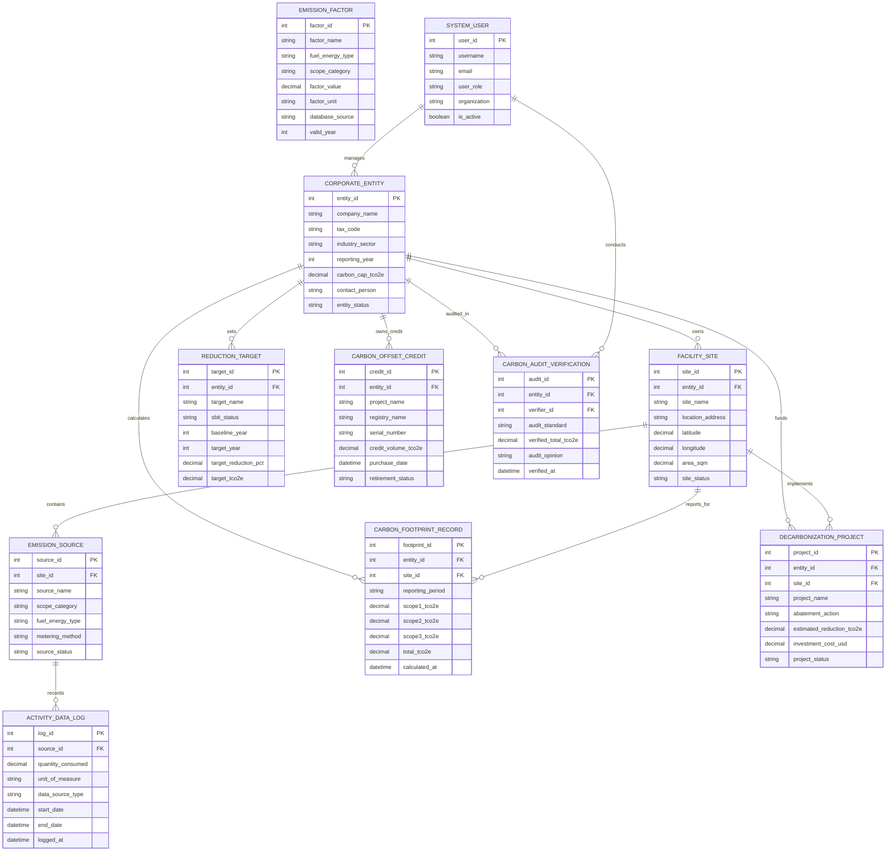

# Conceptual ERD — Carbon Emission Tracking System

## Mermaid Code

## Entity Description Table | Bang mo ta Entity

| # | Entity Name | Vietnamese Name | Description | Key Attributes | Main Relationships |
|---|-------------|-----------------|-------------|----------------|-------------------|
| 1 | CORPORATE_ENTITY | Doanh Nghiệp / Tập Đoàn | Stores legal corporate identity, industry sector, tax code, carbon consolidation rules, and carbon budget cap | entity_id, company_name, tax_code, industry_sector, carbon_cap_tco2e, entity_status | Owns FACILITY_SITE, calculates FOOTPRINT, sets TARGET, audited in VERIFICATION |
| 2 | FACILITY_SITE | Cơ Sở / Nhà Máy | Represents physical manufacturing plants, warehouses, office buildings, location coordinates, and area ($m^2$) | site_id, entity_id, site_name, location_address, latitude, area_sqm, site_status | Belongs to CORPORATE_ENTITY, contains EMISSION_SOURCE, reports FOOTPRINT |
| 3 | EMISSION_SOURCE | Nguồn Phát Thải | Identifies individual point sources of emissions (boilers, generator engines, fleet vehicles, purchased grid power, ERP Scope 3) | source_id, site_id, source_name, scope_category, fuel_energy_type, metering_method | Belongs to FACILITY_SITE, records ACTIVITY_DATA_LOG |
| 4 | ACTIVITY_DATA_LOG | Nhật Ký Dữ Liệu Hoạt Động | Time-series operational activity data logs (liters of diesel, $m^3$ of gas, $kWh$ of electricity, $t\cdot km$ freight) | log_id, source_id, quantity_consumed, unit_of_measure, data_source_type, start_date | Belongs to EMISSION_SOURCE |
| 5 | EMISSION_FACTOR | Hệ Số Phát Thải Carbon | Repository of conversion factors ($kgCO_2e/\text{unit}$) from IPCC, DEFRA, eGRID libraries used to convert activity into $tCO_2e$ | factor_id, factor_name, fuel_energy_type, scope_category, factor_value, database_source | Applied in GHG calculations |
| 6 | CARBON_FOOTPRINT_RECORD | Kết Quả Dấu Chân Carbon | Holds computed Scope 1, Scope 2, Scope 3, and total carbon footprint totals ($tCO_2e$) and intensity ratios | footprint_id, entity_id, site_id, reporting_period, scope1_tco2e, scope2_tco2e, total_tco2e | Calculated for CORPORATE_ENTITY and FACILITY_SITE |
| 7 | REDUCTION_TARGET | Mục Tiêu Giảm Phát Thải | Stores near-term and long-term Science Based Targets (SBTi $1.5^\circ C$), baseline years, target years, and reduction % | target_id, entity_id, target_name, sbti_status, baseline_year, target_year, target_tco2e | Set by CORPORATE_ENTITY |
| 8 | CARBON_OFFSET_CREDIT | Tín Chỉ Carbon Bù Trừ | Tracks purchased or generated voluntary carbon offset credits (Verra/Gold Standard), serial numbers, and retirement status | credit_id, entity_id, project_name, registry_name, serial_number, credit_volume_tco2e | Owned and retired by CORPORATE_ENTITY |
| 9 | DECARBONIZATION_PROJECT | Dự Án Giảm Thiểu Carbon | Manages energy efficiency, solar installation, and fuel switching projects, estimated abatement ($tCO_2e$), and CAPEX | project_id, entity_id, site_id, project_name, abatement_action, estimated_reduction_tco2e | Funded by CORPORATE_ENTITY, implemented at FACILITY_SITE |
| 10 | CARBON_AUDIT_VERIFICATION | Báo Cáo Thẩm Định Carbon | Records ISO 14064 third-party audit verification opinions, verified emissions, materiality scores, and assurance levels | audit_id, entity_id, verifier_id, audit_standard, verified_total_tco2e, audit_opinion | Audited for CORPORATE_ENTITY, conducted by SYSTEM_USER |
| 11 | SYSTEM_USER | Người Dùng Hệ Thống | Stores user accounts, corporate roles (Carbon Manager, Operations, Auditor, Admin), organizations, and security keys | user_id, username, user_role, organization, is_active | Conducts CARBON_AUDIT_VERIFICATION, manages CORPORATE_ENTITY |

## Relationship Description | Mo ta Quan he

| # | From Entity | Cardinality | To Entity | Relationship Label | Business Explanation |
|---|-------------|-------------|-----------|-------------------|----------------------|
| 1 | CORPORATE_ENTITY | one-to-many | FACILITY_SITE | owns | A corporate entity owns or operates multiple physical facility sites, plants, and office buildings |
| 2 | FACILITY_SITE | one-to-many | EMISSION_SOURCE | contains | A facility site contains multiple Scope 1, Scope 2, and Scope 3 emission sources and equipment |
| 3 | EMISSION_SOURCE | one-to-many | ACTIVITY_DATA_LOG | records | An emission source records continuous operational activity data logs (fuel liters, electricity kWh) |
| 4 | CORPORATE_ENTITY | one-to-many | CARBON_FOOTPRINT_RECORD | calculates | A corporate entity calculates periodic total carbon footprint records across all scopes and reporting periods |
| 5 | FACILITY_SITE | one-to-many | CARBON_FOOTPRINT_RECORD | reports_for | A facility site reports individual site-level carbon footprint records and intensity ratios |
| 6 | CORPORATE_ENTITY | one-to-many | REDUCTION_TARGET | sets | A corporate entity sets near-term and long-term Science Based Targets (SBTi) for decarbonization |
| 7 | CORPORATE_ENTITY | one-to-many | CARBON_OFFSET_CREDIT | owns_credit | A corporate entity owns and retires carbon offset credits from carbon registries to neutralize emissions |
| 8 | CORPORATE_ENTITY | one-to-many | DECARBONIZATION_PROJECT | funds | A corporate entity funds internal decarbonization and energy efficiency capital expenditure projects |
| 9 | FACILITY_SITE | one-to-many | DECARBONIZATION_PROJECT | implements | A facility site implements energy efficiency and fuel switching decarbonization projects |
| 10 | CORPORATE_ENTITY | one-to-many | CARBON_AUDIT_VERIFICATION | audited_in | A corporate entity undergoes third-party ISO 14064 audit verification reviews annually |
| 11 | SYSTEM_USER | one-to-many | CARBON_AUDIT_VERIFICATION | conducts | An independent certified auditor system user conducts carbon verification audits |
