# Swimlane Diagram — Carbon Emission Tracking System

## Mermaid Code

```mermaid
flowchart LR
    Start(["Start Annual Carbon Accounting Cycle"])

    subgraph DataIngestionLane["IoT Smart Meters & Supply Chain ERP"]
        S1["Stream Real-Time Electricity & Fuel Logs"]
        S2["Upload Freight & Scope 3 Procurement Data"]
    end

    subgraph SystemLane["Carbon Emission Tracking System"]
        M1["Ingest & Validate Activity Data Logs"]
        M2["Match Emission Factors & Calculate tCO2e"]
        M3["Check Monthly Emissions against Carbon Cap"]
        M4{"Carbon Cap Exceeded or Target Gap?"}
        M5["Lock Inventory & Compile ISO 14064 File"]
        M6["Execute Carbon Credit Offset Retirement"]
    end

    subgraph ManagerLane["Sustainability Officer / Carbon Manager"]
        A1["Set SBTi Reduction Targets & Boundaries"]
        A2["Review Scope 1, 2 & 3 Footprint Breakdown"]
        A3["Evaluate Decarbonization MAC Projects"]
    end

    subgraph AuditorLane["Third-Party Carbon Auditor"]
        G1["Inspect Activity Audit Trails & Invoices"]
        G2{"Material Errors < 5%?"}
        G3["Issue Signed ISO 14064 Verification"]
        G4["Request Data Clarification"]
    end

    subgraph RegistryLane["Carbon Market Registry & Regulatory EPA"]
        R1["Verify & Retire Carbon Offset Serials"]
        R2["Receive Annual Statutory Carbon Disclosure"]
    end

    Finish(["End Reporting Cycle"])

    Start --> A1 --> S1 --> S2 --> M1 --> M2 --> M3 --> M4
    M4 -->|"Yes"| A3 --> M6 --> R1
    M4 -->|"No"| A2 --> M5 --> G1 --> G2
    G2 -->|"No"| G4 --> M1
    G2 -->|"Yes"| G3 --> R2 --> Finish
```

## Flow Description | Mo ta luong

| Lane | Actor | Role in Flow |
|------|-------|-------------|
| 1 | IoT Smart Meters & Supply Chain ERP | Streams automated real-time facility electricity ($kWh$) and fuel consumption logs, and uploads Scope 3 procurement invoices and freight transport ($t\cdot km$) activity data |
| 2 | Carbon Emission Tracking System | Ingests activity data, matches conversion factors from IPCC/DEFRA libraries, calculates total GHG emissions ($tCO_2e$), evaluates emissions against corporate carbon caps, generates MAC decarbonization curves, and manages credit retirements |
| 3 | Sustainability Officer / Carbon Manager | Establishes organizational inventory boundaries, configures Science Based Targets (SBTi), reviews Scope 1/2/3 footprint breakdowns, evaluates energy efficiency abatement projects, and purchases offset credits |
| 4 | Third-Party Carbon Auditor | Inspects raw activity evidence, utility bills, and emission factor logic, verifies inventory materiality thresholds ($<5\%$ error limit), and issues formal ISO 14064-3 verification assurance statements |
| 5 | Carbon Market Registry & Regulatory EPA | Verifies cryptographic carbon credit serial numbers on registries (Verra / Gold Standard), executes credit retirement transactions for net-zero claims, and ingests statutory ESG carbon disclosures |
