# Action Tree — Carbon Emission Tracking System

## Mermaid Code

```mermaid
graph TD
    Root["Carbon Emission Tracking System"]

    Root --> M1["Organizational Boundary & Facility Admin"]
    Root --> M2["Scope 1, Scope 2 & Scope 3 Ingestion"]
    Root --> M3["GHG Calculation & Emission Factor Engine"]
    Root --> M4["Decarbonization Targets & Abatement Modeling"]
    Root --> M5["Carbon Offset Credit Trading & Insetting"]
    Root --> M6["Third-Party Audit & ESG Compliance Disclosure"]
    Root --> M7["Smart Meter Network & System Administration"]

    M1 --> A11["Register Corporate Consolidation Boundaries"]
    M1 --> A12["Define Subsidiary Equity & Control Rules"]
    M1 --> A13["Configure Facility Site GPS & Area Metadata"]
    M1 --> A14["Establish Baseline Reporting Year Parameters"]

    M2 --> A21["Ingest Scope 1 Stationary & Mobile Fuel Logs"]
    M2 --> A22["Ingest Scope 2 Purchased Electricity Utility Feeds"]
    M2 --> A23["Ingest Scope 3 Freight & Procurement Invoices"]
    M2 --> A24["Validate Activity Data Completeness & Outliers"]

    M3 --> A31["Match Activity Data with IPCC/DEFRA Conversion Factors"]
    M3 --> A32["Apply IPCC AR6 Global Warming Potential GWP Multipliers"]
    M3 --> A33["Calculate Location-Based & Market-Based Scope 2 Totals"]
    M3 --> A34["Compute Corporate Carbon Intensity Ratios"]

    M4 --> A41["Configure Science Based Targets SBTi Trajectories"]
    M4 --> A42["Track Near-Term & Long-Term Net-Zero Milestones"]
    M4 --> A43["Model Marginal Abatement Cost MAC Curves"]
    M4 --> A44["Evaluate Decarbonization CAPEX Project ROI"]

    M5 --> A51["Track Internal Solar & Reforestation Insetting"]
    M5 --> A52["Ingest Verra & Gold Standard Offset Serial Numbers"]
    M5 --> A53["Execute Electronic Carbon Credit Retirement"]
    M5 --> A54["Calculate Net Carbon Balance Post-Offset"]

    M6 --> A61["Compile ISO 14064 Audit Dossier & Evidence Trails"]
    M6 --> A62["Manage Third-Party Auditor Review Workflow"]
    M6 --> A63["Export CDP, CSRD & GRI Sustainability Disclosures"]
    M6 --> A64["Generate Public Carbon Footprint Scorecards"]

    M7 --> A71["Manage Smart Meter Gateway Network Protocols"]
    M7 --> A72["Update Versioned Grid Emission Factor Libraries"]
    M7 --> A73["Configure Facility Monthly Carbon Cap Alerts"]
    M7 --> A74["Manage User Access Roles & Security Credentials"]
```

## Module Description | Mo ta Module

| # | Module | Description | Actions |
|---|--------|-------------|---------|
| 1 | Organizational Boundary & Facility Admin | Manages corporate GHG consolidation approaches (operational vs financial control), subsidiary equity rules, physical facility profiles, and baseline reporting year parameters | Register Corporate Consolidation Boundaries, Define Subsidiary Equity & Control Rules, Configure Facility Site GPS & Area Metadata, Establish Baseline Reporting Year Parameters |
| 2 | Scope 1, Scope 2 & Scope 3 Ingestion | Collects activity data for Scope 1 direct combustion, Scope 2 indirect electricity, Scope 3 supply chain procurement, and validates data quality | Ingest Scope 1 Stationary & Mobile Fuel Logs, Ingest Scope 2 Purchased Electricity Utility Feeds, Ingest Scope 3 Freight & Procurement Invoices, Validate Activity Data Completeness & Outliers |
| 3 | GHG Calculation & Emission Factor Engine | Matches activity data to IPCC/DEFRA emission factors, applies GWP multipliers, calculates dual-reported Scope 2, and outputs carbon intensity ratios | Match Activity Data with IPCC/DEFRA Conversion Factors, Apply IPCC AR6 Global Warming Potential GWP Multipliers, Calculate Location-Based & Market-Based Scope 2 Totals, Compute Corporate Carbon Intensity Ratios |
| 4 | Decarbonization Targets & Abatement Modeling | Configures Science Based Targets (SBTi $1.5^\circ C$), tracks annual reduction trajectories, and models Marginal Abatement Cost (MAC) curves for energy efficiency projects | Configure Science Based Targets SBTi Trajectories, Track Near-Term & Long-Term Net-Zero Milestones, Model Marginal Abatement Cost MAC Curves, Evaluate Decarbonization CAPEX Project ROI |
| 5 | Carbon Offset Credit Trading & Insetting | Manages internal insetting projects, ingests Verra/Gold Standard offset credit serial numbers, executes credit retirements, and calculates net carbon balance | Track Internal Solar & Reforestation Insetting, Ingest Verra & Gold Standard Offset Serial Numbers, Execute Electronic Carbon Credit Retirement, Calculate Net Carbon Balance Post-Offset |
| 6 | Third-Party Audit & ESG Compliance Disclosure | Compiles audit evidence trails, manages ISO 14064 third-party verification workflows, and exports standardized ESG disclosures (CDP, CSRD, GRI, TCFD) | Compile ISO 14064 Audit Dossier & Evidence Trails, Manage Third-Party Auditor Review Workflow, Export CDP, CSRD & GRI Sustainability Disclosures, Generate Public Carbon Footprint Scorecards |
| 7 | Smart Meter Network & System Administration | Manages IoT smart energy meter gateways, updates versioned grid emission factor libraries, configures monthly carbon cap alerts, and controls security access roles | Manage Smart Meter Gateway Network Protocols, Update Versioned Grid Emission Factor Libraries, Configure Facility Monthly Carbon Cap Alerts, Manage User Access Roles & Security Credentials |
