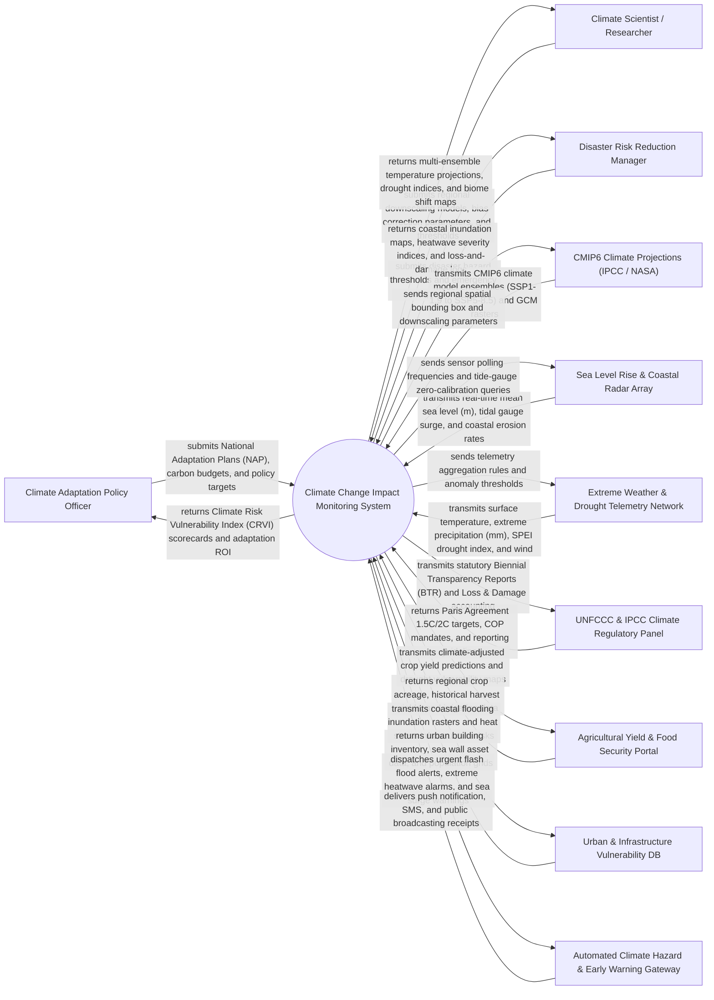

# Context Diagram — Climate Change Impact Monitoring System

## Mermaid Code

## Actor & Interaction Table | Bang Actor & Tuong tac

| # | Actor | Actor Type | Data Sent TO System | Data Received FROM System | Notes |
|---|-------|------------|---------------------|---------------------------|-------|
| 1 | Climate Adaptation Policy Officer | Primary | National Adaptation Plans (NAP), resilience intervention budgets, policy target years | Climate Risk Vulnerability Index (CRVI) ratings, adaptation cost-benefit models, loss-and-damage totals | Policy maker designing national and regional climate adaptation strategies |
| 2 | Climate Scientist / Researcher | Primary | Downscaling algorithms, bias correction grids, biome displacement thresholds, GCM parameters | Ensemble climate projections, multi-decadal temperature/precipitation trend anomalies, biome maps | Domain scientist modeling climate change impacts, downscaling GCM models, and studying ecology |
| 3 | Disaster Risk Reduction Manager | Primary | Disaster hazard thresholds, emergency evacuation triggers, relief asset inventories | High-resolution coastal inundation maps, heatwave severity heatmaps, flash flood risk vectors | Emergency management official coordinating disaster preparedness and climate hazard response |
| 4 | CMIP6 Climate Projections (IPCC / NASA) | Supporting System | CMIP6 Shared Socioeconomic Pathways (SSP1-1.9, SSP2-4.5, SSP5-8.5), GCM netCDF grid rasters | Regional GIS bounding boxes, spatial resolution queries ($1\text{ km}^2$ downscaled grids) | International climate data repository providing Earth System Model (ESM) global projections |
| 5 | Sea Level Rise & Coastal Radar Array | Supporting System | Real-time mean sea level ($m$), storm surge height ($m$), coastal erosion velocity ($m/year$), salinity | Radar sensor polling intervals, acoustic tide gauge zeroing signals, battery health status | Satellite radar altimetry and coastal acoustic tide gauge stations tracking sea level rise |
| 6 | Extreme Weather & Drought Telemetry Network | Supporting System | Surface air temperature ($^\circ C$), 24h precipitation ($mm$), SPEI drought index, maximum wind speed ($knots$) | Telemetry aggregation interval commands, sensor anomaly filtering thresholds | Meteorological station network measuring extreme weather parameters and drought indices |
| 7 | UNFCCC & IPCC Climate Regulatory Panel | Regulatory System | Paris Agreement global temperature targets ($1.5^\circ C / 2.0^\circ C$), BTR disclosure guidelines | Statutory Biennial Transparency Reports (BTR), Loss and Damage Fund claims, adaptation progress | International climate body (UN Framework Convention on Climate Change / IPCC) overseeing compliance |
| 8 | Agricultural Yield & Food Security Portal | Supporting System | Regional crop acreage GIS layers, historical crop harvest yields ($\text{t/ha}$), irrigation infrastructure | Climate-adjusted crop yield predictions ($2030-2050$), heat-stress yield loss models, drought maps | Agricultural GIS system supplying crop baseline data and consuming climate-yield impact models |
| 9 | Urban & Infrastructure Vulnerability DB | Supporting System | Urban building GIS polygons, sea wall structural assets, population density grids, road networks | Coastal flooding inundation rasters, urban heat island maps, infrastructure vulnerability scores | Municipal GIS database managing urban infrastructure assets and population vulnerability |
| 10 | Automated Climate Hazard Alert Gateway | Supporting System | SMS delivery receipts, emergency broadcast status logs | High-priority sea surge warnings, extreme heatwave alarms, flash flood inundation notifications | Public warning gateway broadcasting emergency alerts to government agencies and the public |

## System Boundary Description | Mo ta Pham vi He thong

The **Climate Change Impact Monitoring System** is an enterprise geospatial environmental analytics platform designed to monitor long-term climate change impacts, ingest CMIP6 global climate model projections (SSP scenarios), assess sea level rise and coastal inundation, track extreme weather anomalies, evaluate agricultural crop yield sensitivity, calculate the Climate Risk Vulnerability Index (CRVI), and report to the UNFCCC.

The **system boundary** encompasses climate impact zone GIS registration, CMIP6 global model spatial downscaling ($1\text{ km}$ resolution), sea level rise projection modeling, SPEI drought index calculation, agricultural crop yield climate sensitivity simulation, coastal inundation GIS mapping, Loss & Damage Fund accounting, and statutory UNFCCC Biennial Transparency Report (BTR) generation.

**External to the system boundary** are physical planetary orbital dynamics, physical greenhouse gas atmospheric absorption physics, physical ocean thermal expansion, legal international treaty negotiations, and physical storm surge wave mechanics. System interfaces operate via HTTPS REST APIs, OGC WMS/WCS spatial rasters, netCDF data formats, and encrypted UN compliance reporting portals.
