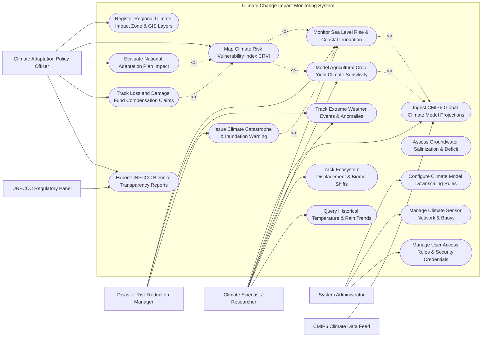

# Use Case Diagram — Climate Change Impact Monitoring System

## Mermaid Code

## Actor Table | Bang Actor

| # | Actor | Actor Type | Role Description | Related Use Cases |
|---|-------|------------|------------------|-------------------|
| 1 | Climate Adaptation Policy Officer | Primary | Government official designing climate adaptation plans (NAP), managing Loss & Damage claims, and reporting to UN | UC01, UC07, UC09, UC11, UC13 |
| 2 | Climate Scientist / Researcher | Primary | Domain scientist downscaling CMIP6 models, running crop yield sensitivity simulations, and tracking biomes | UC02, UC03, UC04, UC05, UC08, UC12 |
| 3 | Disaster Risk Reduction Manager | Primary | Emergency management official monitoring coastal inundation, heatwaves, and issuing early warning alarms | UC03, UC04, UC10 |
| 4 | System Administrator | Primary | Technical admin managing spatial downscaling algorithms, sensor networks, and security access roles | UC14, UC15, UC16 |
| 5 | CMIP6 Climate Data Feed | Secondary / System | External IPCC/NASA Earth System Model repository supplying global climate projections under SSP scenarios | UC02 |
| 6 | UNFCCC Regulatory Panel | Secondary / System | UN regulatory body ingesting statutory Biennial Transparency Reports (BTR) and Loss & Damage accounting | UC13 |

## Use Case Table | Bang Use Case

| # | UC ID | Use Case Name | Primary Actor | Secondary Actor | Description | Priority |
|---|-------|---------------|---------------|-----------------|-------------|----------|
| 1 | UC01 | Register Regional Climate Impact Zone & GIS Layers | Policy Officer | None | Defines regional climate impact zones, administrative boundaries, biomes, and coastal baselines | High |
| 2 | UC02 | Ingest CMIP6 Global Climate Model Projections | Climate Scientist | CMIP6 Feed | Ingests CMIP6 Earth System Model projections under Shared Socioeconomic Pathways (SSP1-1.9 to SSP5-8.5) | High |
| 3 | UC03 | Monitor Sea Level Rise & Coastal Inundation | Climate Scientist | Disaster Manager | Models thermal ocean expansion, ice sheet melt, storm surges, and maps 3D coastal flooding rasters | High |
| 4 | UC04 | Track Extreme Weather Events & Anomalies | Climate Scientist | Disaster Manager | Monitors extreme heatwaves, 100-year rainfall events, SPEI drought indices, and tropical cyclone intensity | High |
| 5 | UC05 | Model Agricultural Crop Yield Climate Sensitivity | Climate Scientist | System | Simulates crop yield changes ($\text{t/ha}$) for staple crops under warming scenarios ($+1.5^\circ C, +2.0^\circ C, +3.0^\circ C$) | High |
| 6 | UC06 | Assess Groundwater Salinization & Deficit | Climate Scientist | System | Models coastal aquifer saltwater intrusion ($km$) caused by sea level rise and reduced river recharge | Medium |
| 7 | UC07 | Map Climate Risk Vulnerability Index CRVI | Policy Officer | System | Computes composite Climate Risk Vulnerability Index (CRVI) by fusing Exposure, Sensitivity, and Adaptive Capacity | High |
| 8 | UC08 | Track Ecosystem Displacement & Biome Shifts | Climate Scientist | System | Maps poleward and elevational range shifts of plant/animal biomes due to warming temperatures | Medium |
| 9 | UC09 | Evaluate National Adaptation Plan Impact | Policy Officer | System | Evaluates the effectiveness of seawalls, mangrove restoration, and drought-resistant crops on reducing CRVI | High |
| 10 | UC10 | Issue Climate Catastrophe & Inundation Warning | Disaster Manager | Notification Gateway | Dispatches high-priority emergency alerts when storm surge or flash flood levels breach safety limits | High |
| 11 | UC11 | Track Loss and Damage Fund Compensation Claims | Policy Officer | System | Compiles climate disaster economic damage totals ($USD$) for submission to international Loss and Damage Funds | High |
| 12 | UC12 | Query Historical Temperature & Rain Trends | Climate Scientist | None | Provides searchable historical database of 50-year temperature anomalies, rainfall shifts, and extreme days | Low |
| 13 | UC13 | Export UNFCCC Biennial Transparency Reports | Policy Officer | UNFCCC Panel | Exports statutory UN climate disclosures: National Adaptation Plan progress, CRVI heatmaps, and BTR dossiers | High |
| 14 | UC14 | Configure Climate Model Downscaling Rules | System Admin | Climate Scientist | Configures spatial downscaling algorithms (statistical/dynamical) to convert $100\text{ km}$ GCMs to $1\text{ km}$ grids | Medium |
| 15 | UC15 | Manage Climate Sensor Network & Buoys | System Admin | System | Monitors ocean tide gauges, weather stations, satellite altimeter feeds, and sensor calibration status | Low |
| 16 | UC16 | Manage User Access & Security Roles | System Admin | None | Configures user accounts, operational roles (Officer, Scientist, Manager, Admin), and security permissions | Low |

## Use Case Specification | Dac ta Use Case

---

### UC02 — Ingest CMIP6 Global Climate Model Projections

| Field | Detail |
|-------|--------|
| **UC ID** | UC02 |
| **Use Case Name** | Ingest CMIP6 Global Climate Model Projections |
| **Actor(s)** | Primary: Climate Scientist / Researcher   Secondary: CMIP6 Climate Data Feed |
| **Description** | Ingests global Earth System Model (ESM) climate projections from CMIP6 (Coupled Model Intercomparison Project Phase 6) across Shared Socioeconomic Pathways (SSP1-1.9, SSP2-4.5, SSP3-7.0, SSP5-8.5), applying spatial downscaling ($1\text{ km}$) and bias correction. |
| **Precondition** | 1. Regional climate impact zones are registered in system (UC01).   2. Connection to CMIP6 netCDF data repository (ESGF / NASA NEX-GDDP-CMIP6) is active. |
| **Main Flow** | 1. Climate Scientist opens "CMIP6 Projection Ingestion & Downscaling" module.   2. Scientist selects target Shared Socioeconomic Pathway (SSP) scenario:   &nbsp;&nbsp;&nbsp;&nbsp;a. **SSP1-1.9**: $1.5^\circ C$ ambitious mitigation scenario.   &nbsp;&nbsp;&nbsp;&nbsp;b. **SSP2-4.5**: Middle-of-the-road moderate scenario ($+2.7^\circ C$ by 2100).   &nbsp;&nbsp;&nbsp;&nbsp;c. **SSP5-8.5**: High-emissions business-as-usual scenario ($+4.4^\circ C$ by 2100).   3. Scientist selects CMIP6 model ensemble (e.g., GFDL-ESM4, UKESM1-0-LL, MPI-ESM1-2-HR).   4. System initiates netCDF raster download for target spatial bounding box and time horizons ($2030, 2050, 2080, 2100$).   5. System executes **Bias Correction** against 30-year historical baseline (1990-2020 ERA5 reanalysis).   6. System executes **Spatial Downscaling Algorithm** (e.g., Delta Method / Bias-Corrected Spatial Disaggregation BCSD) to downscale raw $100\text{ km}$ grid resolution to high-resolution $1\text{ km} \times 1\text{ km}$ regional grids.   7. System stores processed downscaled temperature ($^\circ C$), precipitation ($mm$), and solar radiation rasters in spatial GIS database.   8. System generates multi-model ensemble mean and variance maps, displaying projected temperature anomalies on scientist dashboard. |
| **Alternative Flow** | **AF1** — Regional Climate Model (RCM) Dynamical Downscaling: System ingests high-resolution CORDEX RCM outputs ($12.5\text{ km}$) for complex mountainous topography. |
| **Exception Flow** | **EX1** — netCDF File Corruption: Ingested CMIP6 file fails checksum verification; system flags `DATA_CORRUPT_RETRY`, aborts downscaling, and re-fetches netCDF file from mirror server. |
| **Postcondition** | High-resolution ($1\text{ km}$) CMIP6 climate projections stored in GIS database and ready for impact modeling (UC03, UC05). |
| **Business Rule** | **BR1**: Climate projections must always report multi-model ensemble means alongside 5th and 95th percentile confidence intervals to quantify model uncertainty. |

---

### UC03 — Monitor Sea Level Rise & Coastal Inundation

| Field | Detail |
|-------|--------|
| **UC ID** | UC03 |
| **Use Case Name** | Monitor Sea Level Rise & Coastal Inundation |
| **Actor(s)** | Primary: Climate Scientist / Researcher   Secondary: Disaster Risk Reduction Manager |
| **Description** | Models thermal ocean expansion, polar ice sheet melt, local land subsidence, and storm surge dynamics under CMIP6 warming scenarios, generating 3D coastal flooding inundation maps and estimating land loss. |
| **Precondition** | 1. Downscaled CMIP6 climate projections (UC02) are ingested.   2. High-resolution Digital Elevation Model (LiDAR DEM $1\text{m}$ accuracy) for coastal zones is registered (UC01). |
| **Main Flow** | 1. Scientist or Disaster Manager selects target coastal zone and projection year (e.g., Red River Delta / Mekong Delta, Year 2050).   2. System retrieves projected global sea level rise ($SLR$) for selected SSP scenario (e.g., $+0.38\text{ m}$ under SSP2-4.5, $+0.55\text{ m}$ under SSP5-8.5 by 2050).   3. System incorporates local coastal dynamics:   &nbsp;&nbsp;&nbsp;&nbsp;a. **Land Subsidence Rate**: e.g., $1.5\text{ cm/year}$ due to groundwater extraction.   &nbsp;&nbsp;&nbsp;&nbsp;b. **Astronomical High Tide**: e.g., $+1.8\text{ m}$ peak tide.   &nbsp;&nbsp;&nbsp;&nbsp;c. **Category 3 Typhoon Storm Surge**: e.g., $+2.5\text{ m}$ surge height.   4. System computes **Total Coastal Water Level ($HW_{total}$)**:   &nbsp;&nbsp;&nbsp;&nbsp;$$HW_{total} = SLR + \text{Subsidence} + \text{Tide} + \text{Storm Surge}$$   5. System executes 3D Bathtub / Hydrodynamic Inundation Algorithm over high-resolution LiDAR DEM.   6. System overlays existing coastal sea wall protection structures ($3.0\text{ m}$ dike height threshold).   7. System renders 3D coastal flooding inundation raster highlighting flooded land area ($km^2$), affected population, flooded agricultural land ($ha$), and breached sea wall sections.   8. If flood inundation threatens inhabited urban zones, system alerts Disaster Risk Reduction Manager and triggers emergency warning (UC10). |
| **Alternative Flow** | **AF1** — Coastal Erosion Speed Modeling: System projects shoreline retreat distance ($meters/year$) using the Bruun Rule based on sea level rise and wave energy. |
| **Exception Flow** | **EX1** — Low-Resolution DEM Error: Selected area lacks high-res LiDAR DEM ($>10\text{m}$ DEM error); system warns user that inundation boundaries carry $\pm 30\%$ spatial uncertainty margin. |
| **Postcondition** | 3D coastal inundation maps generated, flooded land acreage calculated, and affected population metrics logged. |
| **Business Rule** | **BR1**: Coastal inundation modeling must incorporate local land subsidence rates alongside global thermal sea level rise parameters. |

---

### UC05 — Model Agricultural Crop Yield Climate Sensitivity

| Field | Detail |
|-------|--------|
| **UC ID** | UC05 |
| **Use Case Name** | Model Agricultural Crop Yield Climate Sensitivity |
| **Actor(s)** | Primary: Climate Scientist / Researcher   Secondary: System |
| **Description** | Simulates changes in staple crop yields (rice, corn, wheat, coffee) under projected temperature increases, altered precipitation patterns, heat stress days, and $CO_2$ fertilization effects using biophysical crop growth models (DSSAT / WOFOST). |
| **Precondition** | 1. Downscaled CMIP6 climate projections (UC02) are loaded.   2. Baseline agricultural crop distribution maps and historical yield data (UC00) are registered. |
| **Main Flow** | 1. Climate Scientist opens "Agricultural Climate Impact Modeling" workspace.   2. Scientist selects target crop species (e.g., Wet Paddy Rice), region, and projection horizon ($2030, 2050$).   3. System retrieves downscaled climate variables: mean daily maximum temp ($T_{max}$), minimum temp ($T_{min}$), rainfall ($mm$), and elevated atmospheric $CO_2$ ($ppm$).   4. System executes biophysical crop growth model (DSSAT / WOFOST):   &nbsp;&nbsp;&nbsp;&nbsp;a. **Heat Stress Impact**: Evaluates number of consecutive days where $T_{max} > 35^\circ C$ during anthesis (flowering stage), calculating spikelet sterility percentage.   &nbsp;&nbsp;&nbsp;&nbsp;b. **Water Stress Impact**: Computes SPEI drought index and root-zone soil water deficit.   &nbsp;&nbsp;&nbsp;&nbsp;c. **$CO_2$ Fertilization Effect**: Models partial yield enhancement for C3 crops due to higher $CO_2$ ($550\text{ ppm}$).   5. System calculates **Projected Crop Yield Change ($\Delta Y\text{ in } \%$)**:   &nbsp;&nbsp;&nbsp;&nbsp;$$\Delta Y = \left( \frac{Y_{projected} - Y_{baseline}}{Y_{baseline}} \right) \times 100$$   6. System renders spatial crop yield loss heatmaps (e.g., $15-25\%$ rice yield reduction by 2050 in tropical lowlands).   7. System evaluates potential adaptation options: shifting planting dates by 30 days, adopting heat-tolerant rice varieties (e.g., $T_{max}$ threshold $38^\circ C$), or increasing irrigation.   8. System saves assessment results and routes yield impact data to Agricultural GIS Portal (UC00). |
| **Alternative Flow** | **AF1** — Perennial Coffee Belt Elevation Shift: System models loss of Arabica coffee growing area in lowlands and projects required upward elevation migration ($+150\text{m}$ altitude per $+1^\circ C$). |
| **Exception Flow** | **EX1** — Unmodeled Pest Outbreak Hazard: Extreme warming triggers unmodeled brown planthopper pest explosion; scientist manually applies secondary pest loss penalty factor ($-10\%$) to yield output. |
| **Postcondition** | Climate-adjusted crop yield projections computed, loss heatmaps generated, and adaptation mitigation options evaluated. |
| **Business Rule** | **BR1**: Crop yield models must explicitly factor in extreme temperature days during flowering, not just mean monthly temperature averages. |

---

### UC07 — Map Climate Risk Vulnerability Index CRVI

| Field | Detail |
|-------|--------|
| **UC ID** | UC07 |
| **Use Case Name** | Map Climate Risk Vulnerability Index CRVI |
| **Actor(s)** | Primary: Climate Adaptation Policy Officer   Secondary: System |
| **Description** | Computes a standardized composite Climate Risk Vulnerability Index (CRVI score $0.00 - 1.00$) for administrative provinces by integrating Exposure (hazard intensity), Sensitivity (socio-economic susceptibility), and Adaptive Capacity (infrastructure/wealth). |
| **Precondition** | 1. Coastal inundation (UC03), extreme weather (UC04), and crop yield impact (UC05) layers are completed.   2. Socio-economic census data (poverty rate, infrastructure, healthcare access) is loaded. |
| **Main Flow** | 1. Policy Officer opens "Climate Vulnerability Mapping & CRVI Engine".   2. System retrieves sub-index indicators across three IPCC vulnerability dimensions:   &nbsp;&nbsp;&nbsp;&nbsp;a. **Exposure Index ($E$)**: Sea level rise flooding area, heatwave frequency, drought SPEI rating.   &nbsp;&nbsp;&nbsp;&nbsp;b. **Sensitivity Index ($S$)**: Agricultural labor share $\%$, poverty rate $\%$, elderly population $\%$, coastal asset value.   &nbsp;&nbsp;&nbsp;&nbsp;c. **Adaptive Capacity Index ($AC$)**: Sea wall protection length, per capita GDP, irrigation coverage, hospital bed density.   3. System calculates normalized sub-index scores ($0.00\text{ to } 1.00$) using min-max normalization.   4. System computes composite **Climate Risk Vulnerability Index (CRVI)**:   &nbsp;&nbsp;&nbsp;&nbsp;$$\text{CRVI} = \frac{E \times S}{AC}$$   5. System categorizes provinces into standardized vulnerability tiers:   &nbsp;&nbsp;&nbsp;&nbsp;a. **0.80 - 1.00** (Red): `EXTREMELY_HIGH_VULNERABILITY`   &nbsp;&nbsp;&nbsp;&nbsp;b. **0.60 - 0.79** (Orange): `HIGH_VULNERABILITY`   &nbsp;&nbsp;&nbsp;&nbsp;c. **0.40 - 0.59** (Yellow): `MODERATE_VULNERABILITY`   &nbsp;&nbsp;&nbsp;&nbsp;d. **< 0.40** (Green): `LOW_VULNERABILITY`   6. System generates national CRVI choropleth map, identifying top 10 most vulnerable priority districts requiring immediate Adaptation Fund allocation.   7. Policy Officer exports CRVI dossier to support National Adaptation Plan (NAP) budget prioritization. |
| **Alternative Flow** | **AF1** — Sector-Specific Vulnerability Sub-Mapping: Policy Officer filters CRVI map specifically for "Agricultural Vulnerability" or "Urban Infrastructure Vulnerability". |
| **Exception Flow** | **EX1** — Missing Socio-Economic Census Data: Target rural district lacks current census data; system uses spatial proxy indicators (nighttime light satellite intensity) to estimate adaptive capacity. |
| **Postcondition** | Composite CRVI scores calculated, national vulnerability maps rendered, and priority adaptation zones identified. |
| **Business Rule** | **BR1**: CRVI calculation formulas must strictly conform to IPCC 5th/6th Assessment Report vulnerability framework definitions. |

---

### UC09 — Evaluate National Adaptation Plan Impact

| Field | Detail |
|-------|--------|
| **UC ID** | UC09 |
| **Use Case Name** | Evaluate National Adaptation Plan Impact |
| **Actor(s)** | Primary: Climate Adaptation Policy Officer   Secondary: System |
| **Description** | Evaluates the risk-reduction effectiveness and cost-benefit ratio of implemented National Adaptation Plan (NAP) projects (sea wall construction, mangrove reforestation, crop switching) by re-simulating CRVI scores post-intervention. |
| **Precondition** | 1. Baseline CRVI vulnerability scores (UC07) are established.   2. Adaptation project specifications (CAPEX cost, coverage area, engineering design parameters) are registered. |
| **Main Flow** | 1. Policy Officer opens "Adaptation Project Evaluation & Cost-Benefit Analysis" module.   2. Officer selects proposed or implemented adaptation project:   &nbsp;&nbsp;&nbsp;&nbsp;a. **Project 1**: $50\text{ km}$ Reinforced Sea Wall Construction ($CAPEX = 50\text{ Million USD}$).   &nbsp;&nbsp;&nbsp;&nbsp;b. **Project 2**: $2,000\text{ ha}$ Coastal Mangrove Reforestation ($CAPEX = 10\text{ Million USD}$).   &nbsp;&nbsp;&nbsp;&nbsp;c. **Project 3**: Conversion of 50,000 ha Triple-Crop Rice to Saline-Tolerant Shrimp-Rice Farming ($CAPEX = 15\text{ Million USD}$).   3. System updates physical hazard layers based on project intervention parameters (e.g., Mangrove buffer reduces storm surge wave height by $65\%$).   4. System recalculates post-intervention Exposure ($E_{post}$), Sensitivity ($S_{post}$), and Adaptive Capacity ($AC_{post}$).   5. System computes **Avoided Economic Loss ($USD$)** over a 30-year operational lifetime:   &nbsp;&nbsp;&nbsp;&nbsp;$$\text{Avoided Loss} = \text{Baseline Expected Loss} - \text{Post-Intervention Loss}$$   6. System calculates **Benefit-Cost Ratio (BCR)**:   &nbsp;&nbsp;&nbsp;&nbsp;$$\text{BCR} = \frac{\text{Present Value of Avoided Economic Losses}}{\text{CAPEX + OPEX Costs}}$$   7. System displays comparison matrix: Mangrove Reforestation yields $\text{BCR} = 4.2$ (highly cost-effective), while Sea Wall yields $\text{BCR} = 1.8$.   8. Officer exports Adaptation Evaluation Dossier to justify national budget allocations and green climate fund (GCF) grant applications. |
| **Alternative Flow** | **AF1** — Ecosystem-Based Adaptation (EbA) Valuation: System quantifies additional co-benefits of EbA projects (carbon sequestration, fishery nursery habitat, ecotourism value). |
| **Exception Flow** | **EX1** — Maladaptation Hazard Alert: Simulation reveals sea wall project deflects wave energy onto adjacent unprotected fishing village, increasing their flood risk; system flags `MALADAPTATION_RISK_WARNING`. |
| **Postcondition** | Post-intervention CRVI scores computed, avoided economic losses quantified, benefit-cost ratios calculated, and evaluation report exported. |
| **Business Rule** | **BR1**: Adaptation projects must demonstrate a Benefit-Cost Ratio ($\text{BCR}$) $> 1.0$ to qualify for national climate fund approval. |
