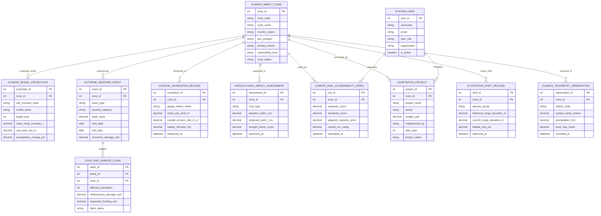

# Conceptual ERD — Climate Change Impact Monitoring System

## Mermaid Code

## Entity Description Table | Bang Mo Ta Entity

| # | Entity Name | Vietnamese Name | Description | Key Attributes | Main Relationships |
|---|-------------|-----------------|-------------|----------------|-------------------|
| 1 | CLIMATE_IMPACT_ZONE | Vùng Tác Động Biến Đổi Khí Hậu | Master profile of regional climate impact zones, GIS bounding polygons, biome type, and vulnerability tier | zone_id, zone_code, zone_name, country_region, geo_polygon, primary_biome, vulnerability_level, zone_status | Projected under PROJECTION, experiences EVENT, rated by CRVI |
| 2 | CLIMATE_MODEL_PROJECTION | Dự Báo Mô Hình Khí Hậu CMIP6 | Stores downscaled CMIP6 model projections under SSP scenarios (SSP1-5), mean temperature increase ($^\circ C$), and SLR ($m$) | projection_id, zone_id, ssp_scenario_code, model_name, target_year, mean_temp_increase_c, sea_level_rise_m | Belongs to CLIMATE_IMPACT_ZONE |
| 3 | EXTREME_WEATHER_EVENT | Biến Cố Thời Tiết Cực Đoan | Records extreme weather incidents (heatwaves, typhoons, severe droughts), peak values, and economic damages ($USD$) | event_id, zone_id, event_type, severity_category, peak_value, start_date, economic_damage_usd | Experienced in CLIMATE_IMPACT_ZONE, triggers LOSS_CLAIM |
| 4 | COASTAL_INUNDATION_RECORD | Nhật Ký Ngập Lụt Bờ Biển | Stores tide gauge telemetry, mean sea level ($m$), coastal erosion velocity ($m/yr$), and salinity intrusion ($km$) | inundation_id, zone_id, gauge_station_name, mean_sea_level_m, coastal_erosion_rate_m_yr, measured_at | Monitored in CLIMATE_IMPACT_ZONE |
| 5 | AGRICULTURAL_IMPACT_ASSESSMENT | Đánh Giá Tác Động Nông Nghiệp | Stores biophysical crop yield simulation results ($\text{t/ha}$ change), heat stress scores, and drought stress ratings | assessment_id, zone_id, crop_type, baseline_yield_t_ha, projected_yield_t_ha, assessed_at | Assessed in CLIMATE_IMPACT_ZONE |
| 6 | CLIMATE_RISK_VULNERABILITY_INDEX | Chỉ Số Mức Độ Dễ Bị Tổn Thương CRVI | Stores composite CRVI ratings ($0.00-1.00$) calculated from Exposure ($E$), Sensitivity ($S$), and Adaptive Capacity ($AC$) | crvi_id, zone_id, exposure_score, sensitivity_score, adaptive_capacity_score, overall_crvi_rating, calculated_at | Rates CLIMATE_IMPACT_ZONE, calculated by SYSTEM_USER |
| 7 | ADAPTATION_PROJECT | Dự Án Thích Ứng Khí Hậu | Manages National Adaptation Plan (NAP) infrastructure projects (sea walls, mangrove restoration), budget ($USD$), and status | project_id, zone_id, project_name, sector, budget_usd, implemented_by, project_status | Protects CLIMATE_IMPACT_ZONE, managed by SYSTEM_USER |
| 8 | LOSS_AND_DAMAGE_CLAIM | Yêu Cầu Bồi Thường Mất Mát & Thiệt Hải | Records economic loss and damage claims ($USD$), affected population counts, and international fund compensation status | claim_id, event_id, zone_id, affected_population, infrastructure_damage_usd, requested_funding_usd, claim_status | Triggered by EXTREME_WEATHER_EVENT |
| 9 | ECOSYSTEM_SHIFT_RECORD | Nhật Ký Dịch Chuyển Hệ Sinh Thái | Tracks species elevational/latitudinal range shifts ($meters/year$), habitat loss percentages ($\%$), and biome displacement | shift_id, zone_id, species_group, historical_range_elevation_m, habitat_loss_pct, observed_at | Tracks shift in CLIMATE_IMPACT_ZONE |
| 10 | CLIMATE_TELEMETRY_OBSERVATION | Nhật Ký Quan Trắc Thủy Văn Khí Hậu | Real-time weather station telemetry: surface air temperature ($^\circ C$), precipitation ($mm$), and maximum wind speed | observation_id, zone_id, station_code, surface_temp_celsius, precipitation_mm, recorded_at | Observed in CLIMATE_IMPACT_ZONE |
| 11 | SYSTEM_USER | Người Dùng Hệ Thống | Stores user credentials, roles (Policy Officer, Scientist, Disaster Manager, Admin), organizations, and security rights | user_id, username, user_role, organization, is_active | Calculates CRVI, manages ADAPTATION_PROJECT |

## Relationship Description | Mo ta Quan he

| # | From Entity | Cardinality | To Entity | Relationship Label | Business Explanation |
|---|-------------|-------------|-----------|-------------------|----------------------|
| 1 | CLIMATE_IMPACT_ZONE | one-to-many | CLIMATE_MODEL_PROJECTION | projected_under | A climate impact zone is projected under multiple CMIP6 Earth System Models and SSP scenarios |
| 2 | CLIMATE_IMPACT_ZONE | one-to-many | EXTREME_WEATHER_EVENT | experiences | A climate impact zone experiences multiple extreme weather events (heatwaves, droughts, typhoons) over time |
| 3 | CLIMATE_IMPACT_ZONE | one-to-many | COASTAL_INUNDATION_RECORD | monitored_in | A coastal climate impact zone is monitored by continuous sea level rise and inundation telemetry records |
| 4 | CLIMATE_IMPACT_ZONE | one-to-many | AGRICULTURAL_IMPACT_ASSESSMENT | assessed_in | A climate impact zone undergoes agricultural crop yield climate sensitivity assessments across crop types |
| 5 | CLIMATE_IMPACT_ZONE | one-to-many | CLIMATE_RISK_VULNERABILITY_INDEX | rated_by | A climate impact zone is rated by periodic composite Climate Risk Vulnerability Index (CRVI) evaluations |
| 6 | CLIMATE_IMPACT_ZONE | one-to-many | ADAPTATION_PROJECT | protected_by | A climate impact zone is protected by National Adaptation Plan (NAP) infrastructure and EbA projects |
| 7 | EXTREME_WEATHER_EVENT | one-to-many | LOSS_AND_DAMAGE_CLAIM | triggers | A severe extreme weather event triggers loss and damage financial compensation claims |
| 8 | CLIMATE_IMPACT_ZONE | one-to-many | ECOSYSTEM_SHIFT_RECORD | tracks_shift | A climate impact zone tracks species ecosystem range shifts and biome displacement over multi-decadal horizons |
| 9 | CLIMATE_IMPACT_ZONE | one-to-many | CLIMATE_TELEMETRY_OBSERVATION | observed_in | A climate impact zone is observed in real-time by weather station telemetry observations |
| 10 | SYSTEM_USER | one-to-many | CLIMATE_RISK_VULNERABILITY_INDEX | calculates | A climate scientist or policy officer system user calculates composite CRVI ratings |
| 11 | SYSTEM_USER | one-to-many | ADAPTATION_PROJECT | manages | A policy officer system user manages National Adaptation Plan (NAP) projects and budgets |
