# Swimlane Diagram — Climate Change Impact Monitoring System

## Mermaid Code

```mermaid
flowchart LR
    Start(["Start Climate Monitoring Cycle"])

    subgraph DataIngestionLane["Satellites, Coastal Radar & Climate Sensors"]
        S1["Stream CMIP6 Climate Model NetCDF Rasters"]
        S2["Measure Real-Time Tide Gauge & Sea Level"]
        S3["Record Extreme Weather & SPEI Drought Telemetry"]
    end

    subgraph SystemLane["Climate Change Impact Monitoring System"]
        M1["Downscale CMIP6 Rasters to 1km Grid"]
        M2["Compute 3D Inundation & Crop Yield Loss"]
        M3["Calculate Composite CRVI Rating Score"]
        M4{"CRVI >= 0.80 or Catastrophic Sea Surge?"}
        M5["Re-simulate Post-Intervention CRVI & BCR"]
        M6["Compile Statutory UNFCCC BTR Dossier"]
    end

    subgraph ScientistLane["Climate Scientist / Researcher"]
        E1["Select SSP Scenarios & Model Ensembles"]
        E2["Calibrate DSSAT Crop Sensitivity Rules"]
    end

    subgraph PolicyOfficerLane["Climate Adaptation Policy Officer"]
        P1["Prioritize High CRVI Vulnerability Zones"]
        P2["Formulate National Adaptation Plan Projects"]
        P3["Submit Loss and Damage Fund Claims"]
    end

    subgraph UNGatewayLane["UNFCCC / IPCC Regulatory & Early Warning"]
        G1["Broadcast Emergency Sea Surge & Heat Alarm"]
        G2["Ingest Annual UN Climate Disclosure Reports"]
    end

    Finish(["End Climate Monitoring Cycle"])

    Start --> S1 --> M1 --> E1 --> E2 --> S2 --> S3 --> M2 --> M3 --> M4
    M4 -->|"Catastrophic Surge / Flash Flood"| G1 --> Finish
    M4 -->|"High CRVI >= 0.80"| P1 --> P2 --> M5 --> P3 --> M6 --> G2 --> Finish
```

## Flow Description | Mo ta luong

| Lane | Actor | Role in Flow |
|------|-------|-------------|
| 1 | Satellites, Coastal Radar & Climate Sensors | Streams global CMIP6 netCDF climate rasters, measures real-time sea level rise ($m$) and coastal erosion, and records surface temperature anomalies and SPEI drought telemetry |
| 2 | Climate Change Impact Monitoring System | Downscales CMIP6 models to $1\text{ km}$ grids, simulates 3D coastal flooding inundation and biophysical crop yield losses ($\text{t/ha}$), computes composite CRVI scores ($0.00-1.00$), and generates UNFCCC BTR dossiers |
| 3 | Climate Scientist / Researcher | Selects CMIP6 SSP scenarios (SSP1-1.9 to SSP5-8.5), configures spatial downscaling bias corrections, and calibrates biophysical DSSAT/WOFOST crop growth sensitivity rules |
| 4 | Climate Adaptation Policy Officer | Reviews national CRVI vulnerability maps, prioritizes high-risk zones ($\text{CRVI} \ge 0.80$), formulates National Adaptation Plan (NAP) projects, and submits Loss & Damage Fund claims |
| 5 | UNFCCC / IPCC Regulatory & Early Warning | Receives statutory UN climate disclosure reports (Biennial Transparency Reports - BTR), and broadcasts emergency sea surge and flash flood warning alerts to public agencies |
