# Action Tree — Climate Change Impact Monitoring System

## Mermaid Code

```mermaid
graph TD
    Root["Climate Change Impact Monitoring System"]

    Root --> M1["Climate Impact Zone & GIS Spatial Registry"]
    Root --> M2["CMIP6 Climate Projections & Downscaling Engine"]
    Root --> M3["Sea Level Rise, Inundation & Coastal Erosion"]
    Root --> M4["Extreme Weather Anomaly & Hazard Monitoring"]
    Root --> M5["Agricultural Crop Yield & Food Security"]
    Root --> M6["Loss & Damage Accounting & Adaptation"]
    Root --> M7["UNFCCC Compliance & System Administration"]

    M1 --> A11["Register Regional Climate Impact Zone GIS Polygons"]
    M1 --> A12["Set Administrative Boundaries & Primary Biome Types"]
    M1 --> A13["Link Coastal Protection Dike & Sea Wall Assets"]
    M1 --> A14["Map Baseline Socio-Economic Census Indicators"]

    M2 --> A21["Ingest CMIP6 NetCDF Rasters for SSP Scenarios"]
    M2 --> A22["Execute Bias Correction against ERA5 Historical Baseline"]
    M2 --> A23["Downscale 100km GCM Models to High-Res 1km Grids"]
    M2 --> A24["Compute Multi-Model Ensemble Means & Variances"]

    M3 --> A31["Model Ocean Thermal Expansion & Ice Sheet Melt"]
    M3 --> A32["Incorporate Local Coastal Land Subsidence Rates"]
    M3 --> A33["Simulate 3D Bathtub & Hydrodynamic Inundation"]
    M3 --> A34["Project Shoreline Erosion Distances via Bruun Rule"]

    M4 --> A41["Track Extreme Heatwave Frequency & Intensity"]
    M4 --> A42["Compute Standardized Precipitation Evapotranspiration SPEI"]
    M4 --> A43["Monitor Tropical Cyclone Storm Surge Wave Heights"]
    M4 --> A44["Dispatch Emergency Flash Flood & Coastal Surge Alerts"]

    M5 --> A51["Simulate DSSAT Biophysical Crop Yield Sensitivity"]
    M5 --> A52["Calculate Anthesis Heat Stress Spikelet Sterility"]
    M5 --> A53["Map Spatial Crop Yield Loss Heatmaps under Warming"]
    M5 --> A54["Evaluate Shift in Perennial Coffee Belt Altitudes"]

    M6 --> A61["Calculate Composite Climate Risk Vulnerability Index CRVI"]
    M6 --> A62["Evaluate Benefit-Cost Ratio BCR of Sea Walls vs EbA"]
    M6 --> A63["Compile Disaster Loss and Damage Compensation Claims"]
    M6 --> A64["Identify Priority Adaptation Districts for GCF Funding"]

    M7 --> A71["Export Statutory UNFCCC Biennial Transparency Reports"]
    M7 --> A72["Configure Downscaling Spatial Resolution Rules"]
    M7 --> A73["Monitor Ocean Tide Gauge & Satellite Buoy Calibration"]
    M7 --> A74["Manage User Access Roles & Security Credentials"]
```

## Module Description | Mo ta Module

| # | Module | Description | Actions |
|---|--------|-------------|---------|
| 1 | Climate Impact Zone & GIS Spatial Registry | Manages regional climate impact zones, administrative GIS polygons, biomes, sea wall asset baselines, and socio-economic census data | Register Regional Climate Impact Zone GIS Polygons, Set Administrative Boundaries & Primary Biome Types, Link Coastal Protection Dike & Sea Wall Assets, Map Baseline Socio-Economic Census Indicators |
| 2 | CMIP6 Climate Projections & Downscaling Engine | Ingests CMIP6 netCDF climate rasters (SSP1-5), executes ERA5 bias correction, and downscales $100\text{ km}$ GCM models to $1\text{ km}$ spatial grids | Ingest CMIP6 NetCDF Rasters for SSP Scenarios, Execute Bias Correction against ERA5 Historical Baseline, Downscale 100km GCM Models to High-Res 1km Grids, Compute Multi-Model Ensemble Means & Variances |
| 3 | Sea Level Rise, Inundation & Coastal Erosion | Models thermal ocean expansion, polar ice melt, local land subsidence, simulates 3D coastal flooding, and projects shoreline retreat | Model Ocean Thermal Expansion & Ice Sheet Melt, Incorporate Local Coastal Land Subsidence Rates, Simulate 3D Bathtub & Hydrodynamic Inundation, Project Shoreline Erosion Distances via Bruun Rule |
| 4 | Extreme Weather Anomaly & Hazard Monitoring | Monitors extreme heatwaves, calculates SPEI drought indices, tracks cyclone storm surges, and dispatches emergency early warning notifications | Track Extreme Heatwave Frequency & Intensity, Compute Standardized Precipitation Evapotranspiration SPEI, Monitor Tropical Cyclone Storm Surge Wave Heights, Dispatch Emergency Flash Flood & Coastal Surge Alerts |
| 5 | Agricultural Crop Yield & Food Security | Simulates biophysical DSSAT crop yield sensitivity, assesses anthesis heat stress sterility, maps yield loss heatmaps, and models biome shifts | Simulate DSSAT Biophysical Crop Yield Sensitivity, Calculate Anthesis Heat Stress Spikelet Sterility, Map Spatial Crop Yield Loss Heatmaps under Warming, Evaluate Shift in Perennial Coffee Belt Altitudes |
| 6 | Loss & Damage Accounting & Adaptation | Computes composite Climate Risk Vulnerability Index (CRVI), evaluates Benefit-Cost Ratios ($\text{BCR}$) of adaptation projects, and compiles Loss & Damage claims | Calculate Composite Climate Risk Vulnerability Index CRVI, Evaluate Benefit-Cost Ratio BCR of Sea Walls vs EbA, Compile Disaster Loss and Damage Compensation Claims, Identify Priority Adaptation Districts for GCF Funding |
| 7 | UNFCCC Compliance & System Administration | Exports statutory UN Biennial Transparency Reports (BTR), configures downscaling rules, monitors ocean tide gauge buoys, and controls security roles | Export Statutory UNFCCC Biennial Transparency Reports, Configure Downscaling Spatial Resolution Rules, Monitor Ocean Tide Gauge & Satellite Buoy Calibration, Manage User Access Roles & Security Credentials |
