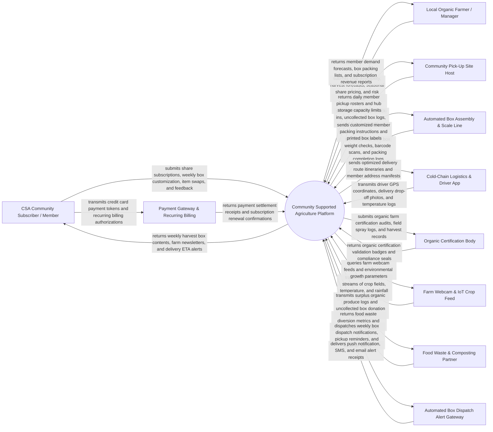

# Context Diagram — Community Supported Agriculture (CSA) Platform

## Mermaid Code

## Actor & Interaction Table | Bang Actor & Tuong tac

| # | Actor | Actor Type | Data Sent TO System | Data Received FROM System | Notes |
|---|-------|------------|---------------------|---------------------------|-------|
| 1 | CSA Community Subscriber / Member | Primary | Seasonal share tier selections, weekly item swap requests, add-on orders (eggs, honey), pickup site preference | Weekly harvest box packing lists, farmer newsletters, pickup time windows, delivery ETA alerts | Household member subscribing upfront to a farm's seasonal harvest shares |
| 2 | Local Organic Farmer / Manager | Primary | Crop planting plans, weekly harvest estimates, crop loss notices (shared risk), share tier pricing | Aggregated member demand forecasts, harvest box packing sheets, subscription revenue settlements | Local farmer growing crops, managing harvests, and communicating with community members |
| 3 | Community Pick-Up Site Host | Primary | Box arrival confirmations, member pickup check-in logs, uncollected box reports, site hours | Member pickup roster manifests, hub storage capacity allocations, drop-off notifications | Neighborhood host (porch, local cafe, school) receiving bulk weekly harvest boxes for member pickup |
| 4 | Automated Box Assembly Line | Supporting System | Box weight verification ($kg$), barcode scan logs, packing station completion events | Member-specific customized packing instructions, box QR code labels, item swap sheets | Packing line scale and barcode scanner verifying correct produce items per member box |
| 5 | Cold-Chain Logistics & Driver App | Supporting System | Real-time driver GPS tracking, delivery drop-off photo proof, refrigerated van temp logs | Optimized delivery route geometries, member delivery instructions, doorstep manifests | Fleet driver delivering temperature-controlled harvest boxes to homes and pickup hubs |
| 6 | Payment Gateway & Recurring Billing | Supporting System | Payment settlement receipts, card authorization tokens, recurring charge status | Automated recurring subscription payment orders, refund requests, failed payment retries | Payment processor (Stripe, PayPal) managing seasonal upfront payments and weekly add-on billing |
| 7 | Organic Certification Body | Supporting System | Organic farming compliance seals, certification validity status, field audit reports | Organic crop harvest logs, farm field spraying records, crop input audit dossiers | Recognized organic certification authority (USDA Organic, EU Organic, Participatory Guarantee System) |
| 8 | Farm Webcam & IoT Crop Feed | Supporting System | Live HD video streams of farm fields, ambient weather telemetry (temp, rain, solar radiation) | Video stream embedding queries, crop progress time-lapse parameters | Field-installed IoT webcams allowing subscribers to virtually watch their crops grow |
| 9 | Food Waste & Composting Partner | Supporting System | Food waste diversion weight ($kg$), composting certificate receipts, food bank delivery logs | Surplus produce donation manifests, uncollected harvest box transfer logs | Local food bank or composting organization receiving surplus uncollected organic produce |
| 10 | Automated Box Dispatch Alert Gateway | Supporting System | SMS delivery receipts, push alert dispatch logs | Weekly box packing alerts, pickup window reminders, weather delay warnings, driver ETA updates | Multi-channel messaging service broadcasting weekly box logistics notifications to members |

## System Boundary Description | Mo ta Pham vi He thong

The **Community Supported Agriculture (CSA) Platform** is a specialized direct-to-consumer farm management and community subscription software platform designed to connect local organic farms with community subscribers. It automates seasonal share tier subscriptions, weekly harvest box customization, crop demand aggregation, packing line logistics, cold-chain doorstep delivery, and shared-risk crop loss communication.

The **system boundary** encompasses member subscription onboarding, weekly harvest box item swap engines, farm crop yield forecasting, packing line barcode scanning, vehicle route optimization, pickup hub roster management, shared harvest risk modeling, and organic food traceability.

**External to the system boundary** are physical plant photosynthesis in farm soil, physical tractor cultivation, physical cooling in delivery van refrigeration units, culinary cooking in subscriber kitchens, and bank clearing house payment networks. System interfaces operate via secure HTTPS REST APIs, Stripe Payment APIs, Google Maps Route APIs, and Twilio SMS/Push notification gateways.
