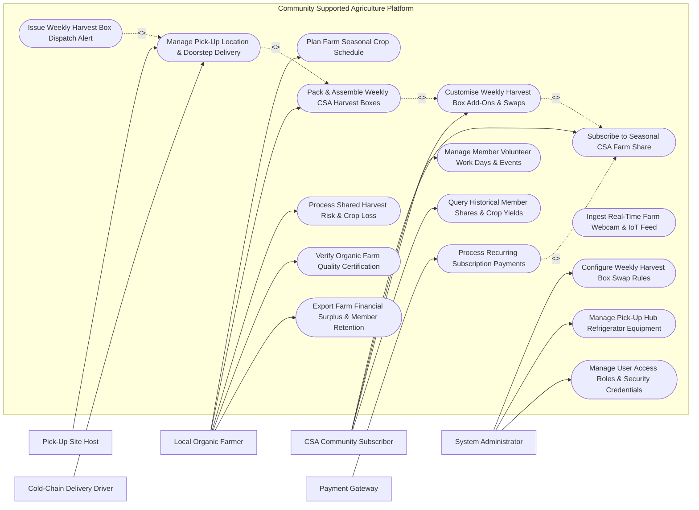

# Use Case Diagram — Community Supported Agriculture (CSA) Platform

## Mermaid Code

## Actor Table | Bang Actor

| # | Actor | Actor Type | Role Description | Related Use Cases |
|---|-------|------------|------------------|-------------------|
| 1 | CSA Community Subscriber | Primary | Household member subscribing to farm harvest shares, customizing weekly boxes, and attending farm events | UC01, UC02, UC08, UC12 |
| 2 | Local Organic Farmer | Primary | Organic farmer planning crop rotations, aggregating member demand, packing boxes, and issuing risk notices | UC03, UC05, UC07, UC11, UC13 |
| 3 | Pick-Up Site Host | Primary | Local neighborhood host hosting weekly box drop-off locations and managing member check-ins | UC06 |
| 4 | Cold-Chain Delivery Driver | Primary | Logistics driver transporting temperature-controlled harvest boxes to home doorsteps and pickup hubs | UC06 |
| 5 | System Administrator | Primary | Technical admin managing item swap rules, pickup hub hardware, user roles, and system parameters | UC14, UC15, UC16 |
| 6 | Payment Gateway | Secondary / System | External payment processor managing upfront seasonal shares and weekly recurring add-on billing | UC09 |

## Use Case Table | Bang Use Case

| # | UC ID | Use Case Name | Primary Actor | Secondary Actor | Description | Priority |
|---|-------|---------------|---------------|-----------------|-------------|----------|
| 1 | UC01 | Subscribe to Seasonal CSA Farm Share | Subscriber | Payment Gateway | Enrolls in a seasonal farm share tier (Full Share, Half Share, Bi-weekly), selecting payment option | High |
| 2 | UC02 | Customise Weekly Harvest Box Add-Ons & Swaps | Subscriber | None | Customizes weekly box contents, swaps disliked vegetables, and orders add-ons (eggs, honey, bread) | High |
| 3 | UC03 | Plan Farm Seasonal Crop Schedule | Farmer | System | Aggregates member share demand to calculate required crop acreage, planting dates, and succession crops | High |
| 4 | UC04 | Ingest Real-Time Farm Webcam & IoT Feed | Subscriber | Farmer | Streams live HD video of farm crop fields and displays soil moisture and weather metrics to members | Low |
| 5 | UC05 | Pack & Assemble Weekly CSA Harvest Boxes | Farmer | System | Generates member-specific box packing sheets, scans item barcodes, and verifies box weight consistency | High |
| 6 | UC06 | Manage Pick-Up Location & Doorstep Delivery | PickUpHost | DeliveryDriver | Manages neighborhood pickup hub rosters, optimizes delivery routes, and sends drop-off photo proof | High |
| 7 | UC07 | Process Shared Harvest Risk & Crop Loss | Farmer | Subscriber | Communicates crop loss events (e.g., hail storm damaging lettuce), adjusting box items per CSA risk-share ethos | High |
| 8 | UC08 | Manage Member Volunteer Work Days & Events | Subscriber | Farmer | Schedules seasonal farm volunteer work days, harvest festivals, farm-to-table dinners, and RSVPs | Medium |
| 9 | UC09 | Process Recurring Subscription Payments | System | Payment Gateway | Processes upfront seasonal payments, installment plans, and weekly add-on credit card charges | High |
| 10 | UC10 | Issue Weekly Harvest Box Dispatch Alert | System | Notification Gateway | Dispatches SMS/Email notifications when weekly harvest boxes are dispatched or arrived at pickup hub | High |
| 11 | UC11 | Verify Organic Farm Quality Certification | Farmer | System | Uploads organic certification seals, soil test reports, and pesticide-free guarantee documentation | Medium |
| 12 | UC12 | Query Historical Member Shares & Crop Yields | Subscriber | None | Provides searchable historical log of weekly items received, total seasonal weight ($kg$), and recipes used | Low |
| 13 | UC13 | Export Farm Financial Surplus & Member Retention | Farmer | System | Generates farm financial reports: member retention rate ($\%$), seasonal revenue, and surplus produce logs | Medium |
| 14 | UC14 | Configure Weekly Harvest Box Swap Rules | System Admin | Farmer | Configures item swap rules (e.g., max 2 swaps per week, equal credit value replacement matching) | Medium |
| 15 | UC15 | Manage Pick-Up Hub Refrigerator Equipment | System Admin | PickUpHost | Monitors temperature sensors in hub refrigerators ($2-4^\circ C$) to ensure produce cold-chain safety | Low |
| 16 | UC16 | Manage User Access & Security Roles | System Admin | None | Configures user accounts, platform roles (Subscriber, Farmer, Host, Driver, Admin), and security rights | Low |

## Use Case Specification | Dac ta Use Case

---

### UC01 — Subscribe to Seasonal CSA Farm Share

| Field | Detail |
|-------|--------|
| **UC ID** | UC01 |
| **Use Case Name** | Subscribe to Seasonal CSA Farm Share |
| **Actor(s)** | Primary: CSA Community Subscriber   Secondary: Payment Gateway |
| **Description** | Enables a household community member to browse local CSA farm offerings, select a seasonal share tier (e.g., Summer 20-Week Full Veggie Share, Fruit Add-on), choose a pickup hub or doorstep delivery, and complete payment. |
| **Precondition** | 1. Farmer has published seasonal share tiers and pricing for the upcoming season (UC03).   2. Payment Gateway integration is active. |
| **Main Flow** | 1. Subscriber logs into CSA platform and enters postal ZIP/Postal Code.   2. System displays participating local organic farms and active seasonal share tiers:   &nbsp;&nbsp;&nbsp;&nbsp;a. **Full Share** (Feeds 3-4 people, $35\text{ USD/week}$ for 20 weeks $= 700\text{ USD}$).   &nbsp;&nbsp;&nbsp;&nbsp;b. **Half Share** (Feeds 1-2 people, $22\text{ USD/week}$ for 20 weeks $= 440\text{ USD}$).   &nbsp;&nbsp;&nbsp;&nbsp;c. **Egg / Bakery Add-On** ($6\text{ USD/week}$).   3. Subscriber selects desired Share Tier and optional add-ons.   4. Subscriber selects fulfillment method:   &nbsp;&nbsp;&nbsp;&nbsp;a. **Neighborhood Pick-Up Hub**: Selects nearby cafe/porch host (Free).   &nbsp;&nbsp;&nbsp;&nbsp;b. **Home Doorstep Delivery**: Enters home address ($5\text{ USD/week}$ delivery fee).   5. Subscriber reviews CSA Shared-Risk Agreement (acknowledges that farm yield fluctuates with weather).   6. Subscriber selects Payment Plan: **Upfront Full Payment** ($5\%$ discount) or **4-Installment Plan**.   7. System submits credit card payment payload to Payment Gateway (UC09).   8. Payment Gateway returns settlement confirmation.   9. System creates active Member Subscription record, assigns member ID, and dispatches welcome email with seasonal calendar. |
| **Alternative Flow** | **AF1** — Low-Income SNAP/EBT Subsidized Share: Subscriber selects subsidized share tier funded by farm equity fund or SNAP/EBT benefits, paying weekly upon box receipt. |
| **Exception Flow** | **EX1** — Share Tier Sold Out: Target share tier has reached maximum subscriber capacity ($100/100$ shares); system places subscriber on waiting list and sends notification if space opens. |
| **Postcondition** | Member subscription created, seasonal payment processed, pickup/delivery assigned, and welcome packet dispatched. |
| **Business Rule** | **BR1**: All subscribers must digitally sign the CSA Charter acknowledging shared harvest risk prior to subscription activation. |

---

### UC02 — Customise Weekly Harvest Box Add-Ons & Swaps

| Field | Detail |
|-------|--------|
| **UC ID** | UC02 |
| **Use Case Name** | Customise Weekly Harvest Box Add-Ons & Swaps |
| **Actor(s)** | Primary: CSA Community Subscriber   Secondary: None |
| **Description** | Allows a subscriber to review their upcoming weekly box contents 48 hours prior to packing, swap up to 2 unwanted vegetable items for alternative available produce, and order artisanal add-ons (fresh eggs, artisanal bread, honey). |
| **Precondition** | 1. Farmer has published the preliminary weekly harvest inventory 72 hours before delivery.   2. Subscriber has an active subscription for the current delivery week. |
| **Main Flow** | 1. System opens "Weekly Box Customization Window" 48 hours before delivery date and sends notification to Subscriber (UC10).   2. Subscriber opens "My Weekly Box" page on mobile app.   3. System presents preliminary box contents (e.g., 1 head Butterhead Lettuce, 1 kg Heirloom Tomatoes, 500g Carrots, 1 bunch Kale, 500g Zucchini).   4. Subscriber chooses to swap an unwanted item (e.g., Swaps 1 bunch Kale $\rightarrow$ Replaced with 500g Sweet Peppers).   5. System checks swap rules (UC14): verifies item point value is equivalent ($2.50\text{ USD}$ value) and replacement item is in stock.   6. Subscriber adds optional weekly add-ons: 1 Dozen Pasture-Raised Eggs ($6.00\text{ USD}$) and 1 Sourdough Bread ($7.50\text{ USD}$).   7. System calculates micro-invoice for add-ons ($13.50\text{ USD}$) and saves customized packing manifest.   8. Customization window closes 24 hours before delivery; System locks member box manifest and routes order to Farm Packing Assembly (UC05). |
| **Alternative Flow** | **AF1** — Vacation Hold / Box Donation: Subscriber marks "Vacation Hold" for the week; system pauses delivery and offers option to donate box to local food bank. |
| **Exception Flow** | **EX1** — Replacement Item Out of Stock: Subscriber attempts to swap item for Heirloom Tomatoes, but inventory reaches 0; system displays `ITEM_OUT_OF_STOCK` and suggests alternative available items. |
| **Postcondition** | Customized weekly packing manifest saved, add-on charges billed, and finalized order sent to farm packing line. |
| **Business Rule** | **BR1**: Item swaps must be completed at least 24 hours prior to the farm's scheduled packing start time. |

---

### UC05 — Pack & Assemble Weekly CSA Harvest Boxes

| Field | Detail |
|-------|--------|
| **UC ID** | UC05 |
| **Use Case Name** | Pack & Assemble Weekly CSA Harvest Boxes |
| **Actor(s)** | Primary: Local Organic Farmer / Pack Manager   Secondary: System |
| **Description** | Generates member-specific packing lists, guides farm workers at packing stations using digital scale verification and barcode scanning, and prints QR code shipping labels for each harvest box. |
| **Precondition** | 1. Customization window for the delivery week is locked (UC02).   2. Harvested produce has been washed, chilled, and delivered to packing barn. |
| **Main Flow** | 1. Pack Manager opens "Harvest Box Packing & Assembly" module for the target delivery date.   2. System aggregates all customized member orders and prints Master Packing Manifest and individual box QR code labels.   3. Packing worker places an empty eco-friendly wax box onto scale at Packing Station 1 and scans box QR label.   4. System display screen shows exact customized item list for this specific member (e.g., Member #104: Standard Box $+$ Sweet Pepper Swap $+$ 1 Dozen Eggs).   5. Worker packs items into box, scanning item barcodes (or placing items on scale) as added.   6. System checks total box weight against expected target weight range ($5.2\text{ kg} \pm 0.4\text{ kg}$).   7. If weight and items match, system displays `PACKING_COMPLETE_GREEN`.   8. Worker seals box, attaches printed QR shipping label, and places box onto designated Pick-Up Hub Pallet (e.g., Pallet B - Downtown Hub).   9. System updates box status to `PACKED_READY_FOR_DISPATCH` and alerts logistics drivers (UC06). |
| **Alternative Flow** | **AF1** — Bulk Standard Box Packing: For un-customized standard shares, packing line operates in continuous bulk assembly mode, packing 50 identical boxes in batch. |
| **Exception Flow** | **EX1** — Underweight Box Warning: Box scale detects total weight is $3.8\text{ kg}$ (below $4.8\text{ kg}$ minimum threshold); system blocks label approval until worker adds missing produce item. |
| **Postcondition** | Weekly harvest boxes packed, weight verified, QR shipping labels attached, and pallets staged for driver pickup. |
| **Business Rule** | **BR1**: Fragile add-ons (eggs, berries, baked goods) must be packed in top-tier protective inserts to prevent crushing during transit. |

---

### UC06 — Manage Pick-Up Location & Doorstep Cold-Chain Delivery

| Field | Detail |
|-------|--------|
| **UC ID** | UC06 |
| **Use Case Name** | Manage Pick-Up Location & Doorstep Cold-Chain Delivery |
| **Actor(s)** | Primary: Pick-Up Site Host & Cold-Chain Delivery Driver   Secondary: System |
| **Description** | Optimizes refrigerated delivery driver routes, tracks real-time box drop-offs at neighborhood pickup hubs and home doorsteps, captures photo proof of delivery, and notifies subscribers upon box arrival. |
| **Precondition** | 1. Harvest boxes are packed and staged on hub pallets (UC05).   2. Refrigerated delivery vans are loaded and drivers logged into mobile app. |
| **Main Flow** | 1. Delivery Driver logs into CSA Logistics Mobile App and selects assigned route.   2. System generates optimized GPS navigation route (minimizing travel time and maintaining van temp $<5^\circ C$).   3. Driver arrives at **Neighborhood Pick-Up Hub** (e.g., Local Cafe Porch).   4. Driver unloads pallet of 25 member boxes, scans hub QR code, and checks in with Pick-Up Site Host.   5. Pick-Up Host verifies box count on app and confirms arrival.   6. System automatically sends SMS/Push Notification to all 25 hub members: "Your weekly harvest box has arrived at Downtown Cafe Hub! Pick-up window: 15:00 - 19:00 PM." (UC10).   7. For **Doorstep Home Deliveries**: Driver navigates to member home, places insulated box in shaded porch area, captures geotagged photo proof in app, and clicks "Delivered".   8. System dispatches immediate SMS alert to home member with photo proof attached.   9. As members arrive at pickup hub, Site Host checks off member names on digital roster. |
| **Alternative Flow** | **AF1** — Uncollected Box Donation: At end of pickup window (19:00 PM), Site Host logs 2 uncollected boxes; system notifies host to donate boxes to local food pantry (UC00). |
| **Exception Flow** | **EX1** — Delivery Van Refrigeration Failure: Driver app alerts van temperature exceeded $10^\circ C$; driver halts route, system alerts pack manager, and dispatches backup cooler van. |
| **Postcondition** | Harvest boxes delivered to hubs and doorsteps, arrival notifications sent to subscribers, and delivery proof logged. |
| **Business Rule** | **BR1**: Produce box temperature must be maintained below $8^\circ C$ throughout cold-chain transit to preserve organic freshness. |

---

### UC07 — Process Shared Harvest Risk & Crop Loss

| Field | Detail |
|-------|--------|
| **UC ID** | UC07 |
| **Use Case Name** | Process Shared Harvest Risk & Crop Loss |
| **Actor(s)** | Primary: Local Organic Farmer / Manager   Secondary: CSA Community Subscriber |
| **Description** | Handles agricultural crop loss events (hail storm, extreme drought, pest outbreak) in alignment with CSA shared-risk philosophy, transparently communicating yield reductions to subscribers and adjusting box item compositions. |
| **Precondition** | 1. Farmer suffers a verified severe weather or pest event damaging standing crops.   2. Active subscriber community is registered for current season. |
| **Main Flow** | 1. Farmer logs into "Crop Loss & Shared Risk Management" module.   2. Farmer creates Crop Impact Notice: Event Type (e.g., Severe Summer Hail Storm), Damaged Crops (e.g., $80\%$ loss of Strawberry crop), Estimated Duration of Shortage (3 weeks), and Geotagged Field Photos.   3. System calculates impact on upcoming weekly share allocations.   4. Farmer formulates **Mitigation & Substitution Plan**:   &nbsp;&nbsp;&nbsp;&nbsp;a. Substitute lost strawberries with surplus organic melons from partner CSA farm.   &nbsp;&nbsp;&nbsp;&nbsp;b. Slightly reduce fruit portion size while increasing root crop portion size.   5. System compiles transparent "Farm Update & Shared Risk Letter" and dispatches to all active subscribers.   6. Subscribers receive notification explaining weather impact, photo proof, and adjusted box composition.   7. System updates weekly box inventory to reflect substitution items.   8. System logs shared risk event in farm sustainability audit ledger. |
| **Alternative Flow** | **AF1** — Total Crop Failure Share Extension: In catastrophic events ($>90\%$ total farm destruction), farmer offers subscribers option to extend subscription into autumn season or receive partial credit for next year. |
| **Exception Flow** | **EX1** — Subscriber Disagreement Dispute: Subscriber rejects shared risk ethos and demands cash refund; system routes case to customer service for manual resolution per policy. |
| **Postcondition** | Crop loss event documented, transparent community notice dispatched, item substitutions configured, and shared risk logged. |
| **Business Rule** | **BR1**: Shared risk communications must be dispatched at least 48 hours prior to box delivery and include photo/video evidence from the farm. |
