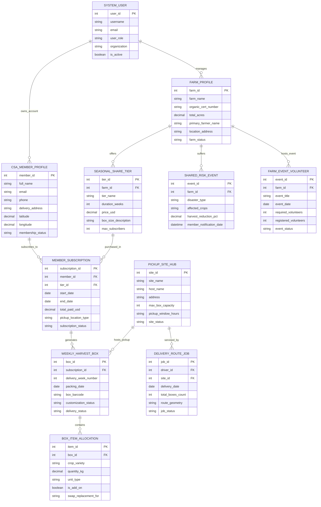

# Conceptual ERD — Community Supported Agriculture (CSA) Platform

## Mermaid Code

## Entity Description Table | Bang Mo Ta Entity

| # | Entity Name | Vietnamese Name | Description | Key Attributes | Main Relationships |
|---|-------------|-----------------|-------------|----------------|-------------------|
| 1 | CSA_MEMBER_PROFILE | Hồ Sơ Thành Viên CSA | Master subscriber household profile: contact details, home delivery address, GIS coordinates, and status | member_id, full_name, email, phone, delivery_address, latitude, longitude, membership_status | Subscribes to MEMBER_SUBSCRIPTION, owns SYSTEM_USER |
| 2 | FARM_PROFILE | Hồ Sơ Trang Trại Hữu Cơ | Master profile of participating organic farm: farm name, organic certification ID, acreage, farmer name, and location | farm_id, farm_name, organic_cert_number, total_acres, primary_farmer_name, farm_status | Offers SEASONAL_SHARE_TIER, suffers SHARED_RISK, managed by USER |
| 3 | SEASONAL_SHARE_TIER | Gói Cổ Phần Nông Sản Theo Mùa | Defines seasonal share products (Full Share 20-week, Half Share, Fruit Add-on), duration, pricing ($USD$), and box sizes | tier_id, farm_id, tier_name, duration_weeks, price_usd, box_size_description, max_subscribers | Offered by FARM_PROFILE, purchased in MEMBER_SUBSCRIPTION |
| 4 | MEMBER_SUBSCRIPTION | Hợp Đồng Đăng Ký Thành Viên | Active seasonal subscription record linking member to share tier, start/end dates, total paid amount, and pickup hub | subscription_id, member_id, tier_id, start_date, end_date, total_paid_usd, subscription_status | Subscribed by MEMBER, generates WEEKLY_HARVEST_BOX |
| 5 | WEEKLY_HARVEST_BOX | Hộp Nông Sản Thu Hoạch Hàng Tuần | Individual weekly share box instances generated for each subscription, delivery week number, barcode, and status | box_id, subscription_id, delivery_week_number, packing_date, box_barcode, delivery_status | Generated from SUBSCRIPTION, contains ITEM_ALLOCATION, hosted at HUB |
| 6 | BOX_ITEM_ALLOCATION | Chi Tiết Nông Sản Trong Hộp | Specific produce items allocated inside a weekly box: crop variety, weight ($kg$), add-on tags, and swap replacements | item_id, box_id, crop_variety, quantity_kg, unit_type, is_add_on, swap_replacement_for | Contained in WEEKLY_HARVEST_BOX |
| 7 | PICKUP_SITE_HUB | Điểm Nhận Hàng Cộng Đồng | Neighborhood pickup location profile: host name, address, max box storage capacity, pickup hours, and status | site_id, site_name, host_name, address, max_box_capacity, pickup_window_hours, site_status | Hosts WEEKLY_HARVEST_BOX, serviced by DELIVERY_ROUTE |
| 8 | DELIVERY_ROUTE_JOB | Chuyến Vận Chuyển Giao Hàng | Cold-chain driver delivery route job: assigned driver, pickup site ID, delivery date, total boxes, and route geometry | job_id, driver_id, site_id, delivery_date, total_boxes_count, route_geometry, job_status | Services PICKUP_SITE_HUB |
| 9 | SHARED_RISK_EVENT | Sự Cố Rủi Ro Mất Mùa Chia Sẻ | Records agricultural disaster events (hail, drought, pests), affected crops, harvest loss $\%$, and member notifications | event_id, farm_id, disaster_type, affected_crops, harvest_reduction_pct, member_notification_date | Suffered by FARM_PROFILE |
| 10 | FARM_EVENT_VOLUNTEER | Sự Kiện Tình Nguyện Trang Trại | Manages farm volunteer work days, harvest festivals, event dates, required volunteer counts, and RSVPs | event_id, farm_id, event_title, event_date, required_volunteers, registered_volunteers, event_status | Hosted by FARM_PROFILE |
| 11 | SYSTEM_USER | Người Dùng Hệ Thống | User credentials, roles (Subscriber, Farmer, Host, Driver, Admin), organizations, and security access permissions | user_id, username, email, user_role, organization, is_active | Manages FARM_PROFILE, owns CSA_MEMBER_PROFILE |

## Relationship Description | Mo ta Quan he

| # | From Entity | Cardinality | To Entity | Relationship Label | Business Explanation |
|---|-------------|-------------|-----------|-------------------|----------------------|
| 1 | FARM_PROFILE | one-to-many | SEASONAL_SHARE_TIER | offers | An organic farm profile offers multiple seasonal share tiers (Full, Half, Bi-weekly, Fruit) |
| 2 | CSA_MEMBER_PROFILE | one-to-many | MEMBER_SUBSCRIPTION | subscribes_to | A subscriber member profile can hold multiple seasonal share subscriptions over time |
| 3 | SEASONAL_SHARE_TIER | one-to-many | MEMBER_SUBSCRIPTION | purchased_in | A seasonal share tier is purchased in multiple individual member subscriptions |
| 4 | MEMBER_SUBSCRIPTION | one-to-many | WEEKLY_HARVEST_BOX | generates | A member subscription generates weekly harvest box instances across the season duration |
| 5 | WEEKLY_HARVEST_BOX | one-to-many | BOX_ITEM_ALLOCATION | contains | A weekly harvest box contains multiple specific produce item allocations and add-ons |
| 6 | PICKUP_SITE_HUB | one-to-many | DELIVERY_ROUTE_JOB | serviced_by | A pickup site hub is serviced by cold-chain driver delivery route jobs each week |
| 7 | PICKUP_SITE_HUB | one-to-many | WEEKLY_HARVEST_BOX | hosts_pickup | A pickup site hub hosts weekly harvest box drop-offs for neighborhood subscribers |
| 8 | FARM_PROFILE | one-to-many | SHARED_RISK_EVENT | suffers | An organic farm can suffer shared risk crop loss events communicated to its member community |
| 9 | FARM_PROFILE | one-to-many | FARM_EVENT_VOLUNTEER | hosts_event | An organic farm hosts community volunteer work days and harvest festival events |
| 10 | SYSTEM_USER | one-to-many | FARM_PROFILE | manages | A farmer system user manages organic farm profiles and packing operations |
| 11 | SYSTEM_USER | one-to-many | CSA_MEMBER_PROFILE | owns_account | A subscriber system user owns a CSA member profile account |
