# Swimlane Diagram — Community Supported Agriculture (CSA) Platform

## Mermaid Code

```mermaid
flowchart LR
    Start(["Start CSA Weekly Delivery Cycle"])

    subgraph SubscriberLane["CSA Community Subscriber / Member"]
        F1["Subscribe to Seasonal Share Tier"]
        F2["Customise Item Swaps & Order Add-Ons"]
        F3["Pick Up Box at Hub or Receive Doorstep"]
    end

    subgraph SystemLane["Community Supported Agriculture Platform"]
        M1["Aggregate Weekly Member Demand & Swaps"]
        M2["Generate Box Packing Sheets & Barcodes"]
        M3{"Crop Loss Disaster Event Occurred?"}
        M4["Optimize Cold-Chain Driver Routes"]
        M5["Process Shared Risk Notice & Substitutions"]
    end

    subgraph FarmerLane["Local Organic Farmer / Pack Manager"]
        A1["Harvest Produce & Wash in Barn"]
        A2["Pack & Assemble Customized Harvest Boxes"]
        A3["Stage Pallets for Cold-Chain Pickup"]
    end

    subgraph DriverHostLane["Pick-Up Site Host / Delivery Driver"]
        D1["Load Refrigerated Delivery Van"]
        D2["Deliver Boxes to Hubs & Doorsteps"]
        D3["Check In Members & Manage Roster"]
    end

    subgraph PaymentAlertLane["Payment Gateway & Alert Notification"]
        P1["Process Share & Add-On Payment Charges"]
        P2["Dispatch Arrival SMS & Delivery Proof"]
    end

    Finish(["End Weekly Delivery Cycle"])

    Start --> F1 --> P1 --> M1 --> F2 --> M2 --> M3
    M3 -->|"Crop Loss Disaster"| M5 --> A1
    M3 -->|"Normal Harvest"| A1 --> A2 --> A3 --> D1 --> M4 --> D2 --> D3 --> P2 --> F3 --> Finish
```

## Flow Description | Mo ta luong

| Lane | Actor | Role in Flow |
|------|-------|-------------|
| 1 | CSA Community Subscriber / Member | Subscribes to seasonal share tiers, customizes weekly box item swaps and add-ons, receives arrival SMS alerts, and picks up boxes at hubs or receives doorstep delivery |
| 2 | Community Supported Agriculture Platform | Aggregates weekly member produce demand, generates customized box packing manifests, checks swap rules, evaluates shared-risk crop loss events, and optimizes delivery driver routes |
| 3 | Local Organic Farmer / Pack Manager | Harvests fresh organic produce, washes and grades items, packs customized member boxes using digital scale/barcode verification, and stages pallets for driver pickup |
| 4 | Pick-Up Site Host / Delivery Driver | Loads temperature-controlled delivery vans, navigates optimized routes, drops off boxes at neighborhood hubs and doorsteps, captures photo proof, and manages member rosters |
| 5 | Payment Gateway & Alert Notification | Processes upfront seasonal payments and weekly add-on credit card charges, and dispatches automated SMS/Push arrival notifications with delivery proof photos to members |
