# Action Tree — Community Supported Agriculture (CSA) Platform

## Mermaid Code

```mermaid
graph TD
    Root["Community Supported Agriculture Platform"]

    Root --> M1["Member Subscription & Share Management"]
    Root --> M2["Farm Crop Planning & Demand Aggregation"]
    Root --> M3["Weekly Box Assembly & Customization"]
    Root --> M4["Cold-Chain Delivery & Pick-Up Hub Logistics"]
    Root --> M5["Shared Risk & Crop Loss Management"]
    Root --> M6["Member Engagement & Farm Events"]
    Root --> M7["Payment Gateway & System Administration"]

    M1 --> A11["Register Member Profiles & Delivery Addresses"]
    M1 --> A12["Define Seasonal Share Tiers Full & Half Shares"]
    M1 --> A13["Configure SNAP EBT Subsidized Share Options"]
    M1 --> A14["Manage Subscription Renewals & Cancellations"]

    M2 --> A21["Aggregate Weekly Member Produce Demand"]
    M2 --> A22["Plan Seasonal Crop Planting & Rotation Dates"]
    M2 --> A23["Ingest Real-Time Farm Field Webcams & Weather"]
    M2 --> A24["Estimate Weekly Harvest Yield Volumes"]

    M3 --> A31["Open Member Customization Window 48h Prior"]
    M3 --> A32["Process Item Swap Requests & Add-On Orders"]
    M3 --> A33["Generate Customized Box Packing Sheets & QR Labels"]
    M3 --> A34["Verify Packing Line Scale Box Weights"]

    M4 --> A41["Optimize Cold-Chain Driver Delivery Routes"]
    M4 --> A42["Manage Neighborhood Pick-Up Hub Roster Lists"]
    M4 --> A43["Capture Geotagged Doorstep Photo Proof of Delivery"]
    M4 --> A44["Monitor Hub Refrigerator Cold-Chain Temperatures"]

    M5 --> A51["Log Weather & Hail Storm Crop Damage Events"]
    M5 --> A52["Formulate Crop Substitution & Mitigation Plans"]
    M5 --> A53["Dispatch Transparent Shared-Risk Notices to Members"]
    M5 --> A54["Audit Surplus Produce Donations to Food Banks"]

    M6 --> A61["Schedule Farm Volunteer Work Days & Harvest Festivals"]
    M6 --> A62["Publish Weekly Farmer Newsletters & Recipes"]
    M6 --> A63["Track Member Volunteer Hours & Event RSVPs"]
    M6 --> A64["Collect Member Feedback & Net Promoter Scores"]

    M7 --> A71["Process Credit Card Payments & Installment Plans"]
    M7 --> A72["Configure Box Item Swap Point Value Rules"]
    M7 --> A73["Verify Organic Farm Certification Badges"]
    M7 --> A74["Manage User Roles & Security Access Credentials"]
```

## Module Description | Mo ta Module

| # | Module | Description | Actions |
|---|--------|-------------|---------|
| 1 | Member Subscription & Share Management | Manages subscriber profiles, seasonal share tiers (Full/Half shares), SNAP/EBT subsidized options, delivery addresses, and renewals | Register Member Profiles & Delivery Addresses, Define Seasonal Share Tiers Full & Half Shares, Configure SNAP EBT Subsidized Share Options, Manage Subscription Renewals & Cancellations |
| 2 | Farm Crop Planning & Demand Aggregation | Aggregates member share demand, plans crop rotations, calculates required planting acreage, ingests farm webcams, and forecasts harvest yields | Aggregate Weekly Member Produce Demand, Plan Seasonal Crop Planting & Rotation Dates, Ingest Real-Time Farm Field Webcams & Weather, Estimate Weekly Harvest Yield Volumes |
| 3 | Weekly Box Assembly & Customization | Manages 48-hour customization windows, processes item swaps and add-ons (eggs/bread), generates QR labels, and verifies box weights | Open Member Customization Window 48h Prior, Process Item Swap Requests & Add-On Orders, Generate Customized Box Packing Sheets & QR Labels, Verify Packing Line Scale Box Weights |
| 4 | Cold-Chain Delivery & Pick-Up Hub Logistics | Optimizes driver delivery routes, manages neighborhood pickup hub rosters, captures delivery photo proof, and monitors van/hub temperatures | Optimize Cold-Chain Driver Delivery Routes, Manage Neighborhood Pick-Up Hub Roster Lists, Capture Geotagged Doorstep Photo Proof of Delivery, Monitor Hub Refrigerator Cold-Chain Temperatures |
| 5 | Shared Risk & Crop Loss Management | Logs natural disaster crop loss events, formulates item substitutions, dispatches transparent community risk notices, and audits food bank donations | Log Weather & Hail Storm Crop Damage Events, Formulate Crop Substitution & Mitigation Plans, Dispatch Transparent Shared-Risk Notices to Members, Audit Surplus Produce Donations to Food Banks |
| 6 | Member Engagement & Farm Events | Schedules farm volunteer work days, harvest festivals, publishes weekly newsletters and recipes, and tracks volunteer RSVPs and feedback | Schedule Farm Volunteer Work Days & Harvest Festivals, Publish Weekly Farmer Newsletters & Recipes, Track Member Volunteer Hours & Event RSVPs, Collect Member Feedback & Net Promoter Scores |
| 7 | Payment Gateway & System Administration | Processes credit card charges and installment plans, configures item swap point value rules, verifies organic certifications, and manages security roles | Process Credit Card Payments & Installment Plans, Configure Box Item Swap Point Value Rules, Verify Organic Farm Certification Badges, Manage User Roles & Security Access Credentials |
