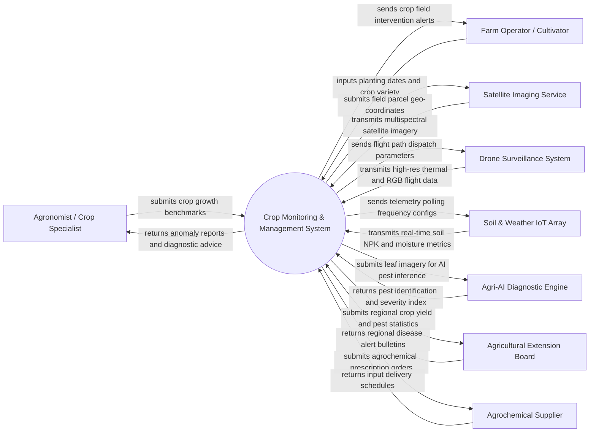

# Context Diagram — Crop Monitoring & Management System

## Mermaid Code

## Actor & Interaction Table | Bang Actor & Tuong tac

| # | Actor | Actor Type | Data Sent TO System | Data Received FROM System | Notes |
|---|-------|------------|---------------------|---------------------------|-------|
| 1 | Agronomist / Crop Specialist | Primary | Agronomic growth benchmarks, disease treatment thresholds, target soil pH ranges | Crop health dashboards, anomaly alerts, automated diagnostic recommendations | Expert user responsible for technical crop advice and intervention strategies |
| 2 | Farm Operator / Cultivator | Primary | Planting dates, crop variety details, physical treatment execution confirmation | Daily field task alerts, irrigation recommendations, harvest date forecasts | Field practitioner executing crop care routines on assigned land parcels |
| 3 | Satellite Imaging Service | Supporting System | Multispectral satellite imagery (Sentinel/Landsat), NDVI vegetation indices | Parcel geo-boundary coordinates, imagery query timestamps | External satellite data provider furnishing periodic macro-level crop health images |
| 4 | Drone Surveillance System | Supporting System | High-resolution thermal, multispectral, and RGB aerial flight survey files | Automated flight grid plans, field parcel boundaries, capture triggers | Unmanned aerial vehicles capturing micro-level crop canopy and stress data |
| 5 | Soil & Weather IoT Array | Supporting System | Real-time nitrogen-phosphorus-potassium (NPK) readings, soil moisture, ambient climate data | Sensor calibration settings, polling intervals, energy saving profiles | Ground hardware deployed across crop fields for physical soil telemetry |
| 6 | Agri-AI Diagnostic Engine | Supporting System | Crop pest identification, disease confidence scores, yield prediction models | Raw leaf images, spectral reflectance data, historical climate logs | Machine learning cloud microservice performing computer vision inference |
| 7 | Agricultural Extension Board | Regulatory System | Regional disease outbreak advisories, quarantine regulations, approved pesticide lists | Aggregate regional crop health reports, yield forecasts, chemical usage metrics | Government body managing agricultural safety standards and regional disease control |
| 8 | Agrochemical Supplier | Supporting | Chemical availability, pricing quotes, shipment fulfillment tracking | Agrochemical prescription orders, fertilizer reorder requests | Commercial vendor supplying certified pesticides, fungicides, and fertilizers |

## System Boundary Description | Mo ta Pham vi He thong

The **Crop Monitoring & Management System** is a high-precision agricultural software platform designed to track crop health, ingest spatial remote sensing data, diagnose plant diseases, and provide predictive agronomic advice. The system boundary encompasses parcel mapping, multispectral imagery processing (NDVI/NDRE), soil telemetry integration, AI-driven pest detection, yield forecasting, and advisory task dispatching. External to the system boundary are physical satellite constellation operations, physical drone flight navigation controls, third-party AI cloud training pipelines, and raw agrochemical manufacturing processes. The platform interfaces via secure RESTful APIs and geospatial data feeds to ingest environmental imagery and transmit actionable field treatment prescriptions.
