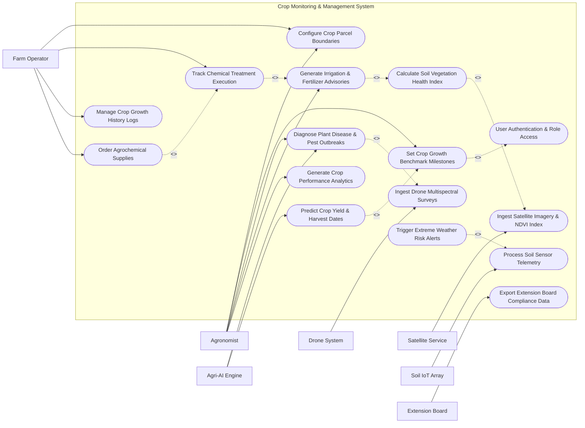

# Use Case Diagram — Crop Monitoring & Management System

## Mermaid Code

## Actor Table | Bang Actor

| # | Actor | Actor Type | Role Description | Related Use Cases |
|---|-------|------------|------------------|-------------------|
| 1 | Agronomist | Primary | Sets target growth benchmarks, reviews remote sensing indices, confirms AI disease diagnoses, and issues intervention advisories | UC01, UC02, UC03, UC08, UC10, UC15 |
| 2 | Farm Operator | Primary | Manages field boundaries, executes chemical treatments, logs field progress, and orders required agrochemicals | UC01, UC02, UC11, UC12, UC14 |
| 3 | Satellite Service | Secondary | Transmits periodic multispectral satellite imagery bands for macro vegetation mapping | UC04, UC07 |
| 4 | Drone System | Secondary | Uploads high-definition thermal and RGB imagery from localized aerial surveys | UC05, UC08 |
| 5 | Soil IoT Array | Secondary | Streams continuous soil moisture, pH, temperature, and NPK nutrient sensor readings | UC06, UC13 |
| 6 | Agri-AI Engine | System | Executes computer vision models for pest identification and statistical yield estimation | UC08, UC09 |
| 7 | Extension Board | System | Consumes compliance reports and shares regional crop disease control warnings | UC16 |

## Use Case Table | Bang Use Case

| # | UC ID | Use Case Name | Primary Actor | Secondary Actor | Description | Priority |
|---|-------|---------------|---------------|-----------------|-------------|----------|
| 1 | UC01 | Configure Crop Parcel Boundaries | Farm Operator | Agronomist | Draws GeoJSON field boundaries, sets soil profiles, and assigns crop varieties | High |
| 2 | UC02 | User Authentication & Role Access | Agronomist | Farm Operator | Validates security credentials and enforces role-based permissions across system modules | High |
| 3 | UC03 | Set Crop Growth Benchmark Milestones | Agronomist | None | Establishes growth stage standards (germination, tillering, canopy closure) for crop varieties | High |
| 4 | UC04 | Ingest Satellite Imagery & NDVI Index | Satellite Service | Agronomist | Ingests satellite spectral bands and calculates Normalized Difference Vegetation Index (NDVI) | High |
| 5 | UC05 | Ingest Drone Multispectral Surveys | Drone System | Agronomist | Processes high-resolution aerial imagery to construct field elevation and health maps | Medium |
| 6 | UC06 | Process Soil Sensor Telemetry | Soil IoT Array | Farm Operator | Collects real-time soil moisture and nutrient readings across registered parcel zones | High |
| 7 | UC07 | Calculate Soil Vegetation Health Index | Agronomist | Satellite Service | Computes NDRE and EVI health indices to identify localized plant stress and chlorophyll loss | High |
| 8 | UC08 | Diagnose Plant Disease & Pest Outbreaks | Agronomist | Agri-AI Engine | Analyzes leaf photos and spectral data using AI models to detect diseases and infestation severity | High |
| 9 | UC09 | Predict Crop Yield & Harvest Dates | Agri-AI Engine | Agronomist | Uses historical growth data, satellite trends, and weather forecasts to project yield tonnage | High |
| 10 | UC10 | Generate Irrigation & Fertilizer Advisories | Agronomist | None | Formulates precise watering schedules and nutrient application prescriptions based on soil telemetry | High |
| 11 | UC11 | Track Chemical Treatment Execution | Farm Operator | Agronomist | Records completed pesticide/fertilizer applications with date, dosage, and operator ID | High |
| 12 | UC12 | Manage Crop Growth History Logs | Farm Operator | Agronomist | Maintains historical records of crop performance across past seasons for baseline analysis | Medium |
| 13 | UC13 | Trigger Extreme Weather Risk Alerts | Soil IoT Array | Farm Operator | Sends immediate emergency notifications when frost, drought, or flood conditions threaten crops | High |
| 14 | UC14 | Order Agrochemical Supplies | Farm Operator | None | Generates purchase orders for fertilizers and pesticides directly from advisory recommendations | Medium |
| 15 | UC15 | Generate Crop Performance Analytics | Agronomist | None | Compiles spatial growth maps, yield comparisons, and input efficiency reports | High |
| 16 | UC16 | Export Extension Board Compliance Data | Agronomist | Extension Board | Formats agrochemical usage logs into regulatory compliance documentation for government filing | Medium |

## Use Case Specification | Dac ta Use Case

---

### UC04 — Ingest Satellite Imagery & NDVI Index

| Field | Detail |
|-------|--------|
| **UC ID** | UC04 |
| **Use Case Name** | Ingest Satellite Imagery & NDVI Index |
| **Actor(s)** | Primary: Satellite Service / Secondary: Agronomist |
| **Description** | Automatically fetches multispectral satellite imagery for registered farm parcels, computes the Normalized Difference Vegetation Index (NDVI), and renders spatial vegetation health heatmaps. |
| **Precondition** | 1. GeoJSON boundaries for crop parcels are defined in UC01.   2. Satellite API connection and authentication keys are active. |
| **Main Flow** | 1. System executes scheduled cron job to query Satellite Service API for new imagery over registered farm parcel coordinates.   2. Satellite Service returns Near-Infrared (NIR) and Red spectral image bands.   3. System checks image cloud coverage percentage.   4. System performs atmospheric correction and calculates NDVI using equation `(NIR - Red) / (NIR + Red)`.   5. System clips the resulting raster map to the farm parcel polygon boundaries.   6. System stores NDVI rasters, generates color-coded vegetation health heatmaps, and notifies the Agronomist. |
| **Alternative Flow** | **AF1** — Manual Imagery Request: Agronomist manually triggers a targeted satellite imagery pull for a specific parcel. System prioritizes request in the processing queue.   **AF2** — Alternative Spectral Index: Agronomist requests Normalized Difference Red Edge (NDRE) index computation for dense crop canopy analysis. System executes NDRE formula using RedEdge bands. |
| **Exception Flow** | **EX1** — Excessive Cloud Cover: If cloud coverage exceeds 20%, System flags the satellite image as "Obscured", skips NDVI rendering, and notifies manager that aerial drone survey is recommended.   **EX2** — Satellite API Timeout: If API call fails after 3 retries, System logs an API connection error and reschedules the pull for the next satellite overpass window. |
| **Postcondition** | Parcel vegetation health map is updated in the database and visible on spatial monitoring dashboards. |
| **Business Rule** | **BR1**: NDVI values must be normalized between -1.0 and +1.0, with values below 0.2 flagged as non-vegetative/stressed.   **BR2**: Satellite imagery older than 5 days must trigger a visual freshness warning on the monitoring dashboard. |

---

### UC07 — Calculate Soil Vegetation Health Index

| Field | Detail |
|-------|--------|
| **UC ID** | UC07 |
| **Use Case Name** | Calculate Soil Vegetation Health Index |
| **Actor(s)** | Primary: Agronomist / Secondary: Satellite Service |
| **Description** | Combines satellite spectral indices with ground soil telemetry to generate a comprehensive multi-factor Vegetation Stress Index (VSI) for each crop parcel zone. |
| **Precondition** | 1. Recent NDVI raster data has been processed (UC04).   2. Soil telemetry data for moisture and NPK has been updated within 24 hours (UC06). |
| **Main Flow** | 1. Agronomist selects a target crop parcel on the spatial monitoring dashboard.   2. System retrieves latest NDVI layer, soil moisture percentage, and NPK nutrient levels for the parcel.   3. System computes Vegetation Stress Index (VSI) by weighting spectral reflectance (60%) against ground soil data (40%).   4. System classifies parcel sub-zones into health categories (Optimal, Mild Stress, Severe Stress).   5. System highlights stressed sub-zones on the interactive map layer.   6. System generates a summary health report and prompts Agronomist to review potential diagnostic workflows. |
| **Alternative Flow** | **AF1** — Drone Data Hybrid Calculation: If high-res drone multispectral survey is available, System replaces satellite NDVI with drone NDRE layer for higher spatial resolution calculation.   **AF2** — Historical Trend Overlay: Agronomist toggles multi-week trend view. System overlays current VSI map with previous 3-year historical averages for the same growth stage. |
| **Exception Flow** | **EX1** — Missing Soil Telemetry: If ground soil telemetry is missing, System computes VSI solely based on satellite spectral data and attaches a "Low Confidence — Ground Data Missing" badge.   **EX2** — Spatial Polygon Mismatch: If parcel boundary coordinates contain topological errors, System halts calculation and alerts Agronomist to fix polygon topology. |
| **Postcondition** | Multi-factor Vegetation Stress Index is calculated, updated on parcel maps, and stored for longitudinal crop trend analysis. |
| **Business Rule** | **BR1**: Sub-zones exhibiting VSI score below 0.35 must automatically trigger an alert to the assigned Agronomist.   **BR2**: VSI algorithms must adjust index weighting based on crop growth stage (e.g., higher moisture weighting during flowering stage). |

---

### UC08 — Diagnose Plant Disease & Pest Outbreaks

| Field | Detail |
|-------|--------|
| **UC ID** | UC08 |
| **Use Case Name** | Diagnose Plant Disease & Pest Outbreaks |
| **Actor(s)** | Primary: Agronomist / Secondary: Agri-AI Engine |
| **Description** | Processes leaf photographs and high-resolution aerial imagery through a trained Agri-AI diagnostic engine to identify specific plant pathogens, insect pests, and disease severity. |
| **Precondition** | 1. Farm Operator or Drone System uploads leaf/canopy image files.   2. Agri-AI inference service is online. |
| **Main Flow** | 1. Agronomist or Field Operator uploads high-resolution leaf photos or selects a stressed drone survey zone.   2. System sends image payload to Agri-AI Diagnostic Engine via API.   3. Agri-AI Engine runs deep convolutional neural network (CNN) models to analyze spot patterns, lesion colors, and leaf wilting.   4. AI Engine returns top 3 disease candidate matches, confidence percentages (e.g., "Rice Blast — 94% Confidence"), and affected area estimates.   5. System displays diagnosis results, disease factsheets, and recommended chemical treatment options to Agronomist.   6. Agronomist validates and confirms the AI diagnosis, committing the result to official crop health records. |
| **Alternative Flow** | **AF1** — Agronomist Overrule: Agronomist disagrees with AI diagnosis (confidence <70%), selects a different disease from the master database, and inputs manual diagnostic notes.   **AF2** — Secondary Lab Sample Escalation: If AI confidence is low and disease is unclassified, System generates a physical leaf sample collection ticket for external agricultural laboratory testing. |
| **Exception Flow** | **EX1** — Blurry Image Rejection: AI Engine rejects image payload due to low resolution (<2MP) or out-of-focus optics. System alerts user to re-take leaf photos under adequate lighting.   **EX2** — AI Microservice Unavailable: If AI cloud service is unresponsive, System queues image for background retries and permits manual diagnostic entry by Agronomist. |
| **Postcondition** | Plant disease diagnosis is recorded, disease severity map is generated, and treatment advisory generation (UC10) is unlocked. |
| **Business Rule** | **BR1**: AI diagnostic results with confidence >90% for quarantine-restricted pests must automatically flag the regional Extension Board.   **BR2**: Confirmed disease diagnoses must freeze parcel status from "Healthy" to "Under Treatment". |

---

### UC09 — Predict Crop Yield & Harvest Dates

| Field | Detail |
|-------|--------|
| **UC ID** | UC09 |
| **Use Case Name** | Predict Crop Yield & Harvest Dates |
| **Actor(s)** | Primary: Agri-AI Engine / Secondary: Agronomist |
| **Description** | Utilizes accumulated NDVI growth curves, historical weather patterns, soil nutrient levels, and crop variety genetics to forecast expected harvest yield tonnage and optimal harvest date. |
| **Precondition** | 1. Crop cultivation cycle benchmark milestones are active (UC03).   2. At least 30 days of spectral and weather data have been recorded for the crop cycle. |
| **Main Flow** | 1. System initiates yield prediction pipeline at designated growth stage milestones (e.g., mid-season flowering).   2. System compiles cumulative NDVI curve area, weather degree-days, soil nitrogen depletion rates, and current parcel acreage.   3. Agri-AI Engine executes yield regression models against historical crop yield datasets.   4. System calculates projected yield tonnage (e.g., 6.5 tons/hectare ± 0.4 tons) and estimates optimal harvest date window.   5. System updates yield forecast dashboard and displays confidence interval graphs.   6. Agronomist reviews yield forecast and exports summary report for farm commercial planning. |
| **Alternative Flow** | **AF1** — Extreme Weather Adjustment: Following a hail or heatwave alert (UC13), System automatically triggers an out-of-cycle yield recalculation, penalizing projected tonnage based on damage severity models.   **AF2** — Multi-Parcel Aggregation: Agronomist selects entire farm enterprise view. System sums individual parcel forecasts into an aggregate enterprise yield projection. |
| **Exception Flow** | **EX1** — Insufficient Historical Data: If less than 14 days of telemetry exist, System displays "Insufficient Telemetry for AI Yield Projection" and falls back to baseline variety average yield estimation.   **EX2** — Model Divergence Warning: If projected yield deviates by >40% from variety benchmark, System flags a "Yield Anomaly Warning" for agronomist manual review. |
| **Postcondition** | Projected crop yield volume and target harvest date window are updated in the crop cycle record. |
| **Business Rule** | **BR1**: Yield prediction calculations must run automatically every 14 days throughout the active crop growth cycle.   **BR2**: Forecast confidence margins must narrow as the crop approaches maturity (target confidence ±5% within 14 days of harvest). |

---

### UC10 — Generate Irrigation & Fertilizer Advisories

| Field | Detail |
|-------|--------|
| **UC ID** | UC10 |
| **Use Case Name** | Generate Irrigation & Fertilizer Advisories |
| **Actor(s)** | Primary: Agronomist / Secondary: None |
| **Description** | Synthesizes soil nutrient deficits, soil moisture levels, and weather forecasts to generate precise, parcel-specific irrigation volume and NPK fertilizer application prescriptions. |
| **Precondition** | 1. Soil telemetry data and VSI indices are processed (UC06, UC07).   2. Crop variety nutrient requirement rules are active. |
| **Main Flow** | 1. System analyzes current soil moisture percentage against crop variety wilting point thresholds.   2. System analyzes soil NPK depletion against target growth stage nutrient requirements.   3. System checks 5-day precipitation forecasts to prevent over-fertilization or nutrient runoff during heavy rainfall.   4. System generates an "Irrigation & Fertilizer Advisory Prescription" specifying exact water volume (liters/sqm) and fertilizer mixture (kg/hectare).   5. Agronomist reviews the generated prescription, adjusts chemical formulation if necessary, and signs off electronically.   6. System converts advisory into actionable work tasks assigned to Farm Operator for execution (UC11). |
| **Alternative Flow** | **AF1** — Automated Fertigation Trigger: For parcels equipped with smart fertigation valves, System transmits advisory dosage parameters directly to automated irrigation controllers.   **AF2** — Organic Alternative Substitution: Agronomist selects "Organic Certification Mode". System substitutes synthetic chemical dosages with approved compost and bio-fertilizer recommendations. |
| **Exception Flow** | **EX1** — High Rain Forecast Override: If weather forecast indicates >80% probability of heavy rainfall (>30mm) within 24 hours, System suspends fertilizer advisory generation and alerts Agronomist of runoff risk.   **EX2** — Toxic Chemical Dosage Warning: If manual dosage adjustment by Agronomist exceeds maximum safety regulation limits, System blocks saving with warning "Regulated Chemical Limit Exceeded". |
| **Postcondition** | Agronomic advisory prescription is finalized, logged in parcel records, and converted into field execution tasks. |
| **Business Rule** | **BR1**: Nitrogen fertilizer advisories must adhere to regional environmental nitrate leaching regulations.   **BR2**: Fertilizer prescriptions must specify mandatory pre-harvest safety intervals (PHI) before harvest can occur. |
