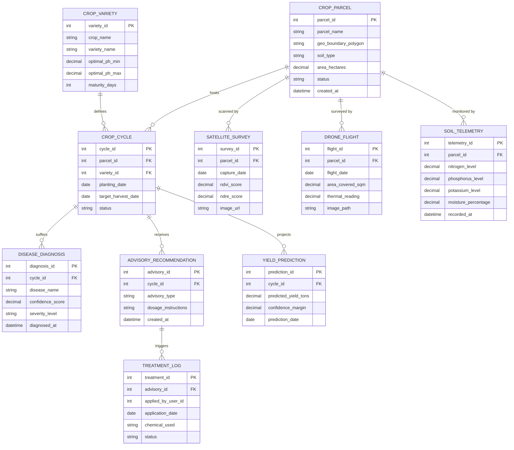

# Conceptual ERD — Crop Monitoring & Management System

## Mermaid Code

## Entity Description Table | Bang mo ta Entity

| # | Entity Name | Vietnamese Name | Description | Key Attributes | Main Relationships |
|---|-------------|-----------------|-------------|----------------|-------------------|
| 1 | CROP_PARCEL | Lô Đất Canh Tác | Physical land parcel defined by GeoJSON boundary coordinates and soil baseline properties | parcel_id, parcel_name, geo_boundary_polygon, area_hectares, status | Has many CROP_CYCLE, SATELLITE_SURVEY, DRONE_FLIGHT, SOIL_TELEMETRY |
| 2 | CROP_VARIETY | Giống Cây Trồng | Taxonomic and agronomic profile detailing optimal growth ranges and maturity timelines | variety_id, crop_name, variety_name, optimal_ph_min, maturity_days | Has many CROP_CYCLE |
| 3 | CROP_CYCLE | Vụ Mùa Cây Trồng | Active cultivation lifecycle instance deployed on a specific crop parcel | cycle_id, parcel_id, variety_id, planting_date, status | Belongs to CROP_PARCEL, CROP_VARIETY; has DISEASE_DIAGNOSIS, ADVISORY_RECOMMENDATION, YIELD_PREDICTION |
| 4 | SATELLITE_SURVEY | Dữ Liệu Vệ Tinh | Multispectral satellite observation record containing calculated NDVI and NDRE health indices | survey_id, parcel_id, capture_date, ndvi_score, image_url | Belongs to CROP_PARCEL |
| 5 | DRONE_FLIGHT | Khảo Sát Drone | High-resolution aerial survey dataset captured by unmanned drones for canopy elevation and stress mapping | flight_id, parcel_id, flight_date, area_covered_sqm, thermal_reading | Belongs to CROP_PARCEL |
| 6 | SOIL_TELEMETRY | Dữ Liệu Cảm Biến Đất | Time-series ground telemetry recording soil NPK nutrient levels, moisture, and temperature | telemetry_id, parcel_id, nitrogen_level, moisture_percentage, recorded_at | Belongs to CROP_PARCEL |
| 7 | DISEASE_DIAGNOSIS | Chẩn Đoán Sâu Bệnh | AI-assisted or agronomist-verified plant disease diagnosis and severity score record | diagnosis_id, cycle_id, disease_name, confidence_score, severity_level | Belongs to CROP_CYCLE |
| 8 | ADVISORY_RECOMMENDATION | Khuyến Cáo Kỹ Thuật | Prescriptive agronomic recommendation specifying required irrigation, fertilizer, or pesticide treatment | advisory_id, cycle_id, advisory_type, dosage_instructions, created_at | Belongs to CROP_CYCLE; has many TREATMENT_LOG |
| 9 | TREATMENT_LOG | Nhật Ký Xử Lý Hóa Chất | Execution record of field chemical applications, operator details, and safety compliance status | treatment_id, advisory_id, applied_by_user_id, application_date, chemical_used | Belongs to ADVISORY_RECOMMENDATION |
| 10 | YIELD_PREDICTION | Dự Báo Sản Lượng | Statistical yield forecast specifying projected crop tonnage and optimal harvest date windows | prediction_id, cycle_id, predicted_yield_tons, confidence_margin, prediction_date | Belongs to CROP_CYCLE |

## Relationship Description | Mo ta Quan he

| # | From Entity | Cardinality | To Entity | Relationship Label | Business Explanation |
|---|-------------|-------------|-----------|-------------------|----------------------|
| 1 | CROP_PARCEL | one-to-many | CROP_CYCLE | hosts | Một lô đất canh tác có thể diễn ra nhiều vụ mùa cây trồng theo các năm. |
| 2 | CROP_PARCEL | one-to-many | SATELLITE_SURVEY | scanned by | Một lô đất được quét và lưu trữ nhiều bản ghi ảnh vệ tinh qua các đợt bay. |
| 3 | CROP_PARCEL | one-to-many | DRONE_FLIGHT | surveyed by | Một lô đất được khảo sát bởi nhiều chuyến bay drone thu thập dữ liệu độ phân giải cao. |
| 4 | CROP_PARCEL | one-to-many | SOIL_TELEMETRY | monitored by | Một lô đất liên tục truyền về nhiều bản ghi cảm biến đo độ ẩm và dinh dưỡng NPK. |
| 5 | CROP_VARIETY | one-to-many | CROP_CYCLE | defines | Một giống cây trồng chuẩn có thể áp dụng cho nhiều vụ mùa canh tác khác nhau. |
| 6 | CROP_CYCLE | one-to-many | DISEASE_DIAGNOSIS | suffers | Một vụ mùa cây trồng có thể phát sinh các bản ghi chẩn đoán sâu bệnh hại. |
| 7 | CROP_CYCLE | one-to-many | ADVISORY_RECOMMENDATION | receives | Một vụ mùa nhận được nhiều khuyến cáo tưới tiêu và bón phân từ kỹ sư nông nghiệp. |
| 8 | CROP_CYCLE | one-to-many | YIELD_PREDICTION | projects | Một vụ mùa được chạy các mô hình thuật toán dự báo sản lượng theo từng giai đoạn. |
| 9 | ADVISORY_RECOMMENDATION | one-to-many | TREATMENT_LOG | triggers | Một khuyến cáo kỹ thuật kích hoạt các đợt phun thuốc/bón phân thực tế trên đồng ruộng. |
