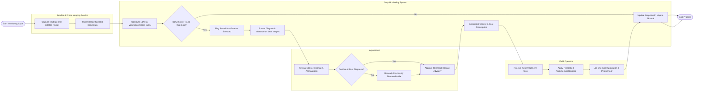

# Swimlane Diagram — Crop Monitoring & Management System

## Mermaid Code

## Flow Description | Mo ta luong

| Lane | Actor / Subsystem | Role in Flow |
|------|-------------------|--------------|
| Satellite & Drone Imaging Service | Remote Sensing Provider | Captures macro-level multispectral satellite bands and micro-level drone flight images over target farm parcel coordinates. |
| Crop Monitoring System | Automated Core Platform | Processes raw spectral feeds to compute NDVI indices, evaluates vegetation stress thresholds, triggers AI diagnostic models, formulates chemical advisories, and maintains live field health maps. |
| Agronomist | Technical Crop Expert | Analyzes automated stress alerts, verifies AI-generated pest disease diagnoses, adjusts chemical dosage formulations, and authorizes treatment dispatches. |
| Field Operator | Ground Execution Staff | Receives approved chemical treatment tasks on mobile devices, applies prescribed pesticides/fertilizers in the target field zone, and submits execution logs with photo proof. |
