# Action Tree — Crop Monitoring & Management System

## Mermaid Code

```mermaid
graph TD
    Root["Crop Monitoring & Management System"]

    Root --> M1["Parcel & Spatial Boundary Management"]
    Root --> M2["Crop Growth Lifecycle Tracking"]
    Root --> M3["Remote Sensing & Spatial Data Ingestion"]
    Root --> M4["Agronomic Disease & Pest Diagnosis"]
    Root --> M5["Predictive Analytics & Advisory Engine"]
    Root --> M6["Treatment Logistics & Compliance Reporting"]

    M1 --> A11["Draw GeoJSON Parcel Boundaries"]
    M1 --> A12["Define Soil Nutrient Baselines"]
    M1 --> A13["Manage Field Elevation & Topography"]

    M2 --> A21["Register Seasonal Cultivation Cycles"]
    M2 --> A22["Set Crop Growth Stage Benchmarks"]
    M2 --> A23["Track Phenological Growth Progress"]
    M2 --> A24["Record Historical Crop Rotation Logs"]

    M3 --> A31["Fetch Sentinel Satellite Spectral Imagery"]
    M3 --> A32["Compute NDVI & NDRE Vegetation Heatmaps"]
    M3 --> A33["Ingest Drone Flight Multispectral Rasters"]
    M3 --> A34["Process Soil Telemetry & Moisture Data"]

    M4 --> A41["Execute AI Disease Inference on Leaf Photos"]
    M4 --> A42["Map Pest Outbreak Severity Zones"]
    M4 --> A43["Validate AI Diagnosis with Agronomist Review"]

    M5 --> A51["Generate NPK Fertilizer Prescriptions"]
    M5 --> A52["Formulate Soil Moisture Irrigation Schedules"]
    M5 --> A53["Predict Crop Harvest Yield & Target Dates"]
    M5 --> A54["Trigger Extreme Climate Risk Notifications"]

    M6 --> A61["Dispatch Agrochemical Field Treatment Tasks"]
    M6 --> A62["Log Chemical Application & Safety Intervals"]
    M6 --> A63["Order Agrochemical Supplies & Fertilizers"]
    M6 --> A64["Export Regulatory Compliance Audit Documents"]
```

## Module Description | Mo ta Module

| # | Module | Description | Actions |
|---|--------|-------------|---------|
| 1 | Parcel & Spatial Boundary Management | Manages GIS spatial mapping, GeoJSON boundary definitions, elevation contours, and soil baseline attributes | Draw GeoJSON Parcel Boundaries, Define Soil Nutrient Baselines, Manage Field Elevation & Topography |
| 2 | Crop Growth Lifecycle Tracking | Monitors cultivation cycles, sets growth stage benchmarks (germination, tillering, flowering), and logs crop rotation histories | Register Seasonal Cultivation Cycles, Set Crop Growth Stage Benchmarks, Track Phenological Growth Progress, Record Historical Crop Rotation Logs |
| 3 | Remote Sensing & Spatial Data Ingestion | Processes satellite multispectral imagery, drone aerial surveys, soil IoT telemetry, and computes NDVI/NDRE health maps | Fetch Sentinel Satellite Spectral Imagery, Compute NDVI & NDRE Vegetation Heatmaps, Ingest Drone Flight Multispectral Rasters, Process Soil Telemetry & Moisture Data |
| 4 | Agronomic Disease & Pest Diagnosis | Leverages computer vision AI models and expert agronomist validation to identify crop diseases, pests, and infestation severity | Execute AI Disease Inference on Leaf Photos, Map Pest Outbreak Severity Zones, Validate AI Diagnosis with Agronomist Review |
| 5 | Predictive Analytics & Advisory Engine | Synthesizes environmental data to formulate precise irrigation schedules, fertilizer dosages, climate risk alerts, and yield projections | Generate NPK Fertilizer Prescriptions, Formulate Soil Moisture Irrigation Schedules, Predict Crop Harvest Yield & Target Dates, Trigger Extreme Climate Risk Notifications |
| 6 | Treatment Logistics & Compliance Reporting | Coordinates chemical application task dispatches, input reordering, operator safety logs, and regulatory compliance exports | Dispatch Agrochemical Field Treatment Tasks, Log Chemical Application & Safety Intervals, Order Agrochemical Supplies & Fertilizers, Export Regulatory Compliance Audit Documents |
