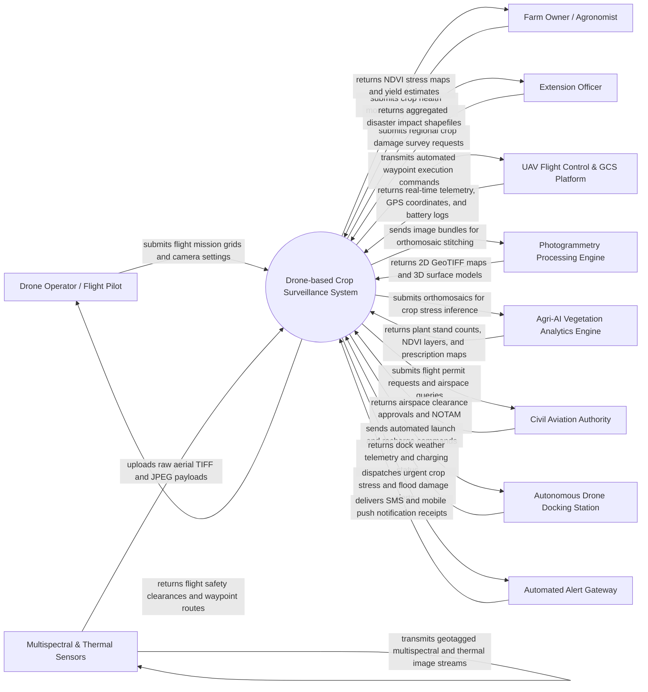

# Context Diagram — Drone-based Crop Surveillance System

## Mermaid Code

## Actor & Interaction Table | Bang Actor & Tuong tac

| # | Actor | Actor Type | Data Sent TO System | Data Received FROM System | Notes |
|---|-------|------------|---------------------|---------------------------|-------|
| 1 | Drone Operator / Flight Pilot | Primary | Flight mission grids, altitude targets, overlap percentages, camera trigger rates | Flight path validation, GCS telemetry displays, airspace safety clearance status | Certified remote pilot managing UAV hardware, mission execution, and field flight safety |
| 2 | Farm Owner / Agronomist | Primary | Field parcel GIS boundaries, crop varieties, growth stage milestones, target indices | NDVI/NDRE vegetation index maps, crop stand density counts, variable rate prescription files | Agricultural manager receiving spatial crop health insights to optimize fertilizer and water inputs |
| 3 | Extension Officer | Primary | Regional survey requests, crop damage verification queries | Aggregated flood damage maps, regional pest infestation reports, GIS shapefile exports | Field agent auditing agricultural disaster claims and monitoring regional crop conditions |
| 4 | UAV Flight Control & GCS Platform | Supporting System | Real-time flight telemetry (altitude, speed, heading, battery voltage, GPS RTK precision) | Autonomous waypoint navigation commands, emergency return-to-home (RTH) triggers | Ground Control Station (GCS) software (e.g., DJI Pilot, PX4 QGroundControl) interfacing with UAV flight controllers |
| 5 | Multispectral & Thermal Sensors | Supporting System | Geotagged multispectral (NIR, RedEdge, Green), RGB, and thermal radiance image files | Camera shutter triggers, spectral gain settings, exposure calibration profiles | Airborne optical and thermal sensor payloads capturing crop canopy spectral reflectance |
| 6 | Photogrammetry Processing Engine | Supporting System | High-resolution 2D GeoTIFF orthomosaics, Digital Elevation Models (DEM), 3D point clouds | Raw geotagged aerial imagery bundles, Ground Control Point (GCP) coordinates | Cloud/edge photogrammetry software (e.g., Pix4D, Agisoft Metashape) processing raw images into orthomosaics |
| 7 | Agri-AI Vegetation Analytics Engine | Supporting System | Plant stand counts, weed infestation clusters, NDVI/NDRE index layers, nitrogen prescription maps | Stitched orthomosaic maps, multispectral band layers, crop growth stage context | Deep learning spatial analytics microservice extracting agronomic insights from orthomosaics |
| 8 | Civil Aviation Authority | Regulatory System | Airspace authorization codes, Notice to Airmen (NOTAM) restrictions, temporary flight bans | UAV flight permit applications, pilot license IDs, planned mission altitude grids | Government authority regulating airspace safety, drone flight limits, and no-fly zones |
| 9 | Autonomous Drone Docking Station | Supporting System | Dock shelter status, battery charging progress, local microclimate station weather data | Autonomous flight launch schedules, landing guidance triggers, firmware updates | Automated field docking station allowing unmanned drone deployment, battery swapping, and data offloading |
| 10 | Automated Alert Gateway | Supporting System | SMS delivery logs, mobile notification receipts | High-priority crop stress alerts, flight emergency warnings, battery malfunction alerts | Multi-channel communication service notifying farmers immediately when severe crop stress is detected |

## System Boundary Description | Mo ta Pham vi He thong

The **Drone-based Crop Surveillance System** is an integrated geospatial precision agriculture platform that coordinates autonomous UAV flight operations, ingests multispectral aerial imagery, processes photogrammetry orthomosaics, calculates vegetation indices, and generates actionable field prescription maps.

The **system boundary** encompasses mission grid planning, airspace clearance validation, GCS telemetry monitoring, photogrammetry stitching integration, multispectral index computation (NDVI/NDRE), AI plant counting, crop stress anomaly detection, variable rate fertilizer map generation, and automated docking station management.

**External to the system boundary** are physical UAV rotor aerodynamics, physical battery chemical charging, national civil aviation radar operations, physical optical camera sensor manufacturing, and tractor hardware application of fertilizer. Communication interfaces utilize MAVLink telemetry, RTK GPS corrections, RESTful cloud APIs, and GeoTIFF geospatial raster standards.
