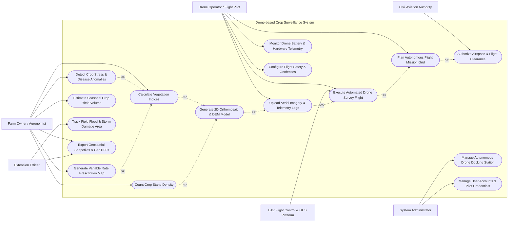

# Use Case Diagram — Drone-based Crop Surveillance System

## Mermaid Code

## Actor Table | Bang Actor

| # | Actor | Actor Type | Role Description | Related Use Cases |
|---|-------|------------|------------------|-------------------|
| 1 | Drone Operator / Flight Pilot | Primary | Certified UAV pilot creating mission flight grids, launching drones, and monitoring telemetry | UC01, UC03, UC04, UC12, UC15 |
| 2 | Farm Owner / Agronomist | Primary | Agricultural specialist analyzing crop health indices, plant stand counts, and prescription maps | UC06, UC07, UC08, UC09, UC10, UC14 |
| 3 | Extension Officer | Primary | Government field advisor reviewing storm/flood crop damage maps and exporting GIS shapefiles | UC11, UC14 |
| 4 | System Administrator | Primary | Technical admin managing drone docking stations, system configurations, and pilot credentials | UC13, UC16 |
| 5 | UAV Flight Control & GCS Platform | Secondary / System | External ground control station platform sending waypoints and receiving live MAVLink telemetry | UC03 |
| 6 | Civil Aviation Authority | Secondary / Regulatory | Regulatory agency granting airspace flight clearance and verifying pilot licenses | UC02 |

## Use Case Table | Bang Use Case

| # | UC ID | Use Case Name | Primary Actor | Secondary Actor | Description | Priority |
|---|-------|---------------|---------------|-----------------|-------------|----------|
| 1 | UC01 | Plan Autonomous Flight Mission Grid | Drone Operator | None | Defines flight boundary polygon, altitude, GSD resolution, and overlap ratios | High |
| 2 | UC02 | Authorize Airspace & Flight Clearance | Drone Operator | Civil Aviation | Verifies pilot license, checks local NOTAM restrictions, and submits flight permit | High |
| 3 | UC03 | Execute Automated Drone Survey Flight | Drone Operator | GCS Platform | Commands drone to launch, follow autonomous waypoint grid, capture photos, and return | High |
| 4 | UC04 | Upload Aerial Imagery & Telemetry Logs | Drone Operator | None | Transfers geotagged multispectral/RGB photos and flight telemetry logs to cloud | High |
| 5 | UC05 | Generate 2D Orthomosaic & DEM Model | System | Photogrammetry | Stitches raw aerial photos into high-resolution 2D GeoTIFF orthomosaic and DEM maps | High |
| 6 | UC06 | Calculate Vegetation Indices | Farm Owner / Agronomist | AI Analytics | Computes NDVI, NDRE, and MSAVI spectral reflectance layers across crop field | High |
| 7 | UC07 | Detect Crop Stress & Disease Anomalies | Farm Owner / Agronomist | AI Analytics | Identifies water stress, nitrogen deficiency, and pest infection clusters | High |
| 8 | UC08 | Count Crop Stand Density | Farm Owner / Agronomist | AI Analytics | Uses deep learning computer vision to count individual plant seedlings and emergence % | Medium |
| 9 | UC09 | Generate Variable Rate Prescription Map | Farm Owner / Agronomist | AI Analytics | Builds spatial fertilizer/pesticide application maps for smart tractor machinery | High |
| 10 | UC10 | Estimate Seasonal Crop Yield Volume | Farm Owner / Agronomist | AI Analytics | Combines canopy cover, NDVI curves, and DEM canopy height to predict harvest yield | Medium |
| 11 | UC11 | Track Field Flood & Storm Damage Area | Extension Officer | None | Measures inundated field hectares and lodging crop damage post-severe weather | High |
| 12 | UC12 | Monitor Drone Battery & Hardware Telemetry | Drone Operator | None | Displays live battery cell voltage, motor temps, GPS RTK fix quality, and signal strength | High |
| 13 | UC13 | Manage Autonomous Drone Docking Station | System Administrator | Drone Dock | Controls automated docking station roof shelter, charging cycles, and HVAC system | Medium |
| 14 | UC14 | Export Geospatial Shapefiles & GeoTIFFs | Farm Owner / Agronomist | Extension Officer | Downloads standard GIS shapefiles, GeoTIFF rasters, and PDF summary reports | High |
| 15 | UC15 | Configure Flight Safety & Geofences | Drone Operator | None | Sets maximum altitude, virtual geofence boundaries, and low battery RTH triggers | High |
| 16 | UC16 | Manage User Accounts & Pilot Credentials | System Administrator | None | Manages pilot Remote Pilot Certificates (Part 107), user roles, and access tiers | Low |

## Use Case Specification | Dac ta Use Case

---

### UC01 — Plan Autonomous Flight Mission Grid

| Field | Detail |
|-------|--------|
| **UC ID** | UC01 |
| **Use Case Name** | Plan Autonomous Flight Mission Grid |
| **Actor(s)** | Primary: Drone Operator / Flight Pilot   Secondary: None |
| **Description** | Allows a remote drone pilot to select a target farm field boundary, set flight altitude, ground sample distance (GSD), front/side image overlap percentages, and camera trigger parameters to generate an autonomous UAV flight path. |
| **Precondition** | 1. Pilot is logged into the system with valid UAV operator credentials.   2. Target farm field parcel GIS boundary is selected. |
| **Main Flow** | 1. Pilot selects target farm parcel on interactive satellite map view.   2. System retrieves terrain elevation profile (DEM) for the selected parcel.   3. Pilot selects camera payload type (e.g., Multispectral 5-Band, RGB 45MP, Thermal).   4. Pilot inputs target Ground Sample Distance (e.g., $1.5\text{ cm/pixel}$) or flight altitude (e.g., $75\text{ meters}$ AGL).   5. Pilot sets image overlap parameters (e.g., $75\%$ Front Overlap, $70\%$ Side Overlap).   6. System calculates optimal grid flight pattern (Lawnmower / Cross-hatch), total flight distance, estimated flight time, and number of required batteries.   7. System computes waypoints including takeoff point, survey grid lines, camera trigger coordinates, and Return-to-Home (RTH) waypoint.   8. System validates flight plan against maximum altitude limits ($120\text{ meters}$) and geofence restrictions.   9. System saves mission plan and sets status to `PLANNED`. |
| **Alternative Flow** | **AF1** — Terrain Following Mode: System adjusts waypoint altitudes dynamically according to DEM elevation contours to maintain constant AGL distance over hilly terrain.   **AF2** — Multi-Parcel Batch Planning: System combines adjacent farm fields into a single optimized flight path sequence to minimize turn-around time. |
| **Exception Flow** | **EX1** — Restricted Airspace Violation: If planned grid intersects a designated airport no-fly zone, system blocks mission creation and highlights conflict zone in red.   **EX2** — Insufficient Battery Capacity: If calculated flight time exceeds single-battery endurance, system prompts pilot to split mission into multi-flight segments. |
| **Postcondition** | Mission grid file saved in system database, formatted as MAVLink/KML waypoint payload ready for export to Ground Control Station (GCS). |
| **Business Rule** | **BR1**: Front overlap must be $\ge 75\%$ and side overlap $\ge 70\%$ for valid photogrammetry orthomosaic stitching.   **BR2**: Flight altitude must not exceed 120 meters (400 feet) AGL per civil aviation regulations. |

---

### UC03 — Execute Automated Drone Survey Flight

| Field | Detail |
|-------|--------|
| **UC ID** | UC03 |
| **Use Case Name** | Execute Automated Drone Survey Flight |
| **Actor(s)** | Primary: Drone Operator / Flight Pilot   Secondary: UAV Flight Control & GCS Platform |
| **Description** | Transmits planned mission waypoints to the UAV flight controller, executes automated takeoff, guides the drone along the survey grid while triggering synchronized camera image captures, and conducts automated landing or RTH. |
| **Precondition** | 1. Mission grid status is `AUTHORIZED` (UC02).   2. UAV hardware pre-flight checklist is completed (GPS RTK fixed, battery voltage $>95\%$, SD card space ok). |
| **Main Flow** | 1. Pilot connects GCS tablet to drone remote controller and selects "Upload Mission".   2. System uploads MAVLink waypoint parameters to UAV flight controller.   3. Pilot conducts physical perimeter check and taps "Arm & Launch".   4. Drone executes automated VTOL takeoff, climbs to mission altitude ($75\text{ meters}$ AGL), and navigates to Waypoint 1.   5. Drone flies along survey grid lines at constant speed ($6\text{ m/s}$).   6. Flight controller triggers camera shutter at calculated spatial intervals, tagging each image with GPS RTK coordinates, altitude, pitch, roll, and yaw EXIF data.   7. System displays real-time telemetry (drone position, battery cell voltage, speed, signal RSSI, captured image count) on GCS display.   8. Upon completing final waypoint, drone navigates to Home point, executes automated descent, and lands within $0.5\text{ meters}$ of launch mark.   9. System marks mission status as `FLIGHT_COMPLETED`. |
| **Alternative Flow** | **AF1** — Dock Station Autonomous Execution: Mission is initiated automatically by Autonomous Drone Docking Station (UC13) without on-site pilot intervention.   **AF2** — Mid-Flight Battery Swap: If battery reaches 30% reserve, drone executes automated RTH, pilot swaps battery, and drone resumes mission from last completed waypoint. |
| **Exception Flow** | **EX1** — Low Battery Emergency RTH: Battery reaches critical threshold (20%), flight controller aborts survey and executes immediate Return-to-Home.   **EX2** — Signal Disconnection: If GCS radio link is lost for $>10\text{ seconds}$, drone automatically triggers failsafe RTH mode. |
| **Postcondition** | Complete set of geotagged aerial imagery files recorded on onboard SD card and mission telemetry log saved in system database. |
| **Business Rule** | **BR1**: Automated flight must immediately abort if wind speed exceeds $12\text{ m/s}$ or precipitation begins.   **BR2**: RTK GPS position fix must be `FIXED` (centimeter accuracy) before takeoff authorization. |

---

### UC05 — Generate 2D Orthomosaic & DEM Model

| Field | Detail |
|-------|--------|
| **UC ID** | UC05 |
| **Use Case Name** | Generate 2D Orthomosaic & DEM Model |
| **Actor(s)** | Primary: System   Secondary: Photogrammetry Processing Engine |
| **Description** | Ingests uploaded raw geotagged aerial images, performs keypoint matching, aerotriangulation, bundle block adjustment, and orthorectification to produce seamless 2D GeoTIFF orthomosaics and Digital Elevation Models (DEM). |
| **Precondition** | 1. Raw geotagged image bundle upload is complete (UC04).   2. Photogrammetry processing cluster has available compute nodes. |
| **Main Flow** | 1. System extracts image EXIF metadata (latitude, longitude, altitude, camera focal length, sensor dimensions).   2. System submits image dataset to Photogrammetry Processing Engine.   3. Processing engine detects scale-invariant feature keypoints across overlapping images.   4. Engine performs Structure-from-Motion (SfM) sparse point cloud reconstruction and camera position optimization.   5. Engine incorporates Ground Control Points (GCPs) or RTK GPS tags for georeferencing calibration.   6. Engine builds dense 3D point cloud and generates Digital Surface Model (DSM) mesh.   7. Engine orthorectifies individual aerial photos against DSM to eliminate perspective distortion.   8. Engine blends orthophotos into a seamless, color-balanced 2D GeoTIFF orthomosaic (RGB and Multispectral bands).   9. System imports generated GeoTIFF files, builds pyramid spatial tiles, and sets status to `ORTHOMOSAIC_READY`. |
| **Alternative Flow** | **AF1** — Fast Cloud Edge Processing: System executes low-resolution rapid orthomosaic stitching on field laptop within 15 minutes of landing for quick field check. |
| **Exception Flow** | **EX1** — Insufficient Image Overlap: Engine detects $<50\%$ overlap between image pairs, resulting in stitching gaps; system flags mission as `STITCHING_FAILED` and recommends re-flight.   **EX2** — Blurry Images Excluded: Engine automatically filters out motion-blurred photos prior to bundle adjustment. |
| **Postcondition** | High-resolution georeferenced GeoTIFF orthomosaic ($<2\text{ cm/pixel}$) and DEM raster saved in cloud storage and mapped to field parcel. |
| **Business Rule** | **BR1**: Absolute spatial accuracy of orthomosaic must be $< 5\text{ cm}$ when using RTK GPS positioning. |

---

### UC06 — Calculate Vegetation Indices

| Field | Detail |
|-------|--------|
| **UC ID** | UC06 |
| **Use Case Name** | Calculate Vegetation Indices |
| **Actor(s)** | Primary: Farm Owner / Agronomist   Secondary: AI Analytics Engine |
| **Description** | Computes multi-band spectral reflectance vegetation indices (NDVI, NDRE, MSAVI, EVI) from multispectral orthomosaics to evaluate plant chlorophyll content, canopy vigor, and spatial crop health variations. |
| **Precondition** | 1. Multispectral orthomosaic GeoTIFF (NIR, RedEdge, Red, Green) is generated (UC05).   2. Radiometric calibration tarp readings or downwelling light sensor logs are applied. |
| **Main Flow** | 1. Agronomist selects target farm parcel and opens "Vegetation Analytics" tab.   2. System retrieves calibrated multispectral GeoTIFF raster bands (Band 1: Green, Band 2: Red, Band 3: RedEdge, Band 4: Near-Infrared).   3. Agronomist selects desired vegetation index formula:   &nbsp;&nbsp;&nbsp;&nbsp;a. **NDVI** (Normalized Difference Vegetation Index): $\frac{\text{NIR} - \text{Red}}{\text{NIR} + \text{Red}}$ (Overall canopy vigor).   &nbsp;&nbsp;&nbsp;&nbsp;b. **NDRE** (Normalized Difference Red Edge Index): $\frac{\text{NIR} - \text{RedEdge}}{\text{NIR} + \text{RedEdge}}$ (Mid-to-late stage nitrogen & chlorophyll content).   &nbsp;&nbsp;&nbsp;&nbsp;c. **MSAVI** (Modified Soil-Adjusted Vegetation Index): Minimizes soil background interference in early stage crops.   4. System executes pixel-level raster math across the field polygon.   5. System generates colorized false-color map layer (Green = Healthy, Yellow = Moderate, Red = Stressed).   6. System calculates summary statistical metrics: mean index score, standard deviation, and histogram distribution.   7. System overlays index map layer onto interactive field GIS map. |
| **Alternative Flow** | **AF1** — Multi-Temporal Trend Comparison: System compares current NDVI layer with previous flight scans from 14 days ago, highlighting crop growth progression or decline zones in delta heatmap. |
| **Exception Flow** | **EX1** — Uncalibrated Radiance Warning: If reflectance calibration tarp image is missing, system displays warning that index values represent relative rather than absolute reflectance. |
| **Postcondition** | Georeferenced vegetation index raster maps (NDVI/NDRE) stored and available for prescription map generation (UC09). |
| **Business Rule** | **BR1**: NDRE index must be recommended over NDVI for dense closed-canopy crops (e.g., mature corn/sugarcane) to prevent spectral saturation. |

---

### UC09 — Generate Variable Rate Prescription Map

| Field | Detail |
|-------|--------|
| **UC09** | Generate Variable Rate Prescription Map |
| **Use Case Name** | Generate Variable Rate Prescription Map |
| **Actor(s)** | Primary: Farm Owner / Agronomist   Secondary: AI Analytics Engine |
| **Description** | Transforms vegetation index maps (NDVI/NDRE) into actionable variable-rate fertilizer (VRA Nitrogen) or pesticide application shapefiles compatible with smart tractor machinery and agricultural spraying drones. |
| **Precondition** | 1. Calibrated vegetation index layer (UC06) is available.   2. Agronomist specifies total target fertilizer budget or baseline application rate ($kg/\text{ha}$). |
| **Main Flow** | 1. Agronomist selects "Generate Prescription Map" for the target field parcel.   2. Agronomist selects target input type (e.g., Urea 46% N, Liquid Nitrogen, Fungicide).   3. Agronomist selects application strategy:   &nbsp;&nbsp;&nbsp;&nbsp;a. **Corrective Strategy**: Higher nitrogen applied to low-NDRE (nitrogen deficient) zones to boost lagging plants.   &nbsp;&nbsp;&nbsp;&nbsp;b. **Potential-Based Strategy**: Higher nitrogen applied to high-NDRE (high yield potential) zones.   4. System classifies field parcel into 3 to 5 management zones based on index threshold ranges.   5. System computes recommended input rate ($kg/\text{ha}$ or $L/\text{ha}$) for each management zone.   6. System calculates total required fertilizer volume for the entire field, comparing against target budget.   7. System converts raster zones into vector polygon grid (e.g., $10\text{m} \times 10\text{m}$ grid cells) matching tractor boom width.   8. System exports prescription file in standard machine formats: ISO-XML (ISO 11783), Shapefile (.shp/.dbf/.shx), or Trimble/John Deere proprietary formats.   9. Agronomist downloads prescription package to USB drive or transfers directly to smart tractor terminal via cloud. |
| **Alternative Flow** | **AF1** — Direct Spraying Drone Mission Export: System exports prescription map directly as a spot-spraying mission plan for agricultural spraying drones (e.g., DJI Agras T40). |
| **Exception Flow** | **EX1** — Excessive Rate Limit Warning: If calculated zone dosage exceeds maximum safe crop chemical threshold, system caps rate and displays agronomic warning. |
| **Postcondition** | Georeferenced Variable Rate Application (VRA) prescription file package created and downloaded. |
| **Business Rule** | **BR1**: Prescription polygon grid cell resolution must match the mechanical boom width of the target application equipment. |
