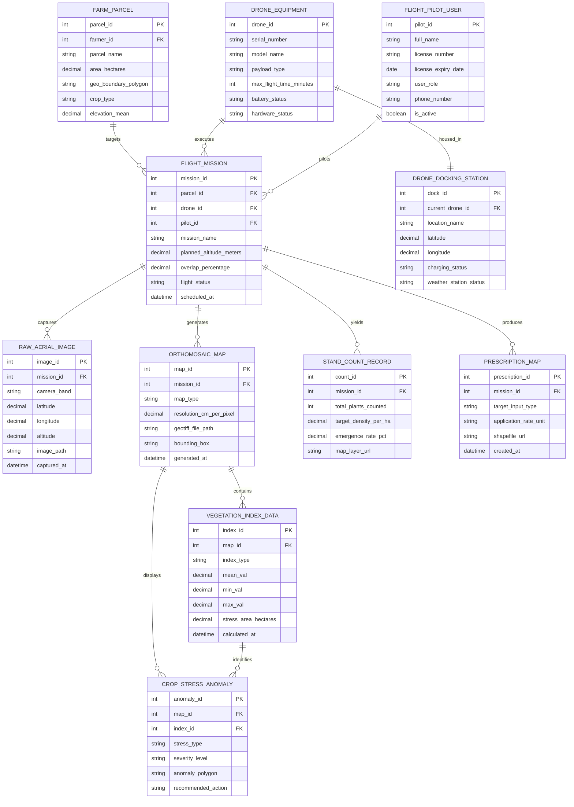

# Conceptual ERD — Drone-based Crop Surveillance System

## Mermaid Code

## Entity Description Table | Bang mo ta Entity

| # | Entity Name | Vietnamese Name | Description | Key Attributes | Main Relationships |
|---|-------------|-----------------|-------------|----------------|-------------------|
| 1 | FARM_PARCEL | Thửa Đất Nông Nghiệp | Represents geographic farm fields, area in hectares, crop varieties, and spatial GIS polygon boundaries | parcel_id, parcel_name, area_hectares, geo_boundary_polygon, crop_type | Has many FLIGHT_MISSION |
| 2 | DRONE_EQUIPMENT | Thiết Bị Drone / UAV | Stores unmanned aerial vehicle hardware specifications, sensor payload types, battery state, and status | drone_id, serial_number, model_name, payload_type, hardware_status | Executes FLIGHT_MISSION, housed in DRONE_DOCKING_STATION |
| 3 | FLIGHT_MISSION | Sứ Mệnh Bay Giám Sát | Central record capturing flight plans, altitude targets, overlap ratios, waypoint status, and timestamps | mission_id, parcel_id, drone_id, pilot_id, planned_altitude_meters, flight_status | Targets PARCEL, executed by DRONE, piloted by PILOT, yields IMAGES and MAPS |
| 4 | RAW_AERIAL_IMAGE | Ảnh Hàng Không Thô | Stores metadata for individual geotagged photos captured during flight (multispectral bands, RTK GPS, orientation) | image_id, mission_id, camera_band, latitude, longitude, image_path | Belongs to FLIGHT_MISSION |
| 5 | ORTHOMOSAIC_MAP | Bản Đồ Ghép Cánh Đồng | Stores stitched 2D GeoTIFF orthomosaics, spatial resolution ($cm/\text{pixel}$), bounding box, and DEM rasters | map_id, mission_id, map_type, resolution_cm_per_pixel, geotiff_file_path | Belongs to FLIGHT_MISSION, contains VEGETATION_INDEX and ANOMALY |
| 6 | VEGETATION_INDEX_DATA | Dữ Liệu Chỉ Số Thực Vật | Holds calculated multispectral indices (NDVI, NDRE, MSAVI), mean values, and stressed area metrics | index_id, map_id, index_type, mean_val, stress_area_hectares | Belongs to ORTHOMOSAIC_MAP, identifies CROP_STRESS_ANOMALY |
| 7 | CROP_STRESS_ANOMALY | Dấu Hiệu Bệnh & Stress Cây | Captures georeferenced stress anomaly polygons (nitrogen deficit, water stress, pest infection clusters) | anomaly_id, map_id, index_id, stress_type, severity_level, anomaly_polygon | Belongs to ORTHOMOSAIC_MAP and VEGETATION_INDEX |
| 8 | STAND_COUNT_RECORD | Báo Cáo Mật Độ Cây Trồng | Stores AI seedling count results, plant emergence rates, target plant density per hectare, and count layers | count_id, mission_id, total_plants_counted, emergence_rate_pct | Yielded by FLIGHT_MISSION |
| 9 | PRESCRIPTION_MAP | Bản Đồ Phân Bón Biến Thiên | Captures Variable Rate Application (VRA) fertilizer/pesticide shapefiles for smart tractor machinery | prescription_id, mission_id, target_input_type, shapefile_url | Produced by FLIGHT_MISSION |
| 10 | DRONE_DOCKING_STATION | Trạm Sạc & Trạm Bay Tự Động | Stores autonomous drone docking hardware status, weather sensor telemetry, charging state, and drone shelter status | dock_id, current_drone_id, location_name, charging_status | Houses DRONE_EQUIPMENT |
| 11 | FLIGHT_PILOT_USER | Phi Công / Operator | Stores remote pilot credentials, FAA Part 107 / CAAV licenses, license expiration dates, and contact info | pilot_id, full_name, license_number, user_role, is_active | Pilots FLIGHT_MISSION |

## Relationship Description | Mo ta Quan he

| # | From Entity | Cardinality | To Entity | Relationship Label | Business Explanation |
|---|-------------|-------------|-----------|-------------------|----------------------|
| 1 | FARM_PARCEL | one-to-many | FLIGHT_MISSION | targets | A farm parcel can be the target of multiple drone surveillance flight missions over time |
| 2 | DRONE_EQUIPMENT | one-to-many | FLIGHT_MISSION | executes | A drone aircraft can execute multiple surveillance flight missions across different fields |
| 3 | FLIGHT_PILOT_USER | one-to-many | FLIGHT_MISSION | pilots | A certified remote pilot can supervise and execute multiple drone flight missions |
| 4 | FLIGHT_MISSION | one-to-many | RAW_AERIAL_IMAGE | captures | A flight mission captures hundreds of individual geotagged raw aerial images |
| 5 | FLIGHT_MISSION | one-to-many | ORTHOMOSAIC_MAP | generates | A flight mission generates RGB, multispectral, and DEM orthomosaic map layers |
| 6 | FLIGHT_MISSION | one-to-many | STAND_COUNT_RECORD | yields | A flight mission yields automated AI plant seedling count and emergence records |
| 7 | FLIGHT_MISSION | one-to-many | PRESCRIPTION_MAP | produces | A flight mission produces variable-rate fertilizer prescription shapefile packages |
| 8 | ORTHOMOSAIC_MAP | one-to-many | VEGETATION_INDEX_DATA | contains | An orthomosaic map contains multiple computed vegetation index layers (NDVI, NDRE) |
| 9 | ORTHOMOSAIC_MAP | one-to-many | CROP_STRESS_ANOMALY | displays | An orthomosaic map displays detected crop stress anomaly polygons and severity clusters |
| 10 | VEGETATION_INDEX_DATA | one-to-many | CROP_STRESS_ANOMALY | identifies | Vegetation index score anomalies identify specific spatial crop stress areas |
| 11 | DRONE_EQUIPMENT | one-to-one | DRONE_DOCKING_STATION | housed_in | An autonomous drone unit can be housed in and managed by one dedicated docking station |
