# Swimlane Diagram — Drone-based Crop Surveillance System

## Mermaid Code

```mermaid
flowchart LR
    Start(["Start Survey Mission Cycle"])

    subgraph PilotLane["Drone Pilot / Farm Operator"]
        A1["Select Parcel & Set Flight Grid Parameters"]
        A2["Request Airspace & Pre-Flight Check"]
        A3["Monitor Autonomous Flight & Telemetry"]
        A4["Review NDVI Layer & Crop Health Maps"]
        A5["Download VRA Prescription Shapefile"]
    end

    subgraph SystemLane["Drone-based Crop Surveillance System"]
        S1["Validate Airspace & Geofence Safety"]
        S2{"Pre-Flight Safety OK?"}
        S3["Upload Mission Waypoints to GCS"]
        S4["Store Geotagged Image Dataset"]
        S5["Compute NDVI/NDRE Vegetation Layers"]
    end

    subgraph HardwareLane["Drone Flight Control & Docking Hardware"]
        H1["Execute Automated Launch & Survey Flight"]
        H2["Trigger Camera Shutter at Waypoints"]
        H3{"Battery < 20% or Mission End?"}
        H4["Execute Automated Landing & Dock Recharge"]
    end

    subgraph AnalyticsLane["Photogrammetry & AI Vision Engine"]
        E1["Stitch Raw Photos into Orthomosaic"]
        E2["Run AI Stand Count & Crop Stress Scoring"]
        E3["Generate Variable Rate Nitrogen Prescription"]
    end

    subgraph AgronomistLane["Agronomist / Extension Officer"]
        G1["Inspect Field Crop Health Anomaly Clusters"]
        G2["Validate Chemical Spraying Dosage"]
    end

    Finish(["End Mission Cycle"])

    Start --> A1 --> A2 --> S1 --> S2
    S2 -->|"No"| A1
    S2 -->|"Yes"| S3 --> H1 --> H2 --> H3
    H3 -->|"In Progress"| H2
    H3 -->|"Finished / Low Batt"| H4 --> S4 --> E1 --> S5 --> E2 --> E3 --> A4 --> G1 --> G2 --> A5 --> Finish
```

## Flow Description | Mo ta luong

| Lane | Actor | Role in Flow |
|------|-------|-------------|
| 1 | Drone Pilot / Farm Operator | Selects farm field parcel, configures mission altitude/overlap parameters, performs pre-flight checks, monitors real-time flight telemetry, reviews crop health maps, and downloads prescription shapefiles |
| 2 | Drone-based Crop Surveillance System | Validates civil aviation airspace rules and geofences, uploads MAVLink waypoint grids, stores geotagged aerial imagery payloads, computes vegetation indices (NDVI/NDRE), and manages workflow outputs |
| 3 | Drone Flight Control & Docking Hardware | Executes automated VTOL launch, navigates survey grid lines, triggers camera shutter at spatial intervals, monitors cell battery voltage, and executes automated precision landing and docking station recharging |
| 4 | Photogrammetry & AI Vision Engine | Processes raw geotagged aerial photos into 2D GeoTIFF orthomosaics and DEMs, runs deep learning plant stand count algorithms, isolates stress anomalies, and generates variable rate fertilizer prescriptions |
| 5 | Agronomist / Extension Officer | Inspects spatial crop stress anomaly clusters, validates chemical application dosages, and signs off on variable-rate prescriptions prior to machine application |
