# Action Tree — Drone-based Crop Surveillance System

## Mermaid Code

```mermaid
graph TD
    Root["Drone-based Crop Surveillance System"]

    Root --> M1["Farm Parcel & Airspace Management"]
    Root --> M2["Autonomous Flight Mission Planning"]
    Root --> M3["Drone Fleet & Docking Station Control"]
    Root --> M4["Raw Aerial Image & Sensor Ingestion"]
    Root --> M5["Photogrammetry & Multispectral Indexing"]
    Root --> M6["AI Crop Stress & Stand Density Analytics"]
    Root --> M7["Variable Rate Prescription & GIS Export"]

    M1 --> A11["Register Farm Field Parcel Polygon"]
    M1 --> A12["Check Civil Aviation Airspace Rules"]
    M1 --> A13["Verify Remote Pilot License Credentials"]
    M1 --> A14["Set Virtual Geofence & Altitude Limits"]

    M2 --> A21["Configure Flight Altitude & GSD Resolution"]
    M2 --> A22["Set Front & Side Image Overlap Ratios"]
    M2 --> A23["Generate MAVLink Survey Grid Waypoints"]
    M2 --> A24["Enable DEM Terrain Following Mode"]

    M3 --> A31["Upload Waypoints to Ground Control Station"]
    M3 --> A32["Monitor Live GPS RTK & Battery Telemetry"]
    M3 --> A33["Trigger Automated Return-to-Home Failsafe"]
    M3 --> A34["Manage Docking Station Shelter & Charging"]

    M4 --> A41["Ingest Raw Geotagged TIFF & JPEG Files"]
    M4 --> A42["Parse EXIF GPS & Camera Orientation Metadata"]
    M4 --> A43["Apply Reflectance Tarp Radiometric Calibration"]
    M4 --> A44["Validate Image Quality & Remove Motion Blur"]

    M5 --> A51["Stitch 2D GeoTIFF Orthomosaic & DEM Model"]
    M5 --> A52["Calculate NDVI & NDRE Vegetation Layers"]
    M5 --> A53["Compute MSAVI Soil-Adjusted Crop Index"]
    M5 --> A54["Generate Multi-Temporal Delta Heatmaps"]

    M6 --> A61["Detect Crop Nitrogen & Water Stress Clusters"]
    M6 --> A62["Count Plant Seedling Stand Density"]
    M6 --> A63["Measure Flood Inundation & Lodging Damage"]
    M6 --> A64["Predict Seasonal Harvest Yield Volume"]

    M7 --> A71["Classify Field Management Zones"]
    M7 --> A72["Generate Variable Rate Nitrogen Prescriptions"]
    M7 --> A73["Export ISO-XML & Shapefile Machine Packages"]
    M7 --> A74["Export High-Resolution GeoTIFF Raster Maps"]
```

## Module Description | Mo ta Module

| # | Module | Description | Actions |
|---|--------|-------------|---------|
| 1 | Farm Parcel & Airspace Management | Manages farm GIS parcel boundaries, checks civil aviation airspace restrictions (NOTAMs), verifies remote pilot credentials, and enforces geofence safety limits | Register Farm Field Parcel Polygon, Check Civil Aviation Airspace Rules, Verify Remote Pilot License Credentials, Set Virtual Geofence & Altitude Limits |
| 2 | Autonomous Flight Mission Planning | Handles survey mission grid setup, ground sample distance (GSD) calculations, image overlap configuration, MAVLink waypoint generation, and terrain-following DEM integration | Configure Flight Altitude & GSD Resolution, Set Front & Side Image Overlap Ratios, Generate MAVLink Survey Grid Waypoints, Enable DEM Terrain Following Mode |
| 3 | Drone Fleet & Docking Station Control | Interfaces with Ground Control Stations (GCS), tracks live RTK telemetry and battery cell status, triggers emergency failsafes, and controls automated docking station charging | Upload Waypoints to Ground Control Station, Monitor Live GPS RTK & Battery Telemetry, Trigger Automated Return-to-Home Failsafe, Manage Docking Station Shelter & Charging |
| 4 | Raw Aerial Image & Sensor Ingestion | Ingests raw geotagged multispectral/RGB aerial photos, parses EXIF orientation metadata, applies radiometric reflectance calibration, and filters out motion blur | Ingest Raw Geotagged TIFF & JPEG Files, Parse EXIF GPS & Camera Orientation Metadata, Apply Reflectance Tarp Radiometric Calibration, Validate Image Quality & Remove Motion Blur |
| 5 | Photogrammetry & Multispectral Indexing | Executes photogrammetry bundle adjustment to produce 2D GeoTIFF orthomosaics and DEM models, and calculates NDVI, NDRE, and MSAVI spectral reflectance index layers | Stitch 2D GeoTIFF Orthomosaic & DEM Model, Calculate NDVI & NDRE Vegetation Layers, Compute MSAVI Soil-Adjusted Crop Index, Generate Multi-Temporal Delta Heatmaps |
| 6 | AI Crop Stress & Stand Density Analytics | Uses deep learning vision models to detect nitrogen/water stress clusters, count individual plant seedlings, measure storm damage, and predict harvest yield volume | Detect Crop Nitrogen & Water Stress Clusters, Count Plant Seedling Stand Density, Measure Flood Inundation & Lodging Damage, Predict Seasonal Harvest Yield Volume |
| 7 | Variable Rate Prescription & GIS Export | Classifies fields into spatial management zones, formulates variable-rate fertilizer prescriptions, and exports standard ISO-XML, Shapefile, and GeoTIFF packages | Classify Field Management Zones, Generate Variable Rate Nitrogen Prescriptions, Export ISO-XML & Shapefile Machine Packages, Export High-Resolution GeoTIFF Raster Maps |
