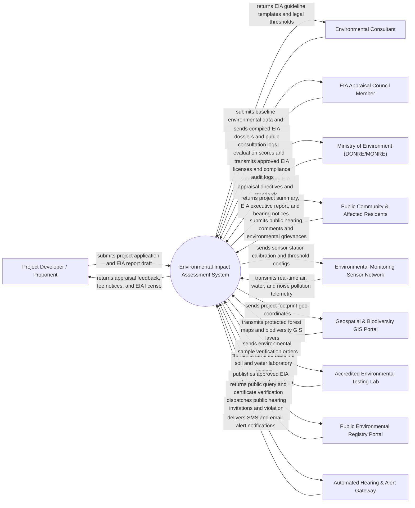

# Context Diagram — Environmental Impact Assessment System

## Mermaid Code

## Actor & Interaction Table | Bang Actor & Tuong tac

| # | Actor | Actor Type | Data Sent TO System | Data Received FROM System | Notes |
|---|-------|------------|---------------------|---------------------------|-------|
| 1 | Project Developer / Proponent | Primary | Project investment profile, engineering specs, EIA draft report, mitigation commitments | Appraisal milestones, fee receipts, council feedback notices, official EIA License | Enterprise or government agency proposing a major infrastructure/industrial development project |
| 2 | Environmental Consultant | Primary | Baseline air/water/noise monitoring data, dispersion modeling results, Environmental Management Plan (EMP) | Legal pollution thresholds (QCVN standards), EIA report templates, scoping requirements | Certified environmental consulting firm hired to conduct baseline surveys and draft EIA reports |
| 3 | EIA Appraisal Council Member | Primary | Technical appraisal scores, compliance review notes, council vote decisions, conditions for approval | Compiled EIA report dossier, public feedback summaries, lab verification assays | Expert panel (scientists, hydrologists, ecologists) appointed by government to evaluate EIA validity |
| 4 | Ministry of Environment (DONRE/MONRE) | Regulatory System | Statutory EIA guidelines, legal environmental quality standards (QCVN/ISO), regulatory directives | Approved EIA decision logs, post-EIA compliance reports, environmental violation notices | Government environmental authority issuing legal EIA Approval Certificates and oversight mandates |
| 5 | Public Community & Affected Residents | Primary / Public | Public consultation feedback, environmental pollution complaints, community hearing comments | Project executive summary, EIA non-technical report, public hearing dates, mitigation promises | Local citizens, NGOs, and community leaders located within the project's environmental impact radius |
| 6 | Environmental Monitoring Sensor Network | Supporting System | Real-time $PM_{2.5}$, $SO_2$, $NO_x$, wastewater $pH/COD/BOD$, noise level ($dB$) telemetry | Telemetry polling frequencies, sensor station health alerts, baseline threshold triggers | IoT monitoring stations deployed around project sites for continuous baseline and post-construction tracking |
| 7 | Geospatial & Biodiversity GIS Portal | Supporting System | Protected forest boundaries, national park GIS layers, endangered species habitats, flood zones | Project footprint polygon, construction buffer zones, land-use query coordinates | Government GIS portal identifying spatial intersections with ecologically sensitive or protected zones |
| 8 | Accredited Environmental Testing Lab | Supporting System | Certified laboratory analysis certificates for soil, groundwater, surface water, and ambient air | Sample tracking codes, chain of custody forms, analytical test requests | ISO/IEC 17025 accredited laboratory analyzing physical baseline environmental samples |
| 9 | Public Environmental Registry Portal | Supporting System | Search queries, public feedback, certificate validation checks | Published EIA executive summaries, approved EIA licenses, post-construction compliance reports | Public transparency portal providing citizen access to environmental impact assessments and licenses |
| 10 | Automated Hearing & Alert Gateway | Supporting System | SMS delivery status, email transmission logs | Public hearing invitations, consultation reminders, environmental threshold breach alerts | Multi-channel communication service broadcasting public hearing notices and emergency pollution alerts |

## System Boundary Description | Mo ta Pham vi He thong

The **Environmental Impact Assessment System** is a comprehensive regulatory and scientific software platform designed to manage the end-to-end Environmental Impact Assessment (EIA) lifecycle for infrastructure, agricultural, and industrial development projects.

The **system boundary** encompasses project registration, environmental baseline data ingestion, air/water/noise dispersion simulation modeling, public consultation and community hearing management, appraisal council evaluation workflows, Environmental Management Plan (EMP) tracking, EIA License issuance, and post-construction compliance monitoring.

**External to the system boundary** are physical air/water sampling execution, laboratory spectrograph hardware operation, physical construction earthmoving activities, judicial court dispute resolution, and public community town hall physical room hosting. System interfaces operate via secure HTTPS REST web services, WFS/WMS geospatial GIS protocols, and encrypted JSON data feeds.
