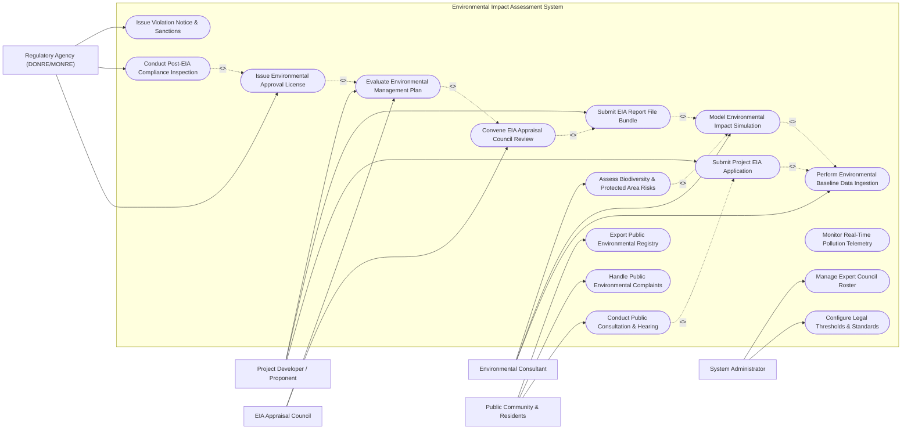

# Use Case Diagram — Environmental Impact Assessment System

## Mermaid Code

## Actor Table | Bang Actor

| # | Actor | Actor Type | Role Description | Related Use Cases |
|---|-------|------------|------------------|-------------------|
| 1 | Project Developer / Proponent | Primary | Enterprise or agency submitting investment project details and seeking EIA legal approval | UC01, UC05, UC08 |
| 2 | Environmental Consultant | Primary | Certified technical specialist executing baseline surveys, impact modeling, and EMP design | UC02, UC03, UC07 |
| 3 | Public Community & Residents | Primary / Public | Affected citizens participating in public consultation hearings and viewing public EIA registries | UC04, UC11, UC14 |
| 4 | EIA Appraisal Council | Primary | Expert panel evaluating technical validity of EIA reports and voting on approval recommendations | UC06, UC08 |
| 5 | Regulatory Agency (DONRE/MONRE) | Primary / Regulatory | Government environmental authority issuing formal EIA Licenses and enforcing post-EIA compliance | UC09, UC10, UC13 |
| 6 | System Administrator | Primary | Technical administrator managing legal environmental standards, system rules, and expert rosters | UC15, UC16 |

## Use Case Table | Bang Use Case

| # | UC ID | Use Case Name | Primary Actor | Secondary Actor | Description | Priority |
|---|-------|---------------|---------------|-----------------|-------------|----------|
| 1 | UC01 | Submit Project EIA Application | Project Developer | None | Submits project profile, GIS investment boundary, capital size, and EIA scoping document | High |
| 2 | UC02 | Perform Environmental Baseline Data Ingestion | Environmental Consultant | Testing Lab | Ingests baseline air ($PM_{2.5}, SO_2$), surface water ($BOD_5, COD$), noise, and soil sampling data | High |
| 3 | UC03 | Model Environmental Impact Simulation | Environmental Consultant | System | Runs air pollutant dispersion (AERMOD) and noise/hydrological impact predictive models | High |
| 4 | UC04 | Conduct Public Consultation & Hearing | Public Community | Developer | Organizes public hearings, collects community feedback, and logs public environmental concerns | High |
| 5 | UC05 | Submit EIA Report File Bundle | Project Developer | Consultant | Compiles and uploads final EIA report, baseline maps, EMP, and public consultation minutes | High |
| 6 | UC06 | Convene EIA Appraisal Council Review | EIA Appraisal Council | Developer | Conducts formal appraisal meeting, evaluates technical report quality, and votes on approval | High |
| 7 | UC07 | Assess Biodiversity & Protected Area Risks | Environmental Consultant | GIS Portal | Cross-references project location against national park, wetland, and wildlife sanctuary GIS layers | Medium |
| 8 | UC08 | Evaluate Environmental Management Plan | EIA Appraisal Council | Developer | Audits mitigation measures (scrubbers, WWTPs), monitoring schedules, and emergency funds | High |
| 9 | UC09 | Issue Environmental Approval License | Regulatory Agency | Developer | Issues legal EIA Approval Certificate specifying binding environmental conditions | High |
| 10 | UC10 | Conduct Post-EIA Compliance Inspection | Regulatory Agency | Developer | Conducts physical on-site audit during construction/operation to verify EMP execution | High |
| 11 | UC11 | Handle Public Environmental Complaints | Public Community | Regulatory Agency | Receives citizen pollution grievances, investigates site emissions, and logs resolution | Medium |
| 12 | UC12 | Monitor Real-Time Pollution Telemetry | Regulatory Agency | System | Ingests continuous stack emission and wastewater effluent IoT sensor telemetry | High |
| 13 | UC13 | Issue Violation Notice & Sanctions | Regulatory Agency | Developer | Issues legal violation notices, fines, or operational shutdown orders for threshold breaches | High |
| 14 | UC14 | Export Public Environmental Registry | Public Community | System | Publishes online searchable registry of approved EIA reports, licenses, and monitoring logs | Medium |
| 15 | UC15 | Configure Legal Thresholds & Standards | System Administrator | Regulatory Agency | Configures legal national environmental quality standards (e.g., QCVN air/water limits) | Medium |
| 16 | UC16 | Manage Expert Council Roster | System Administrator | None | Manages academic credentials, specializations, and conflict of interest declarations for experts | Low |

## Use Case Specification | Dac ta Use Case

---

### UC01 — Submit Project EIA Application

| Field | Detail |
|-------|--------|
| **UC ID** | UC01 |
| **Use Case Name** | Submit Project EIA Application |
| **Actor(s)** | Primary: Project Developer / Proponent   Secondary: None |
| **Description** | Allows a project developer to initiate the EIA regulatory workflow by submitting project profile details, investment capital, GIS land-use boundaries, production technology descriptions, and scoping reports. |
| **Precondition** | 1. Developer is registered in the system portal with verified corporate identity (tax ID).   2. Project pre-feasibility study and land-use planning approvals are granted. |
| **Main Flow** | 1. Developer opens "New EIA Application" on the portal.   2. Developer enters project details: Project Name, Industry Sector (e.g., Thermal Power, Chemical Plant, Industrial Park, Hydropower), Investment Capital ($USD$), and Expected Capacity.   3. Developer inputs project location: Province, District, and uploads GIS polygon boundary shapefile.   4. System automatically determines required EIA Tier Level (e.g., Group I: High Environmental Risk requiring MONRE approval vs Group II: Medium Risk requiring DONRE approval) based on statutory investment threshold rules.   5. Developer attaches project engineering description, raw material usage, water consumption estimates, and waste discharge projections.   6. Developer attaches initial EIA Scoping Document outlining proposed baseline monitoring parameters.   7. System calculates statutory EIA appraisal fee.   8. Developer pays fee via integrated gateway.   9. System records application, generates unique Application ID (e.g., `EIA-2026-MONRE-084`), and updates status to `APPLICATION_SUBMITTED`. |
| **Alternative Flow** | **AF1** — Simplified Environmental Protection Plan (EPP): If project scale is below EIA thresholds, system routes application to simplified Environmental Commitment Registration workflow. |
| **Exception Flow** | **EX1** — Protected Land Intersection: System GIS check detects project polygon intersects a Category 1 Strictly Protected Nature Reserve, setting application status to `PROHIBITED_LOCATION_REJECTED`. |
| **Postcondition** | Application record created in database with status `APPLICATION_SUBMITTED` and assigned to regulatory agency intake officer. |
| **Business Rule** | **BR1**: Project classification tier must strictly follow national Environmental Protection Law (Law No. 72/2020/QH14). |

---

### UC03 — Model Environmental Impact Simulation

| Field | Detail |
|-------|--------|
| **UC ID** | UC03 |
| **Use Case Name** | Model Environmental Impact Simulation |
| **Actor(s)** | Primary: Environmental Consultant   Secondary: System |
| **Description** | Executes mathematical computer simulation models (air dispersion, water quality plume, noise propagation) using baseline data and projected waste discharge rates to predict spatial pollution dispersion radiuses and peak concentration levels. |
| **Precondition** | 1. Baseline environmental monitoring data (UC02) is ingested into system database.   2. Project waste discharge parameters (stack height, flue gas velocity, effluent volume, pollutant concentration) are defined. |
| **Main Flow** | 1. Consultant selects "Environmental Simulation Engine" module and links active EIA application ID.   2. Consultant selects simulation domain:   &nbsp;&nbsp;&nbsp;&nbsp;a. **Air Dispersion Modeling**: Ingests AERMOD / ISCST3 model parameters ($SO_2, NO_x, PM_{10}$, stack velocity, local 5-year meteorological wind rose).   &nbsp;&nbsp;&nbsp;&nbsp;b. **Water Quality Plume Modeling**: Ingests MIKE 21 / QUAL2K model parameters (effluent $BOD_5, COD$, heavy metals, river flow rate, dispersion coefficient).   &nbsp;&nbsp;&nbsp;&nbsp;c. **Noise Propagation Modeling**: Ingests SoundPLAN model parameters (machinery sound power levels $dB$, ground absorption, barrier attenuation).   3. System executes simulation calculations across spatial grid coordinates around project site.   4. System calculates peak ground-level concentrations ($mg/m^3$ or $mg/L$) and maximum impacted radius ($km$).   5. System compares predicted concentrations against national legal standards (e.g., QCVN 05:2023/BTNMNT for ambient air).   6. System generates spatial isoline contour heatmaps overlaying satellite GIS map.   7. Consultant reviews simulation plots, attaches model output files, and saves result into EIA draft dossier. |
| **Alternative Flow** | **AF1** — Thermal Discharge Plume Modeling: For thermal/nuclear power projects, system models thermal water discharge plume temperature elevation ($^\circ C$) in coastal receiving waters. |
| **Exception Flow** | **EX1** — Legal Threshold Exceeded: Simulation shows predicted $SO_2$ concentration exceeds QCVN legal limits at nearest residential receptor (2 km away); system flags red alert and prompts consultant to add flue gas desulfurization (FGD) scrubbers in EMP. |
| **Postcondition** | Predictive simulation reports, concentration tables, and spatial GIS contour maps stored in system dossier. |
| **Business Rule** | **BR1**: Air dispersion models must utilize a minimum of 3 consecutive years of hourly local meteorological data. |

---

### UC04 — Conduct Public Consultation & Hearing

| Field | Detail |
|-------|--------|
| **UC ID** | UC04 |
| **Use Case Name** | Conduct Public Consultation & Hearing |
| **Actor(s)** | Primary: Public Community & Affected Residents   Secondary: Project Developer / Proponent |
| **Description** | Coordinates mandatory public consultation workflows, publishes non-technical project summaries online, collects written public feedback from affected residents, and logs official public hearing town hall meeting minutes. |
| **Precondition** | 1. Draft EIA report non-technical executive summary is submitted by developer.   2. Public consultation window (minimum 15 working days) is open. |
| **Main Flow** | 1. System publishes non-technical EIA executive summary, project GIS map, and expected environmental impacts on the Public Environmental Registry Portal (UC14).   2. System dispatches automated SMS/Email invitations (UC00/Gateway) to local ward/commune leaders and registered community representatives within 5 km radius.   3. Affected residents access portal, view project details, and submit digital comments/concerns regarding water security, air pollution, or resettlement.   4. Developer and Consultant host physical public consultation town hall meeting at local commune headquarters.   5. Consultant presents project mitigation commitments and answers community questions.   6. Developer records detailed meeting minutes, attendance list, and public sentiment summary.   7. Developer uploads signed public hearing minutes, photo evidence, and written response matrix to the System.   8. System cross-references public comments with developer responses, marking consultation status as `PUBLIC_CONSULTATION_COMPLETED`. |
| **Alternative Flow** | **AF1** — Electronic Public Consultation: For minor projects, public consultation is conducted 100% online via portal feedback forms without physical town hall meeting. |
| **Exception Flow** | **EX1** — High Community Opposition Trigger: System sentiment analysis detects $>60\%$ negative public feedback on water pollution risk; system automatically flags application for mandatory special council hearing. |
| **Postcondition** | Public consultation log, community feedback matrix, and hearing minutes permanently attached to EIA dossier. |
| **Business Rule** | **BR1**: Public consultation notice must be published online for at least 15 consecutive working days prior to appraisal council review. |

---

### UC06 — Convene EIA Appraisal Council Review

| Field | Detail |
|-------|--------|
| **UC ID** | UC06 |
| **Use Case Name** | Convene EIA Appraisal Council Review |
| **Actor(s)** | Primary: EIA Appraisal Council   Secondary: Project Developer / Proponent |
| **Description** | Manages the formal technical appraisal council meeting, where an independent panel of environmental scientists and government officers evaluates the EIA report, questions the developer/consultant, and votes on approval. |
| **Precondition** | 1. EIA report file bundle (UC05) and public consultation logs (UC04) are complete.   2. Appraisal council members (minimum 7 members: Chair, 2 Reviewers, Secretary, Members) are formally appointed. |
| **Main Flow** | 1. System distributes digital EIA dossier bundle to assigned council members 10 days prior to assembly date.   2. Council members review dossier and input preliminary technical critique notes into system.   3. Council convenes formal appraisal meeting (in-person or hybrid video conference).   4. Developer and Consultant present project EIA findings, impact models, and EMP mitigation measures.   5. Appointed Reviewer 1 and Reviewer 2 read official written critiques, raising technical questions regarding wastewater treatment, air scrubbers, or ecological damage.   6. Developer responds to council questions and provides technical clarifications.   7. Each council member submits individual secret digital ballot with one of three choices:   &nbsp;&nbsp;&nbsp;&nbsp;a. **Approval without Revision**   &nbsp;&nbsp;&nbsp;&nbsp;b. **Approval Subject to Revision** (requires specific edits)   &nbsp;&nbsp;&nbsp;&nbsp;c. **Rejection / Re-evaluation Required**   8. System tallies votes and generates official Appraisal Council Meeting Minutes and Resolution.   9. If majority votes "Approval Subject to Revision", system updates status to `APPRAISAL_APPROVED_PENDING_REVISION` and outputs required edit list. |
| **Alternative Flow** | **AF1** — Application Rejection Vote: If majority votes "Rejection", system updates status to `EIA_REJECTED`, generates formal rejection notice with scientific grounds, and closes file. |
| **Exception Flow** | **EX1** — Lack of Quorum: Fewer than 2/3 of appointed council members are present; meeting is adjourned and system reschedules assembly. |
| **Postcondition** | Council meeting minutes, vote tally, and mandatory edit checklist recorded in system database. |
| **Business Rule** | **BR1**: Appraisal council approval requires at least 2/3 affirmative votes from attending council members. |

---

### UC09 — Issue Environmental Approval License

| Field | Detail |
|-------|--------|
| **UC ID** | UC09 |
| **Use Case Name** | Issue Environmental Approval License |
| **Actor(s)** | Primary: Regulatory Agency (DONRE/MONRE)   Secondary: Project Developer / Proponent |
| **Description** | Formally approves the revised EIA report dossier, issues the legal Environmental Approval License (EIA Approval Decision), defines binding environmental operating conditions, and publishes the certificate. |
| **Precondition** | 1. Appraisal Council has voted approval (UC06).   2. Developer has submitted revised EIA report addressing 100% of council edit requirements, verified by Council Chair. |
| **Main Flow** | 1. Regulatory Agency intake officer verifies Council Chair signoff on revised EIA dossier.   2. Agency Legal Officer reviews draft approval decision parameters and binding environmental conditions.   3. Authorized Minister or Director (MONRE/DONRE) signs the official Environmental Approval License using cryptographic digital signature (PKI).   4. System updates application status to `EIA_LICENSE_ISSUED`.   5. System generates digital Environmental Approval License specifying: License Number, Proponent Name, Project Location, Approved Scope, Mandatory Wastewater/Air Emission Limits, Required IoT Telemetry Connections, and Expiry/Review Schedule.   6. System dispatches approval notification and downloadable digital license to Developer.   7. System publishes license metadata to Public Environmental Registry (UC14).   8. System initializes post-EIA compliance tracking schedule (UC10). |
| **Alternative Flow** | **AF1** — Conditional Environmental License: License includes mandatory pre-operation inspection milestones (e.g., must pass 30-day trial wastewater run before commercial operation). |
| **Exception Flow** | **EX1** — Unfulfilled Council Conditions: Developer submits revised report without fixing required scrubber specifications; Council Secretary rejects submission, blocking license issuance until fixed. |
| **Postcondition** | Legal EIA Approval License issued, project status set to `APPROVED_FOR_CONSTRUCTION`, and compliance monitoring schedule active. |
| **Business Rule** | **BR1**: EIA License becomes legally void if project construction does not commence within 24 months of issuance without extension.   **BR2**: Digital license must be cryptographically signed using national government PKI root certificate. |
