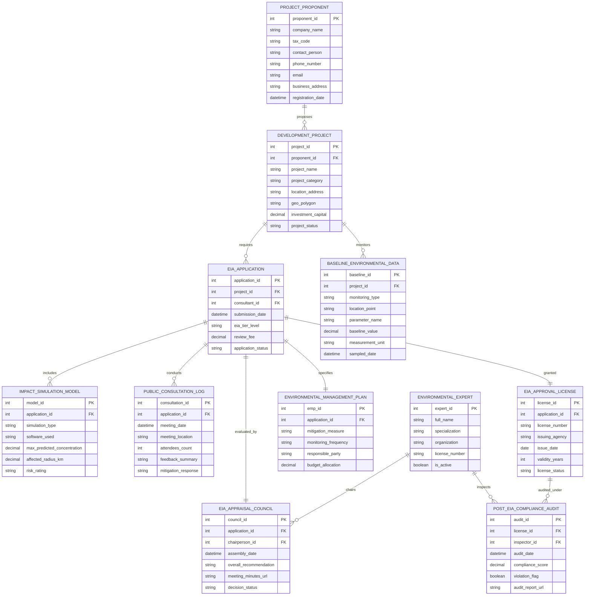

# Conceptual ERD — Environmental Impact Assessment System

## Mermaid Code

## Entity Description Table | Bang mo ta Entity

| # | Entity Name | Vietnamese Name | Description | Key Attributes | Main Relationships |
|---|-------------|-----------------|-------------|----------------|-------------------|
| 1 | PROJECT_PROPONENT | Chủ Đầu Tư Dự Án | Stores corporate profiles, business registration, tax code, and contact person for project developers | proponent_id, company_name, tax_code, contact_person, email | Proposes DEVELOPMENT_PROJECT |
| 2 | DEVELOPMENT_PROJECT | Dự Án Đầu Tư | Represents proposed investment projects, sector categories (power, chemical, park), capital, and GIS polygon | project_id, proponent_id, project_name, investment_capital, geo_polygon | Belongs to PROPONENT, requires EIA_APPLICATION, monitors BASELINE_DATA |
| 3 | EIA_APPLICATION | Hồ Sơ Đánh Giá Tác Động Môi Trường | Central claim record capturing EIA tier levels (Group I/II), submission dates, fees, and review status | application_id, project_id, consultant_id, submission_date, application_status | Belongs to PROJECT, includes SIMULATION, conducts CONSULTATION, granted LICENSE |
| 4 | BASELINE_ENVIRONMENTAL_DATA | Dữ Liệu Nền Môi Trường | Stores baseline monitoring parameters ($PM_{2.5}, BOD_5, COD$, noise dB) collected prior to construction | baseline_id, project_id, monitoring_type, parameter_name, baseline_value | Belongs to DEVELOPMENT_PROJECT |
| 5 | IMPACT_SIMULATION_MODEL | Mô Hình Dự Báo Tác Động | Holds mathematical dispersion model outputs (AERMOD, MIKE 21), peak predicted pollution, and affected radiuses | model_id, application_id, simulation_type, max_predicted_concentration, risk_rating | Belongs to EIA_APPLICATION |
| 6 | PUBLIC_CONSULTATION_LOG | Nhật Ký Tham Vấn Cộng Đồng | Records public town hall meetings, community attendee counts, written resident feedback, and developer replies | consultation_id, application_id, meeting_date, feedback_summary, mitigation_response | Belongs to EIA_APPLICATION |
| 7 | EIA_APPRAISAL_COUNCIL | Hội Đồng Thẩm Định ĐTM | Manages appraisal council assembly dates, technical evaluation scores, council recommendations, and vote results | council_id, application_id, chairperson_id, assembly_date, decision_status | Evaluates EIA_APPLICATION, chaired by ENVIRONMENTAL_EXPERT |
| 8 | ENVIRONMENTAL_MANAGEMENT_PLAN | Kế Hoạch Quản Lý Môi Trường (EMP) | Outlines required pollution mitigation measures (scrubbers, WWTPs), monitoring schedules, and allocated budget | emp_id, application_id, mitigation_measure, monitoring_frequency, budget_allocation | Specified by EIA_APPLICATION |
| 9 | EIA_APPROVAL_LICENSE | Giấy Phép / Quyết Định ĐTM | Stores issued legal EIA Approval Licenses, issuing agency (MONRE/DONRE), license numbers, and validity terms | license_id, application_id, license_number, issuing_agency, issue_date, license_status | Granted for EIA_APPLICATION, audited under POST_EIA_AUDIT |
| 10 | POST_EIA_COMPLIANCE_AUDIT | Kiểm Tra Tuân Thủ Sau ĐTM | Records post-construction field inspections, stack/effluent sampling results, compliance scores, and violation flags | audit_id, license_id, inspector_id, audit_date, compliance_score, violation_flag | Audited under EIA_APPROVAL_LICENSE, inspected by EXPERT |
| 11 | ENVIRONMENTAL_EXPERT | Chuyên Gia Môi Trường | Stores certified environmental experts, academic specializations, license numbers, and council roster status | expert_id, full_name, specialization, license_number, is_active | Chairs APPRAISAL_COUNCIL, inspects COMPLIANCE_AUDIT |

## Relationship Description | Mo ta Quan he

| # | From Entity | Cardinality | To Entity | Relationship Label | Business Explanation |
|---|-------------|-------------|-----------|-------------------|----------------------|
| 1 | PROJECT_PROPONENT | one-to-many | DEVELOPMENT_PROJECT | proposes | A project developer can propose multiple investment development projects over time |
| 2 | DEVELOPMENT_PROJECT | one-to-many | EIA_APPLICATION | requires | A development project requires an EIA application (or revised application for expansion) |
| 3 | DEVELOPMENT_PROJECT | one-to-many | BASELINE_ENVIRONMENTAL_DATA | monitors | A project monitors baseline air, water, and noise parameters across multiple sampling points |
| 4 | EIA_APPLICATION | one-to-many | IMPACT_SIMULATION_MODEL | includes | An EIA application includes multiple computer impact simulation models (air dispersion, noise, water) |
| 5 | EIA_APPLICATION | one-to-many | PUBLIC_CONSULTATION_LOG | conducts | An EIA application conducts public consultations and logs community hearing town hall feedback |
| 6 | EIA_APPLICATION | one-to-one | EIA_APPRAISAL_COUNCIL | evaluated_by | An EIA application is formally evaluated by one appointed EIA Appraisal Council assembly |
| 7 | ENVIRONMENTAL_EXPERT | one-to-many | EIA_APPRAISAL_COUNCIL | chairs | A senior environmental expert can chair or participate in multiple appraisal council assemblies |
| 8 | EIA_APPLICATION | one-to-one | ENVIRONMENTAL_MANAGEMENT_PLAN | specifies | An EIA application specifies exactly one binding Environmental Management Plan (EMP) |
| 9 | EIA_APPLICATION | one-to-one | EIA_APPROVAL_LICENSE | granted | An approved EIA application is granted exactly one legal EIA Approval License |
| 10 | EIA_APPROVAL_LICENSE | one-to-many | POST_EIA_COMPLIANCE_AUDIT | audited_under | An EIA license undergoes multiple post-construction environmental compliance audits over time |
| 11 | ENVIRONMENTAL_EXPERT | one-to-many | POST_EIA_COMPLIANCE_AUDIT | inspects | An environmental inspector expert conducts post-construction compliance field audits |
