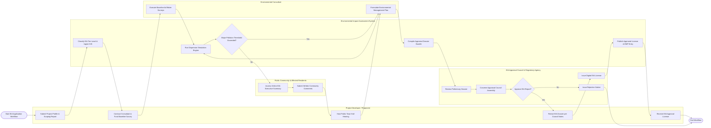

# Swimlane Diagram — Environmental Impact Assessment System

## Mermaid Code

## Flow Description | Mo ta luong

| Lane | Actor | Role in Flow |
|------|-------|-------------|
| 1 | Project Developer / Proponent | Submits project investment profile and scoping report, contracts accredited environmental consultants, funds baseline monitoring surveys, hosts public town hall hearings, revises EIA reports per council feedback, and receives official EIA licenses |
| 2 | Environmental Impact Assessment System | Classifies project EIA risk tiers (Group I/II), runs mathematical air/water dispersion simulation models, verifies QCVN legal pollution thresholds, compiles appraisal dossier packages, and publishes approved EIA licenses to the public registry |
| 3 | Public Community & Affected Residents | Accesses non-technical project EIA executive summaries online, submits written community feedback regarding environmental risks, and participates in public consultation town hall meetings |
| 4 | Environmental Consultant | Conducts baseline air, water, soil, and noise field sampling surveys, processes laboratory test assays, formats computer dispersion models, and formulates the Environmental Management Plan (EMP) |
| 5 | EIA Appraisal Council & Regulatory Agency | Reviews preliminary EIA dossiers, convenes formal appraisal council assemblies, questions developers, votes on technical report approval, and digitally signs official legal EIA Approval Licenses |
