# Action Tree — Environmental Impact Assessment System

## Mermaid Code

```mermaid
graph TD
    Root["Environmental Impact Assessment System"]

    Root --> M1["Project & Proponent Registration"]
    Root --> M2["Baseline Data & Impact Simulation Modeling"]
    Root --> M3["Public Consultation & Community Hearing"]
    Root --> M4["EIA Dossier Appraisal & Council Review"]
    Root --> M5["Environmental Management Plan & Licensing"]
    Root --> M6["Post-EIA Compliance Monitoring & Sanctions"]
    Root --> M7["Standards Configuration & Expert Roster Admin"]

    M1 --> A11["Register Project Proponent Corporate Profile"]
    M1 --> A12["Define Project GIS Polygon Footprint"]
    M1 --> A13["Determine Statutory EIA Risk Tier Group"]
    M1 --> A14["Submit EIA Scoping & Terms of Reference"]

    M2 --> A21["Ingest Baseline Air Water Noise Laboratory Assays"]
    M2 --> A22["Execute AERMOD Air Dispersion Simulation"]
    M2 --> A23["Model Effluent Plume Water Quality Dispersion"]
    M2 --> A24["Cross-Reference GIS Protected Forest Boundaries"]

    M3 --> A31["Publish Online Non-Technical Executive Summary"]
    M3 --> A32["Dispatch Public Hearing Invitations to Local Wards"]
    M3 --> A33["Collect Public Written Concerns & Feedback"]
    M3 --> A34["Log Town Hall Hearing Minutes & Developer Reply"]

    M4 --> A41["Appoint Independent EIA Appraisal Council Panel"]
    M4 --> A42["Distribute Digital EIA Dossier to Council Members"]
    M4 --> A43["Convene Formal Council Appraisal Meeting"]
    M4 --> A44["Record Council Ballots & Required Edits List"]

    M5 --> A51["Audit Environmental Management Plan Measures"]
    M5 --> A52["Verify Flue Gas & Wastewater Treatment Budgets"]
    M5 --> A53["Digitally Sign Official EIA Approval License"]
    M5 --> A54["Publish Approved License on Public Registry"]

    M6 --> A61["Ingest Continuous IoT Stack Emission Telemetry"]
    M6 --> A62["Conduct Physical Post-Construction Site Audits"]
    M6 --> A63["Investigate Public Citizen Environmental Grievances"]
    M6 --> A64["Issue Legal Pollution Violation Notices & Fines"]

    M7 --> A71["Configure National Legal Standards QCVN Limits"]
    M7 --> A72["Manage Environmental Expert Credentials & Roster"]
    M7 --> A73["Maintain Public EIA Searchable Registry"]
    M7 --> A74["Export MONRE Annual Environmental Status Reports"]
```

## Module Description | Mo ta Module

| # | Module | Description | Actions |
|---|--------|-------------|---------|
| 1 | Project & Proponent Registration | Manages developer corporate profiles, project investment specifications, GIS footprint boundaries, statutory EIA risk tier classification, and scoping reports | Register Project Proponent Corporate Profile, Define Project GIS Polygon Footprint, Determine Statutory EIA Risk Tier Group, Submit EIA Scoping & Terms of Reference |
| 2 | Baseline Data & Impact Simulation Modeling | Ingests baseline environmental lab test assays and executes mathematical computer dispersion models (AERMOD, MIKE 21) to predict pollution impact radiuses | Ingest Baseline Air Water Noise Laboratory Assays, Execute AERMOD Air Dispersion Simulation, Model Effluent Plume Water Quality Dispersion, Cross-Reference GIS Protected Forest Boundaries |
| 3 | Public Consultation & Community Hearing | Coordinates mandatory public consultation workflows, publishes executive summaries online, collects resident feedback, and logs town hall meeting minutes | Publish Online Non-Technical Executive Summary, Dispatch Public Hearing Invitations to Local Wards, Collect Public Written Concerns & Feedback, Log Town Hall Hearing Minutes & Developer Reply |
| 4 | EIA Dossier Appraisal & Council Review | Manages appraisal council appointments, distributes digital dossiers, convenes appraisal review assemblies, and records council secret ballots and required edits lists | Appoint Independent EIA Appraisal Council Panel, Distribute Digital EIA Dossier to Council Members, Convene Formal Council Appraisal Meeting, Record Council Ballots & Required Edits List |
| 5 | Environmental Management Plan & Licensing | Audits mitigation measures (WWTPs, scrubbers) in the EMP, verifies emergency budgets, digitally signs official EIA Approval Licenses, and publishes public entries | Audit Environmental Management Plan Measures, Verify Flue Gas & Wastewater Treatment Budgets, Digitally Sign Official EIA Approval License, Publish Approved License on Public Registry |
| 6 | Post-EIA Compliance Monitoring & Sanctions | Ingests continuous IoT effluent/emissions telemetry, conducts post-construction physical compliance audits, investigates public complaints, and issues violation fines | Ingest Continuous IoT Stack Emission Telemetry, Conduct Physical Post-Construction Site Audits, Investigate Public Citizen Environmental Grievances, Issue Legal Pollution Violation Notices & Fines |
| 7 | Standards Configuration & Expert Roster Admin | Maintains national environmental quality standards (QCVN thresholds), manages environmental expert council credentials, and exports annual regulatory reports | Configure National Legal Standards QCVN Limits, Manage Environmental Expert Credentials & Roster, Maintain Public EIA Searchable Registry, Export MONRE Annual Environmental Status Reports |
