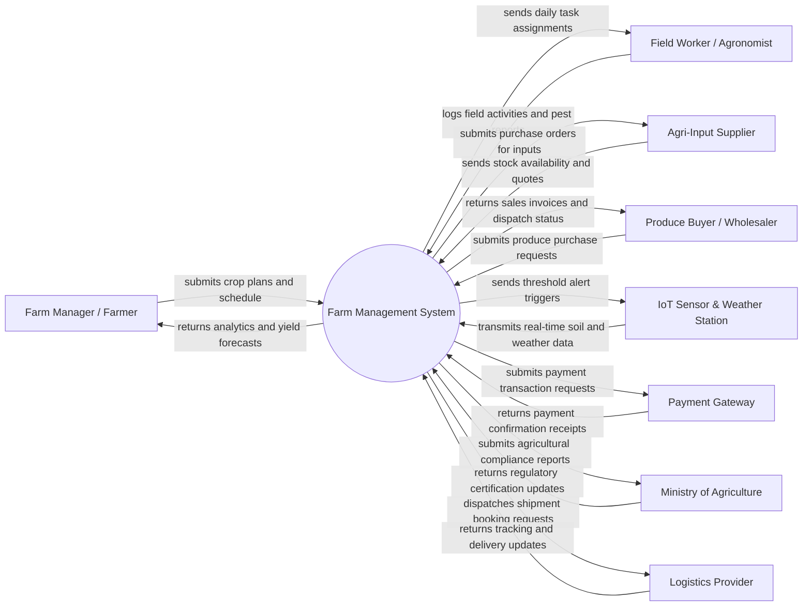

# Context Diagram — Farm Management System

## Mermaid Code

## Actor & Interaction Table | Bang Actor & Tuong tac

| # | Actor | Actor Type | Data Sent TO System | Data Received FROM System | Notes |
|---|-------|------------|---------------------|---------------------------|-------|
| 1 | Farm Manager / Farmer | Primary | Crop plans, field zone data, budgeting info, user credentials | Yield forecasts, financial reports, alert dashboards, worker logs | Quick decision making and overall farm oversight |
| 2 | Field Worker / Agronomist | Primary | Task status updates, pest/disease logs, chemical application logs | Daily task assignments, crop treatment guidelines, safety alerts | Field operational actor executing physical farm tasks |
| 3 | Agri-Input Supplier | Supporting | Seed/fertilizer availability, catalog prices, order fulfillment | Purchase orders, stock replenishment requests, payment status | External provider for seeds, fertilizers, and equipment |
| 4 | Produce Buyer / Wholesaler | Supporting | Crop purchase requests, quality criteria, contract terms | Sales invoices, produce availability, shipment tracking | External customer buying harvested agricultural products |
| 5 | IoT Sensor & Weather Station | Supporting System | Soil moisture, temperature, humidity, weather sensor readings | Calibration configurations, threshold alert triggers | Automated hardware monitoring field environmental conditions |
| 6 | Payment Gateway | Supporting System | Payment confirmation receipts, payment failure notices | Transaction payment requests, invoice settlement data | External payment provider processing sales and purchases |
| 7 | Ministry of Agriculture | Regulatory System | Agricultural standards, pesticide regulations, quarantine updates | Harvest compliance reports, organic farming certificates | Government body overseeing compliance and environmental safety |
| 8 | Logistics Provider | Supporting System | Delivery tracking updates, freight quotes, shipment status | Booking requests, pickup location, cargo volume data | Third-party logistics company transporting produce to buyers |

## System Boundary Description | Mo ta Pham vi He thong

The **Farm Management System** serves as an end-to-end digital platform for centralizing agricultural operations, crop planning, field monitoring, and inventory logistics. The system boundary encompasses field zone layout management, crop lifecycle scheduling, automated IoT environmental monitoring, task distribution for farm hands, inventory tracking of agricultural inputs, and harvest sales management. Outside the system boundary are raw payment card processing (delegated to third-party payment gateways), physical IoT hardware sensor fabrication, external supply chain logistics execution, and official regulatory licensing bodies. The system interacts with external entities via secure API protocols, receiving environmental telemetries and buyer orders while exporting compliance documentation and procurement requests.
