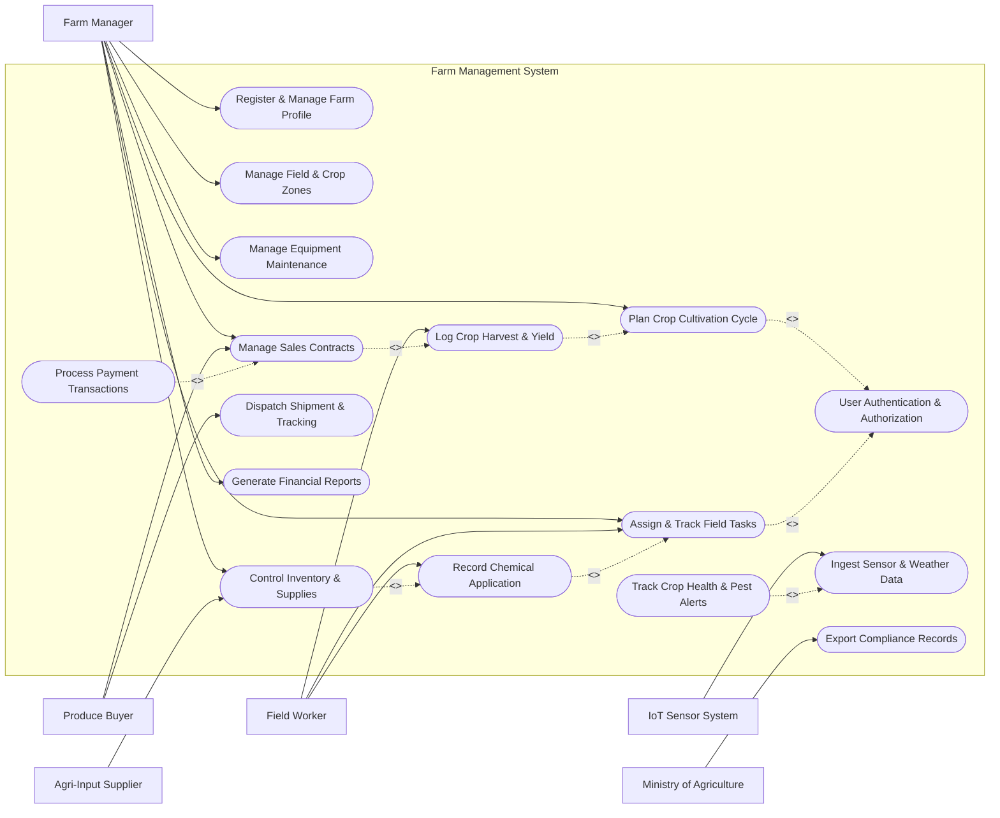

# Use Case Diagram — Farm Management System

## Mermaid Code

## Actor Table | Bang Actor

| # | Actor | Actor Type | Role Description | Related Use Cases |
|---|-------|------------|------------------|-------------------|
| 1 | Farm Manager | Primary | Oversees farm operations, field allocation, financial budgeting, and sales contracts | UC01, UC02, UC03, UC04, UC07, UC09, UC10, UC12, UC15 |
| 2 | Field Worker | Primary | Executes day-to-day farm activities, applies chemical treatments, and records harvests | UC02, UC07, UC08, UC11 |
| 3 | Agri-Input Supplier | Secondary | Fulfills requests for seeds, fertilizers, and supplies stock level information | UC10 |
| 4 | Produce Buyer | Secondary | Browses produce catalogs, places purchase orders, and coordinates shipment details | UC12, UC13, UC14 |
| 5 | IoT Sensor System | System | Transmits microclimate data, soil moisture levels, and automated telemetry readings | UC05, UC06 |
| 6 | Ministry of Agriculture | System | Consumes official regulatory reporting data and verifies organic/pesticide compliance | UC16 |

## Use Case Table | Bang Use Case

| # | UC ID | Use Case Name | Primary Actor | Secondary Actor | Description | Priority |
|---|-------|---------------|---------------|-----------------|-------------|----------|
| 1 | UC01 | Register & Manage Farm Profile | Farm Manager | None | Configures farm information, spatial boundaries, and ownership details | High |
| 2 | UC02 | User Authentication & Authorization | Farm Manager | Field Worker | Secures access to system modules based on assigned user roles | High |
| 3 | UC03 | Manage Field & Crop Zones | Farm Manager | None | Maps land parcels into distinct cultivation zones and monitors soil attributes | High |
| 4 | UC04 | Plan Crop Cultivation Cycle | Farm Manager | None | Establishes crop planting schedules, target yield expectations, and stage milestones | High |
| 5 | UC05 | Ingest Sensor & Weather Data | IoT Sensor System | Farm Manager | Receives continuous environmental metrics and weather forecasts for farm fields | Medium |
| 6 | UC06 | Track Crop Health & Pest Alerts | Farm Manager | IoT Sensor System | Analyzes telemetry data and worker logs to trigger disease and pest warning alerts | High |
| 7 | UC07 | Assign & Track Field Tasks | Farm Manager | Field Worker | Schedules daily duties (irrigation, weeding, harvesting) and tracks execution status | High |
| 8 | UC08 | Record Chemical Application | Field Worker | Farm Manager | Documents pesticide/fertilizer applications with dosage rates and safety intervals | High |
| 9 | UC09 | Manage Equipment Maintenance | Farm Manager | Field Worker | Schedules inspection and maintenance for tractors, irrigation pumps, and machinery | Medium |
| 10 | UC10 | Control Inventory & Supplies | Farm Manager | Agri-Input Supplier | Tracks warehouse levels for seeds, agrochemicals, fuel, and reorders automatically | Medium |
| 11 | UC11 | Log Crop Harvest & Yield | Field Worker | Farm Manager | Records harvest metrics, weight, batch numbers, and quality grading per zone | High |
| 12 | UC12 | Manage Sales Contracts | Farm Manager | Produce Buyer | Negotiates and finalizes sales agreements for harvested produce with buyers | High |
| 13 | UC13 | Process Payment Transactions | Produce Buyer | Farm Manager | Executes secure electronic payment processing for sales orders and supply invoices | High |
| 14 | UC14 | Dispatch Shipment & Tracking | Produce Buyer | Farm Manager | Manages logistics dispatch, package tracking, and buyer delivery notifications | Medium |
| 15 | UC15 | Generate Financial Reports | Farm Manager | None | Compiles profitability metrics, input cost breakdowns, and crop yield analytics | High |
| 16 | UC16 | Export Compliance Records | Farm Manager | Ministry of Agriculture | Generates standardized regulatory audit files for chemical usage and land conservation | Medium |

## Use Case Specification | Dac ta Use Case

---

### UC04 — Plan Crop Cultivation Cycle

| Field | Detail |
|-------|--------|
| **UC ID** | UC04 |
| **Use Case Name** | Plan Crop Cultivation Cycle |
| **Actor(s)** | Primary: Farm Manager / Secondary: None |
| **Description** | Allows the Farm Manager to create, adjust, and schedule a complete cultivation lifecycle plan for a specific field zone, including seed variety selection, planting dates, irrigation milestones, and estimated harvest timeframe. |
| **Precondition** | 1. Farm Manager is authenticated and logged into the system.   2. Active field zones have been mapped and defined under UC03. |
| **Main Flow** | 1. Farm Manager navigates to the "Cultivation Management" module and selects "Create Crop Plan".   2. System displays a form requesting target field zone, crop species, variety, area size, and target start date.   3. Farm Manager inputs crop details, expected growth duration, and target yield metrics.   4. System calculates projected milestone dates (germination, flowering, harvesting) based on crop template algorithms.   5. Farm Manager reviews the generated timeline and submits the cultivation plan.   6. System saves the crop plan, updates field zone status to "Scheduled", and logs the cultivation lifecycle record. |
| **Alternative Flow** | **AF1** — Load Saved Crop Template: At step 3, Farm Manager selects a pre-configured crop template (e.g., "Standard Rice Cycle 110-Days"). System populates default milestones automatically, allowing minor date adjustments before saving.   **AF2** — Multi-Zone Batch Planning: At step 2, Farm Manager selects multiple contiguous zones for simultaneous planting. System validates aggregate seed demand against current inventory. |
| **Exception Flow** | **EX1** — Zone Conflict Detected: At step 4, if the selected field zone is currently occupied by another active crop batch, System alerts "Zone occupied until [Date]" and prevents saving until dates are revised.   **EX2** — Insufficient Seed Supply: At step 5, if required seed volume exceeds available inventory, System displays warning "Low Seed Stock" and prompts the manager to create a reorder request. |
| **Postcondition** | Crop cultivation plan is established in the database, milestone notifications are queued, and field zone status is updated. |
| **Business Rule** | **BR1**: A field zone cannot have overlapping active cultivation cycles.   **BR2**: Harvest target dates must comply with crop variety maturity minimums (e.g., minimum 90 days for Maize variety X). |

---

### UC06 — Track Crop Health & Pest Alerts

| Field | Detail |
|-------|--------|
| **UC ID** | UC06 |
| **Use Case Name** | Track Crop Health & Pest Alerts |
| **Actor(s)** | Primary: Farm Manager / Secondary: IoT Sensor System |
| **Description** | Monitors environmental conditions and crop field logs to automatically trigger pest risk warnings and enable proactive disease treatment planning. |
| **Precondition** | 1. Field sensors are active and transmitting real-time environmental data (UC05).   2. Disease threshold rules are configured in the system rule engine. |
| **Main Flow** | 1. System receives continuous telemetry data (high humidity, leaf wetness, temperature spikes) from IoT sensors.   2. System evaluates incoming environmental data against agronomic disease threat models.   3. System identifies elevated risk for fungal infection in Zone B.   4. System generates an high-priority "Pest/Disease Risk Alert" dashboard notification.   5. Farm Manager clicks the notification to view affected zone maps, severity scores, and recommended chemical treatments.   6. Farm Manager approves an intervention workflow, automatically spawning a chemical application task for field workers. |
| **Alternative Flow** | **AF1** — Manual Field Inspection Alert: Farm Manager or Field Worker manually logs visual signs of pest infestation via mobile app. System correlates manual log with IoT data and prompts immediate treatment task creation.   **AF2** — False Positive Dismissal: At step 5, Farm Manager performs field verification, determines no risk exists, and dismisses the alert with an audit comment. |
| **Exception Flow** | **EX1** — Sensor Offline Error: If an IoT sensor fails to send data for over 6 hours, System flags the zone as "Telemetry Offline" and sends a hardware check notification to the manager.   **EX2** — Missing Agronomic Rule: If unknown weather patterns occur without matching threshold rules, System logs an unclassified weather anomaly event for agronomist review. |
| **Postcondition** | Disease risk alert is recorded, response action is documented, and treatment tasks are routed to worker queues. |
| **Business Rule** | **BR1**: High-risk pest alerts must trigger SMS/Email notifications to Farm Managers within 15 minutes of threshold breach.   **BR2**: Recommended pesticide treatments must automatically filter for chemical safety compliance based on national standards. |

---

### UC07 — Assign & Track Field Tasks

| Field | Detail |
|-------|--------|
| **UC ID** | UC07 |
| **Use Case Name** | Assign & Track Field Tasks |
| **Actor(s)** | Primary: Farm Manager / Secondary: Field Worker |
| **Description** | Enables the Farm Manager to create, schedule, and assign daily field operational tasks to workers, while allowing workers to update task completion status via mobile devices. |
| **Precondition** | 1. Active field workers and crop batches exist in the system.   2. User roles and mobile permissions are configured (UC02). |
| **Main Flow** | 1. Farm Manager opens the "Task Dispatcher" interface.   2. Manager creates a new task (e.g., "Drip Irrigation Inspection"), selects target field zone, sets due time, and assigns Field Worker A.   3. System saves the task and pushes a mobile notification to Field Worker A's device.   4. Field Worker A logs into the mobile app, views assigned task details, and marks "In Progress" upon arrival at the zone.   5. Field Worker A completes the physical inspection, attaches photo evidence, and updates status to "Completed".   6. System updates task status, logs completion timestamp, and updates Farm Manager's real-time operational dashboard. |
| **Alternative Flow** | **AF1** — Reassign Task: At step 2 or 4, if assigned worker is unavailable, Farm Manager reassigns the task to Field Worker B. System revokes access from Worker A and sends notification to Worker B.   **AF2** — Offline Mobile Sync: Field Worker completes task in low-connectivity zone. App caches status locally and automatically syncs with system server once internet connectivity is restored. |
| **Exception Flow** | **EX1** — Overdue Task Alert: If a high-priority task is not marked "In Progress" within 2 hours of scheduled start, System highlights task in red on the manager dashboard and sends an overdue reminder.   **EX2** — Task Rejection: Field Worker rejects task due to safety hazard (e.g., severe storm). System notifies manager with worker's submitted reason. |
| **Postcondition** | Task execution history is recorded with timestamps, worker activity logs are updated, and farm operational metrics are updated. |
| **Business Rule** | **BR1**: Workers cannot be assigned overlapping hazardous tasks (e.g., spraying restricted pesticides) without mandatory rest intervals.   **BR2**: Completed tasks involving chemical usage must include photo proof and batch dosage entries before status can be marked "Completed". |

---

### UC11 — Log Crop Harvest & Yield Quality

| Field | Detail |
|-------|--------|
| **UC ID** | UC11 |
| **Use Case Name** | Log Crop Harvest & Yield Quality |
| **Actor(s)** | Primary: Field Worker / Secondary: Farm Manager |
| **Description** | Captures detailed yield volume, harvest batch numbers, container weights, and initial quality grading data directly at the field zone during harvesting activities. |
| **Precondition** | 1. Target crop batch status is marked as "Ready for Harvest".   2. Weight scales and barcode scanners are calibrated and connected. |
| **Main Flow** | 1. Field Worker selects active crop batch in the harvest logging module.   2. Worker scans container barcode and inputs measured gross weight (in kg/tons).   3. Worker selects quality grade classification (Grade A, Grade B, Reject) based on fruit size/blemish inspection.   4. System calculates net weight and assigns a unique Harvest Batch Serial Number (HBSN).   5. Field Worker submits the harvest record.   6. System updates total accumulated zone yield, updates inventory stock as "Raw Produce Available", and notifies Farm Manager. |
| **Alternative Flow** | **AF1** — Bulk Harvest Logging: Worker logs aggregate truckload weights directly from weighbridge scales. System splits bulk weight across participating field sub-zones based on harvested area ratios.   **AF2** — Immediate Re-grading: Manager inspects harvested batch in warehouse, updates quality grade from B to A after secondary sorting, and system recalculates estimated inventory market value. |
| **Exception Flow** | **EX1** — Abnormal Yield Discrepancy: If entered weight exceeds theoretical maximum yield expected for the zone area by >50%, System flags "Yield Anomaly Warning" requiring supervisor override approval.   **EX2** — Duplicate Container Tag: Worker scans a container code already registered in another active harvest. System displays "Duplicate Barcode Error" and blocks registration. |
| **Postcondition** | Harvest batch is registered with trace code, raw inventory is incremented, and crop cultivation cycle yield statistics are finalized. |
| **Business Rule** | **BR1**: Every harvested batch must be assigned a unique QR code / barcode for farm-to-table traceability compliance.   **BR2**: Total logged harvest weight cannot be modified once sales contract allocation has commenced. |

---

### UC12 — Manage Sales Contracts & Buyers

| Field | Detail |
|-------|--------|
| **UC ID** | UC12 |
| **Use Case Name** | Manage Sales Contracts & Buyers |
| **Actor(s)** | Primary: Farm Manager / Secondary: Produce Buyer |
| **Description** | Manages buyer profiles, price negotiations, sales order creation, harvest batch allocation, and sales contract execution for farm produce. |
| **Precondition** | 1. Available harvest inventory is registered in the system (UC11).   2. Produce Buyer profile is active in the system. |
| **Main Flow** | 1. Produce Buyer submits a purchase order inquiry for specific produce volume and grade.   2. Farm Manager reviews inquiry, checks available harvest inventory stock, and sets unit pricing.   3. Manager generates a draft Sales Contract detailing delivery terms, payment conditions, and batch allocations.   4. Produce Buyer accepts contract terms electronically through buyer portal.   5. System locks allocated inventory batches, changes order status to "Confirmed", and generates a formal sales invoice.   6. System sends order confirmation to logistics dispatch (UC14) and triggers payment processing (UC13). |
| **Alternative Flow** | **AF1** — Forward Contracting (Pre-Harvest Sale): Buyer signs contract for crops currently in cultivation. System reserves future harvest yield percentage from UC04 planning projections.   **AF2** — Price Negotiation Counter-offer: Buyer proposes lower unit price. Manager receives counter-offer, adjusts discount terms, and re-issues updated contract. |
| **Exception Flow** | **EX1** — Inventory Shortfall: If unallocated inventory falls below contracted volume before final confirmation, System alerts manager to partial-fulfillment options or contract volume revision.   **EX2** — Credit Limit Exceeded: If buyer has unpaid overdue invoices exceeding system threshold, System blocks contract confirmation until outstanding balances are cleared. |
| **Postcondition** | Sales contract is legally registered in system, inventory is reserved/deducted, and financial billing records are initiated. |
| **Business Rule** | **BR1**: Inventory allocated to a confirmed sales contract cannot be re-allocated to another order without explicit cancellation.   **BR2**: Sales contracts exceeding $10,000 require dual-authorization from Senior Farm Administrator. |
